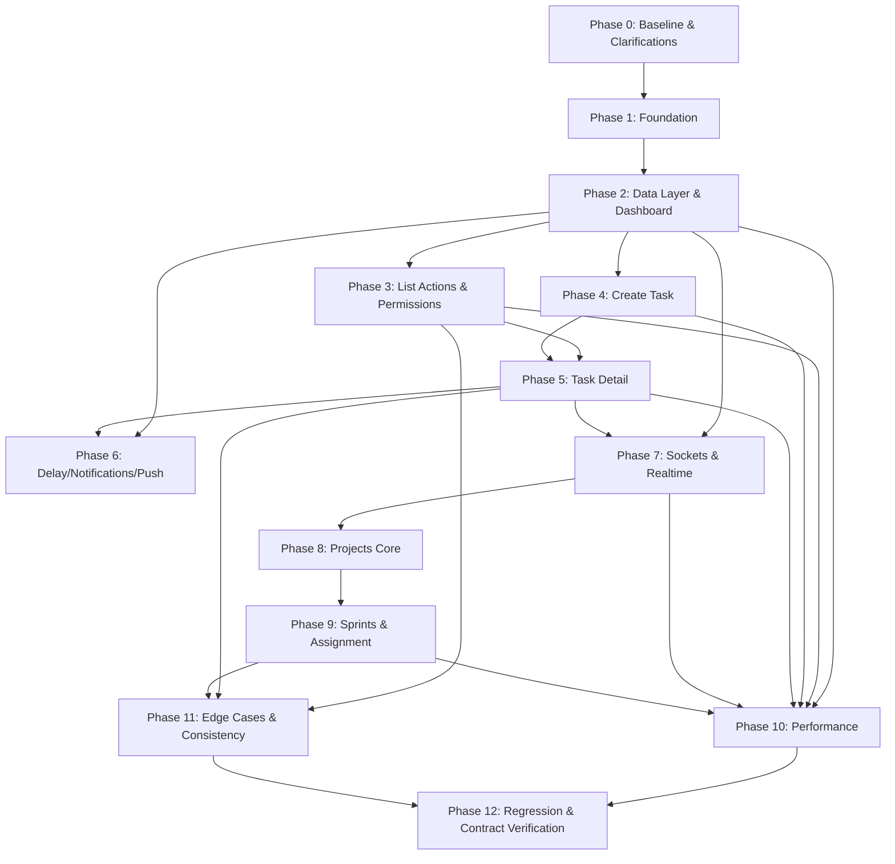

# TASK_MODULE_IMPLEMENTATION_PLAN.md

**Planit mobile — Task Module and Projects-in-Task: audit, gap analysis, target architecture, and phased implementation plan**

| Item | Value |
|---|---|
| Document type | Audit + implementation plan (no code changes) |
| Product | Planit / Plaint mobile app |
| Repository audited | `D:\Websouls\Projects\Plaint_App` |
| Source of truth | `Development/TaskModuleDocuments/TASK_MODULE_BACKEND_CONTRACT.md` (backend + website, 2026-10-30) |
| Secondary input | `Development/TaskModuleDocuments/Task Module Details.md` (mobile audit, 2026-10-21) |
| Mobile stack | Expo SDK ~57, React Native 0.86.3, React 19.2.3, TypeScript 6, Expo Router, React Context + `useReducer` |
| Target state management | Zustand for the Task Module only |
| Chat Module | Fully developed; **must not be modified** |
| Backend / website | Fully developed; **must not be modified** |
| Plan date | 2026-11-02 |
| Audience | AI coding agents and senior React Native engineers |

---

## Source of Truth & Decision Tracking (Mandatory)

This rule applies to every implementation phase and every coding agent working from this plan.

1. **`TASK_MODULE_BACKEND_CONTRACT.md` is the absolute source of truth.** If this plan, the original audit, existing mobile code, or any assumption conflicts with the backend contract, the backend contract wins.
2. **If a behavior or requirement is not covered by the backend contract**, follow the recommended approach in this plan where one exists. If neither the contract nor this plan covers it, choose the smallest, safest approach that is consistent with existing Planit mobile conventions and the contract's principles.
3. **Every such decision must be documented.** Before marking any phase DONE, append an entry to **Section 33. Implementation Decisions, Assumptions & Skipped Items** for every behavior or requirement that was:
   - implemented using an assumption or recommended approach not explicitly defined by the contract;
   - skipped;
   - deferred to a later phase;
   - implemented differently from this plan for a documented technical reason;
   - blocked by an unanswered question.
4. **Each entry must include:** a unique Decision ID, phase, date, contract/plan reference (or `Not covered`), category, the decision, the reasoning, the impact/risk, and the owner/approver. Do not record an assumption without its reasoning.
5. **No silent assumptions.** If an implementation choice depends on an unanswered backend question, mark it `BLOCKED` or `ASSUMPTION` and reference the question ID (for example, `Q-BE-04`). Do not invent contract behavior.
6. **If the contract conflicts with this plan**, follow the contract, record the deviation in Section 33, and update the affected traceability entry.
7. **The decision log is append-only during a phase.** Do not delete prior entries. If a decision is reversed, add a new entry that references the original Decision ID.
8. **A phase is not DONE if it introduced an unrecorded assumption, skip, deferral, or contract deviation.** Section 33 is part of every phase's completion checklist.

---

## Table of Contents

1. Executive Summary
2. Project Context and Scope
3. Source-of-Truth Rules
4. Critical Development Boundaries
5. Documents Reviewed
6. Existing Mobile Architecture Overview
7. Existing Task Module File Inventory
8. Backend Contract Requirement Inventory
9. Complete Existing Implementation Audit
10. API Coverage Matrix
11. Frontend Validation and Business Logic Audit
12. Permission and Role-Based Access Matrix
13. Socket Event Coverage Matrix
14. Screen and UI Requirements
15. Projects Functionality Breakdown
16. Task Functionality Breakdown
17. Cross-Module Dependencies
18. Gap and Discrepancy Analysis
19. Open Questions and Required Clarifications
20. Existing Code Quality and Modularization Audit
21. Proposed Task Module Architecture
22. Zustand State Management Architecture
23. Large Dataset and Performance Strategy
24. Phase Dependency Graph
25. Detailed Phased Implementation Plan
26. Testing and Regression Strategy
27. Final Backend Contract Traceability Matrix
28. Global Definition of Done
29. Implementation Safety and Regression Rules
30. Senior Engineering Standards
31. File-Level Implementation Guidance (New Files)
32. Plan Self-Audit and Coverage Verification

---

## 1. Executive Summary

The mobile Task Module is a substantial, working prototype, but it was built against an older and partly incorrect understanding of the backend. The backend contract dated 2026-10-30 changes several fundamentals, and the current mobile code violates a number of them in ways that **corrupt shared data today**, not merely in edge cases.

The highest-risk findings are:

1. **Effort is sent in the user's chosen unit, but the backend stores minutes.** `effort_hours: 4, effort_unit: "hours"` is persisted as 4 minutes. This affects create, update, and would affect reopen/resume. (`CreateTaskModal.tsx:417`, `TaskDetailModal.tsx:661`.)
2. **Create sends `due_date` as an ISO UTC string.** A date picked as 30 Oct in Pakistan becomes `2026-10-29T19:00:00.000Z` and the backend treats the date portion as PKT, so the task lands on the previous day. (`CreateTaskModal.tsx:391`.)
3. **The update payload is structurally wrong.** It sends `project_id`/`sprint_id` (which removes tasks from projects), sends a plain-text description (which destroys website HTML), sends effort in normal companies, and is used for status changes. (`TaskDetailModal.tsx:640-666`.)
4. **Status changes do not use the required endpoint.** List changes use `/tasks/updatetaskstatus` but the detail modal uses `/tasks/update`; list changes never roll back on `Good:false`, and the approval reply is ignored. (`TaskDetailModal.tsx:675`, `TaskContext.tsx:1009-1022`.)
5. **Permissions are wrong.** Create is gated only by `is_head`; reassign is gated by `is_head`; detail treats a missing `can_edit` as editable; `tasks-edit`, `tasks-list`, and the `Tasks` module are not checked.
6. **Approval, reopen, resume, reject gating, and the ATS reject flow are missing or wrong.** Reject is available from any status; there is no approve UI; reopen/resume do not exist.
7. **Recurring templates never load** because `/tasks/all` excludes them; the Recurring tab is always empty. Completed tasks are fully downloaded on every launch; `exclude_complete`, `complete_count`, and paged completed are not used.
8. **The delay popup is computed on the device**, while the backend now provides `/tasks/delayed-popup` and `next_check_at`.
9. **Socket handling is incomplete.** `status_change`, `critical_reorder`, and `sprint_assigned` are not handled; `schedule_update` patches only `due_date`; `jobstatus_update` is incorrectly treated as a task-status event.
10. **Project types and flows are wrong.** The project status enum includes `Pending` (causing a 500) and omits `On Hold`/`Abandoned`; project detail expects `sprints`, which it does not return; sprints have no service or UI; project assignment is disabled.
11. **Task notifications are duplicated.** The app still creates local “mentioned you” notifications even though the backend sends them.
12. **Architecture does not scale.** `TaskContext` holds three unnormalized arrays and exposes the whole state through one context; `tasks.tsx` recomputes eight full scans per render; several Task files exceed 2,000–3,400 lines. This is not viable for thousands of tasks/users.

The plan therefore does two things in parallel:

- **Correctness first:** fix the data-corrupting contract violations, permissions, status flows, approvals, lists, sockets, notifications, and projects.
- **Architecture second but early:** introduce a modular `src/features/tasks` and `src/features/projects` architecture, normalized Zustand stores, a compatibility facade that keeps the Chat Module working, and a performance strategy designed for thousands of records.

The implementation is divided into **13 independently executable phases (Phase 0–Phase 12)**. Each phase has explicit scope, exclusions, file-level tasks, sequence, acceptance criteria, tests, and a completion checklist.

### Top 20 contract-mandated corrections (summary)

| # | Correction | Contract reference | Planned phase |
|---|---|---|---|
| 1 | Send effort in **minutes** everywhere (create/update/reopen/resume) | §0 #1, §8.6 | 1, 4, 5 |
| 2 | Send `due_date` as `YYYY-MM-DD` (normal) / `null` (ATS) | §0 #2, §2.7, §3.8 | 1, 4 |
| 3 | Detect ATS from `user.company.modules` exact `"Advanced Task Scheduling"`; refresh via `GET /companies/:id/modules`; never call `/modules/all` | §0 #3, §8.2 | 1 |
| 4 | Create gate: `(Company Admin or is_head === "yes") && tasks-create` | §0 #4, §6 | 1, 3, 4 |
| 5 | Reassign gate: row `can_edit` (creator), not `is_head` | §0 #5, §3.13 | 1, 3 |
| 6 | Reject only from `Pending-Approval`, creator/admin; ATS two-step `reject_type` | §0 #6, §3.18 | 3, 5 |
| 7 | Add Approve for creator on `Pending-Approval` | §0 #7, §3.17 | 3, 5 |
| 8 | All status changes via `POST /tasks/updatetaskstatus/:id` | §0 #8, §3.12 | 3, 5 |
| 9 | Revert optimistic status on `Good:false`; handle “approval is required” success | §0 #9, §3.12 | 3 |
| 10 | `/tasks/update`: full website payload, HTML description, no project/sprint, ATS-only effort | §0 #10, §3.10 | 5 |
| 11 | Recurring tab from `GET /tasks/filter?filter=recurring` | §0 #11, §3.4 | 2 |
| 12 | `exclude_complete=true`; `complete_count`; paged completed | §0 #12, §3.1, §3.4 | 2 |
| 13 | Delay popup from `GET /tasks/delayed-popup` + `next_check_at` | §0 #13, §3.5 | 6 |
| 14 | Remove local mention notifications; map task push `filter` and digest rows | §0 #14, §10.2 | 6 |
| 15 | Critical priority only in ATS companies | §0 #15, §7.2 | 4, 5 |
| 16 | Remove device-side “one In-Progress” block; show server 400 | §0 #16, §8.7 | 3 |
| 17 | Handle `status_change`, `critical_reorder`, `sprint_assigned`, full `schedule_update` | §0 #17, §5.2 | 7 |
| 18 | Ignore `jobstatus_update` in the Task Module | §0 #18, §5.3 | 7 |
| 19 | Handle `stale: true` with `&wait_fresh=1` | §0 #19, §2.5 | 1, 2 |
| 20 | Fix project status enum, remove `Pending`, add `On Hold`/`Abandoned`, load sprints separately | §0 #20, §4.1-§4.3 | 8, 9 |

---

## 2. Project Context and Scope

### 2.1 What is being built

The backend and the Planit website already implement the Task Module, Projects, Sprints, scheduling, approvals, notifications, and permissions. The mobile app must be brought into exact behavioral parity with the backend contract, using the existing Planit mobile design system.

### 2.2 In scope

- Task list/dashboard, tabs, search, filters, sorting, pagination, virtualization.
- Task create, edit, detail, status transitions, assignment/reassignment, approval, rejection, reopen, resume.
- Task dependencies, recurring tasks, critical tasks, delay extension, effort history.
- Task comments, mentions, attachments, reactions, pinning, reply.
- Task notifications, push deep links, notification inbox integration.
- Projects list, create, edit, detail, attachments, project users.
- Sprints list, create, update date, delete; task-to-project and task-to-sprint assignment.
- Task/project permissions and frontend validations.
- Zustand state management for the Task Module.
- API/socket integration, error handling, loading/empty/success/error states.
- Performance and scalability for thousands of tasks and users.
- Modularization of oversized Task Module files.

### 2.3 Out of scope

- Backend or website development.
- Chat Module changes (screens, components, APIs, sockets, state, navigation, permissions, behavior).
- Authentication redesign.
- Meetings module, Notes module, AI project task generation, Task Scheduling Settings admin screen, HR evaluations, Leads/CRM.
- Subtask creation UI (website disabled it; contract says do not build).
- Task delete UI (website has none; contract says do not add unless product explicitly requests).
- Project delete UI (website has none).
- Priority/effort migration endpoints.
- Legacy endpoints `/tasks/statusupdate`, `GET /tasks/:id`, `/tasks/updateleadsource`, `/tasks/reschedule-reopened`.
- Project AI endpoints.

### 2.4 Success definition

The mobile Task Module is successful when:

1. Every requirement in `TASK_MODULE_BACKEND_CONTRACT.md` is either implemented, explicitly out of scope, or blocked by a documented unanswered question.
2. No Task action can send a value that corrupts shared data (effort, dates, project/sprint fields, description HTML).
3. Permissions match the contract at both visibility and action boundaries.
4. The Task Module remains responsive with 1,000+ tasks and 1,000+ users.
5. The Chat Module remains fully functional and byte-for-byte behaviorally unchanged.

---

## 3. Source-of-Truth Rules

| Priority | Source | Rule |
|---|---|---|
| 1 | `TASK_MODULE_BACKEND_CONTRACT.md` | Authoritative for APIs, payloads, fields, permissions, business rules, sockets, dates, errors, flows. |
| 2 | Existing backend/website behavior described in the contract | Authoritative where the contract says “the website does X”. |
| 3 | Existing Planit mobile design system and conventions | Authoritative for visual/UX implementation only. |
| 4 | `Task Module Details.md` | Historical audit. Useful for current-state description only. **Not authoritative** where it conflicts with the contract. |
| 5 | Existing mobile code | Evidence of current behavior. Never assumed correct. |

### 3.1 Known conflicts where the contract wins

| Topic | Original mobile audit says | Contract says (authoritative) |
|---|---|---|
| `assignee` | Mirrors `asigned_to` | `assignee` is the **creator**; `asigned_to` is the doer |
| `effort_hours` | Hours/days | **Minutes** |
| ATS detection | `company.modules` names or `/modules/all` IDs | Exact `"Advanced Task Scheduling"` in `user.company.modules`; refresh via `/companies/:id/modules`; never `/modules/all` |
| Create gate | `is_head` | `(Company Admin or is_head === "yes") && tasks-create` |
| Reassign gate | `is_head` | `tasks-edit` + row `can_edit` (creator) |
| Reject | Any status | Only `Pending-Approval`, creator/admin; ATS `reject_type` |
| Detail status | `/tasks/update` | `/tasks/updatetaskstatus` |
| `On Hold` | Status string `"On Hold"` | Send `"On-Hold"`; display label may be “On Hold” |
| One In-Progress | Client block | Server enforces only when effort > 0; remove client block |
| Delay popup | Device-computed | `GET /tasks/delayed-popup` |
| Project statuses | `Planning, In Progress, Pending, Completed` | `Planning, In Progress, On Hold, Completed, Abandoned` |
| Project detail | Includes `sprints` | No `sprints`; use `GET /sprints?project_id=` |
| Task notifications | Local mention notifications acceptable | Backend sends them; remove local duplicates |
| `reorderCritical` response | `data.blockedTasks` | Top-level `blockedTasks` |
| `can_edit` missing | Unset means editable | Treat missing as **false** |
| Task list rows | Include description/rejection_reason/createdAt | Not in rows; get from `/tasks/view` |
| `task_priority` | Independent of `priority` | Correct; `priority` is legacy company priority |
| `due_date` create | ISO | `YYYY-MM-DD` (normal) / `null` (ATS) |

---

## 4. Critical Development Boundaries

### 4.1 Backend and website

Do not modify backend or website code. Do not invent endpoints, payload fields, permission names, or socket events. If the contract is ambiguous, record a question; do not guess.

### 4.2 Chat Module — absolutely protected

The following Chat files and behavior must not be modified:

- `src/app/(tabs)/chat.tsx`
- `src/app/conversation.tsx`
- `src/context/ChatContext.tsx`
- `src/services/api/chat.service.ts`
- `src/components/AddPeopleModal.tsx`
- `src/components/CreateChannelModal.tsx`
- `src/components/InviteToChannelModal.tsx`
- `src/components/MediaComposerModal.tsx`
- `src/components/CustomTabBar.tsx` (navigation shared with Chat; do not restructure)
- `src/components/headerapp.tsx` (shared header; do not restructure)
- `src/context/NotificationContext.tsx` (shared notifications; only the Task-specific `task_update` mention listener may be removed, with regression verification)
- `src/context/PushNotificationContext.tsx` (shared push; only Task routing/filters may be corrected, with Chat regression verification)
- `src/components/InboxModal.tsx` and `src/app/notifications.tsx` (shared inbox; only Task branches may be corrected)
- `src/services/socket/socketService.ts` (shared socket; additive Task types only; do not alter Chat emits/listeners)
- `src/utils/chatHelpers.ts` and `src/utils/openChatDocument.ts` (Chat utilities; reuse read-only, do not modify)
- `src/components/FilterModal.tsx` (shared with leaves and notifications; preserve its public API)

**Hard dependency:** `src/app/(tabs)/chat.tsx:273` calls `useTasks()` and reads `taskState.taskOwners` to merge task owners into the Add-People list. Therefore:

1. `TaskProvider` must remain mounted above `ChatProvider` in `src/app/_layout.tsx`.
2. `useTasks()` must continue to exist and expose `state.taskOwners` with the same shape.
3. The Zustand migration must provide a compatibility facade until (and unless) Chat is changed by its owner.

If a requirement cannot be met without changing Chat, stop and raise it as a blocking dependency.

### 4.3 Zustand boundaries

- Add Zustand for the Task Module only.
- Do not migrate Chat, Auth, Notifications, or other modules to Zustand.
- Reuse `AuthContext` for user, company, permissions, and modules.
- Do not put API calls indiscriminately inside components.
- Do not subscribe components to the entire store.
- Reset Task stores on logout/company change.

### 4.4 Modularity boundaries

- New Task code lives under `src/features/tasks/**`.
- New Project/Sprint code lives under `src/features/projects/**`.
- Existing route files remain thin wrappers where Expo Router requires a route path.
- No new file should combine screen, API, socket, form, permission, and modal logic.
- Do not split a large file into several other large files; split by cohesive responsibility.

---

## 5. Documents Reviewed

| Document | Size | Read status | Purpose |
|---|---|---|---|
| `Task Module Details.md` | 2,566 lines / ~104 KB | Fully read | Original mobile audit, Q1–Q142, current-state inventory |
| `TASK_MODULE_BACKEND_CONTRACT.md` | 2,689 lines / ~188 KB | Fully read | Authoritative backend/website contract, change log, flow inventory, parity matrix, answers Q1–Q142 |

Both documents were read in full, including all APIs, sockets, permissions, flows, answers, known bugs, and the coverage checklist. No section was skipped.

### 5.1 Contract sections used as requirement sources

- §0 short list of required changes.
- §1 environment/modules.
- §2 conventions, IDs, companies, cache, field traps, dates.
- §3 task API catalog.
- §4 project and sprint API catalog.
- §5 socket catalog.
- §6 permission matrix.
- §7 status/priority/transition matrix.
- §8 business logic.
- §9 website frontend checks.
- §10 notifications/push.
- §11 attachments/comments/mentions/files.
- §12 change log.
- §13–§15 review tables.
- §16 Task flow inventory T-001–T-046.
- §17 Project flow inventory P-001–P-013.
- §18 parity matrix and mobile guidance.
- §19 answers Q1–Q142.
- §20 recommended implementation order.
- §21 known backend bugs.
- §22 coverage statement.

---

## 6. Existing Mobile Architecture Overview

### 6.1 Framework and runtime

| Area | Current implementation |
|---|---|
| Framework | Expo SDK ~57, React Native 0.86.3, React 19.2.3 |
| Language | TypeScript 6, `strict: true` |
| Navigation | Expo Router; default authenticated route `/(tabs)/tasks`; tab bar Tasks + Chat |
| Root providers | `GestureHandlerRootView → AuthProvider → TaskProvider → NotificationProvider → ChatProvider → PushNotificationProvider → BottomSheetModalProvider` |
| State | React Context + `useReducer` (`AuthContext`, `TaskContext`, `ProjectContext` [unmounted], `ChatContext`, `NotificationContext`, `PushNotificationContext`, `SearchContext`) |
| API client | `react-native-nitro-fetch` wrapper in `src/services/api/client.ts` |
| Auth token | SecureStore via `src/utils/token.ts` |
| Socket | `socket.io-client` singleton in `src/services/socket/socketService.ts` |
| UI | `@gorhom/bottom-sheet`, `react-native-toast-message`, custom components, `FlatList` virtualization |
| Styling | `StyleSheet` + `rf()` responsive font utility + SF Pro fonts |
| Testing | No test framework configured |
| Lint | `expo lint` (`eslint-config-expo`) |

### 6.2 Request/auth conventions (current vs contract)

| Item | Current | Contract | Status |
|---|---|---|---|
| Base URL | `{EXPO_PUBLIC_API_BASE_URL}` (default `https://backend.planit.pk/api/v1/`) | `{host}/api/v1` | COMPLIANT |
| Token headers | `x-access-token`, `authToken` | Accepted | COMPLIANT |
| Mobile header | `x-client-platform: mobile` | Only affects notification endpoints | COMPLIANT |
| Multipart token | Header | Must be header (FormData token not read) | COMPLIANT |
| Session expiry | Body contains `Un-Athunticated request` | Correct; plain text; 200 for expired | COMPLIANT |
| Response handling | Logs `Good:false`/HTTP errors but **does not throw** | Callers must inspect `Good` | NEEDS UPDATE (error contract) |
| Company fields | Sent on most writes | Send `company_id` + `company_identifier` | PARTIAL |
| `skipTasks` | Supported in service | Ignored by backend | NEEDS UPDATE (remove reliance) |

### 6.3 Provider tree and Chat dependency

`src/app/_layout.tsx:220-240` mounts `TaskProvider` above `ChatProvider`. `ProjectProvider` is commented out (`_layout.tsx:224-237`). `ChatScreen` uses `useTasks()` (`chat.tsx:273`, `:433-443`). This is a hard architectural constraint.

### 6.4 Current Task data flow

```text
TasksScreen / CreateTaskModal / TaskDetailModal / ProjectDetailModal
        │
        ▼
TaskContext (useReducer, three arrays, optimistic patches)
        │
        ▼
tasks.service.ts → client.ts → /api/v1/tasks/*
```

### 6.5 Current Project data flow

```text
ProjectDetailModal / CreateProjectModal / AssignTaskProjectModal
        │
        ▼
ProjectContext (provider unmounted) + direct projects.service calls
        │
        ▼
projects.service.ts → client.ts → /api/v1/projects/*
```

### 6.6 Current notification/push flow

- `NotificationContext` loads `/notification/all`, listens to `notification` and `task_update` (for local mention notifications).
- `PushNotificationContext` routes push `data.type` to tasks/chat; `type:"tasks"` passes `filter` as a route param.
- `TasksScreen` reads only `taskId`; it ignores `filter` (`tasks.tsx:553`).
- `headerapp.tsx` and `notifications.tsx` open `TaskDetailModal` for task notifications with `task_id > 0`.

### 6.7 Architecture risks identified

1. `TaskContext` is a 1,136-line god-context; any state change re-renders every consumer.
2. `LOAD_SUCCESS` is used both as a full load and as a patch action, which overwrites unrelated state from a stale closure.
3. Three unnormalized arrays duplicate task entities; bucket membership is implicit.
4. `tasks.tsx` computes 8 tab counts by scanning the full list on every render.
5. Large files combine UI, validation, API, socket, permissions, and navigation.
6. No request cancellation or stale-response protection.
7. No normalized user/project entities; owner lookups are linear.
8. No test infrastructure.

---

## 7. Existing Task Module File Inventory

Line counts are from the audited repository (newline counts may differ slightly from editor totals).

### 7.1 Core Task files

| File | Lines | Current responsibility | Usage | Audit verdict |
|---|---:|---|---|---|
| `src/app/(tabs)/tasks.tsx` | 1,168 | Dashboard, 8 tabs, client-side search/filter/sort/pagination, swipe rows, create/detail/reject/delay modals, deep link, overdue prompts | Active | **Oversized / mixed responsibilities**; needs extraction and contract fixes |
| `src/context/TaskContext.tsx` | 1,136 | State, reducer, two-phase fetch, optimistic updates, all task actions, owners/priorities/statuses | Active | **God context**; replace with Zustand + compatibility facade |
| `src/hooks/useTasks.ts` | 1 | Re-export `useTasks` | Active | Keep as compatibility export |
| `src/hooks/useTaskSocket.ts` | 187 | Company-wide task socket listeners, debounced refetch | Active (mounted by TasksScreen) | Incomplete; move to provider-level bridge |
| `src/services/api/tasks.service.ts` | 385 | All `/tasks/*` REST functions | Active | Missing new params/endpoints; includes forbidden legacy functions |
| `src/types/task.types.ts` | 398 | Task API/UI types and request payloads | Active | Wrong fields/statuses/payloads |
| `src/utils/statusMapper.ts` | 140 | `TaskListItem` → UI row mapping, status conversion, date formatting | Active | Status normalization okay; missing PKT rules; mapping is per-render |
| `src/utils/permissions.ts` | 127 | Task/project/chat permission helpers | Active | Task rules wrong; shared with Chat |
| `src/components/TaskTable.tsx` | 3 | Alias to `SingleTaskTable` | Active | Keep alias during migration |
| `src/components/SingleTaskTable.tsx` | 2,401 | Table, swipe gestures, status/assignee dropdowns, virtualization | Active | **Oversized**; split into list/row/cell/dropdown modules |
| `src/components/TaskRow.tsx` | 51 | Row prop types, status colors, priority accents, `ALL_STATUSES` | Active | `ALL_STATUSES` includes `Rejected`; split constants |
| `src/components/TaskTableSkeleton.tsx` | 345 | Loading skeleton | Active | Keep |
| `src/components/CreateTaskModal.tsx` | 2,773 | Create sheet, recurrence, dependencies, effort, critical conflict, attachments | Active | **Oversized / wrong payload**; split into form sections |
| `src/components/TaskDetailModal.tsx` | 3,411 | Detail/comments sheet, inline edits, dependencies, mentions, effort logs | Active | **Oversized / wrong endpoints and payload**; split into detail tabs |
| `src/components/RejectTaskModal.tsx` | 417 | Rejection reason + effort | Active | Missing `reject_type`; gating missing |
| `src/components/CriticalTaskModal.tsx` | 590 | Critical prompt + order modal | Partially reachable | Order modal unreachable; ATS gating missing |
| `src/components/DependencyModal.tsx` | 393 | Searchable/paginated dependency picker | Active in create | Client-side only; missing ATS gating/exclusions |
| `src/components/taskdelay.tsx` | 427 | Device-computed delay popup | Active | Must switch to `/tasks/delayed-popup` |
| `src/components/StatCard.tsx` | 162 | Stat tab card | Active | Keep |
| `src/components/AnimatedFAB.tsx` | 135 | Create-task FAB | Active | Keep |
| `src/components/TaskRefreshHeader.tsx` | 109 | Refresh header | **Unused** | Remove or leave unused; do not wire |
| `src/components/AssignTaskProjectModal.tsx` | 444 | Project picker for a task | **Unreachable** (commented out) | Rebuild in Phase 9 |
| `src/components/FilterModal.tsx` | 1,259 | Generic filter sheet | Shared: tasks, leaves, notifications | **Shared; do not break**; extract task-specific wrapper only |

### 7.2 Project/Sprint files relevant to Task

| File | Lines | Current state | Usage | Verdict |
|---|---:|---|---|---|
| `src/context/ProjectContext.tsx` | 216 | Project list/users/create; provider unmounted | **Unmounted** | Replace with Zustand project store; keep compatibility |
| `src/services/api/projects.service.ts` | 93 | Project REST layer | Partially used | Missing `lite`, sprints, proper types |
| `src/types/project.types.ts` | 119 | Project/detail/sprint types | Active | Wrong status enum; `sprints` in detail; sprint shape wrong |
| `src/components/ProjectDetailModal.tsx` | 1,113 | Project detail, project tasks, sprints display | **Unreachable** | **Oversized**; rebuild in Phases 8–9 |
| `src/components/CreateProjectModal.tsx` | 570 | Create project | **Unreachable** | Fix status enum, due-date requirement, permissions |
| `src/components/ProjectQuickMenuModal.tsx` | 270 | Project quick menu | **Unreachable** | Do not restore unless product asks |
| `src/components/AssignTaskProjectModal.tsx` | 444 | Task project picker | **Unreachable** | Rebuild |
| `src/hooks/useProjects.ts` | 1 | Re-export `useProjects` | Used by project components | Keep compatibility |
| `src/utils/permissions.ts` | — | Project permission helpers | Partially used | Fix rules |

### 7.3 Shared files touched by Task

| File | Task-related responsibility | Constraint |
|---|---|---|
| `src/services/api/client.ts` | Headers, response envelope, error logging | Add structured error extraction; do not break Chat |
| `src/services/socket/socketService.ts` | Socket singleton, task payload types | Additive Task types only; do not change Chat emits |
| `src/context/AuthContext.tsx` | User/company/modules/permissions, ATS flag | Minimal ATS fix; do not restructure auth |
| `src/context/NotificationContext.tsx` | Task notifications, local mention notifications | Remove Task-specific local mention listener only |
| `src/context/PushNotificationContext.tsx` | Task push routing | Fix `type:"tasks"` filter and `type:"lead"` only |
| `src/app/notifications.tsx` | Task notification tap | Fix digest rows (`task_id = 0`) |
| `src/components/InboxModal.tsx` | Task notification tap | Same |
| `src/components/headerapp.tsx` | Task notification tap | Same |
| `src/app/(tabs)/_layout.tsx` | Tasks tab/header config | Hide Tasks tab without `tasks-list`/module |
| `src/app/_layout.tsx` | Provider tree | Keep `TaskProvider` above `ChatProvider` |
| `src/utils/dateFormat.ts` | Date display | Add PKT-aware task date helpers or new task-specific module |
| `src/features/attachments/**` | File picking/validation | Add 30 MB check; keep existing API |
| `src/utils/openChatDocument.ts` | Secure-file download | Reuse read-only; do not modify |

### 7.4 Confirmed unused / dead code

| Item | Evidence | Action |
|---|---|---|
| `TaskRefreshHeader` | Only self-reference | Leave unused; do not wire |
| `ProjectQuickMenuModal` | Only commented reference in `CustomTabBar.tsx` | Leave disabled |
| `getAllProjectsForAssignment` | Only service definition | Replace with `scope=all&lite=true` in Phase 9 |
| `getProjectsList` | Service + type only | Optional; not required for mobile |
| `updateTaskDueDate` | Service only | Wire in Phase 3/5 |
| `updateNote` | Service only | Wire in Phase 5 |
| `updateNoteReaction` | Service only | Wire in Phase 5 |
| `uploadAttachment` | Service only | Wire in Phase 4/5 |
| `deleteAttachment` | Service only | Wire in Phase 5 |
| `approveTask` | Context/service only | Wire in Phase 3/5 |
| `reopenTask` | Context/service only | Wire in Phase 5 |
| `recalculateSchedule` | Context/service only | Wire in ATS flows Phase 4/5 |
| `addDependency` / `removeDependency` | Context/service only | Wire in Phase 5 |
| `fetchFiltered` | Context only; destructured but unused in screen | Wire in Phase 2 |
| `deleteTask` | Context/service only; no UI | Keep unwired |
| `rescheduleReopened` | Context/service only; dead website path | Remove from Task module |
| `migratePriorities` / `migrateEffortToMinutes` | Service only | Remove from Task module |
| `updateLeadSource` | Service only | Remove from Task module |

### 7.5 Approximate total Task Module footprint

- Core Task files: ~13,000 lines across ~25 files.
- Files over 2,000 lines: `TaskDetailModal` (3,411), `CreateTaskModal` (2,773), `SingleTaskTable` (2,401).
- Files over 1,000 lines: `tasks.tsx` (1,168), `TaskContext` (1,136), `ProjectDetailModal` (1,113).
- Shared/generic file over 1,000 lines: `FilterModal` (1,259).

This is the maintainability problem the plan must solve.

---

## 8. Backend Contract Requirement Inventory

This section condenses the contract into implementable requirement groups. Each group receives IDs used in later matrices.

### 8.1 Shared conventions (CONV)

| ID | Requirement |
|---|---|
| CONV-01 | Send `company_id` (number) and `company_identifier` on writes. |
| CONV-02 | Use `Good` for success. Show first string in `data`, `message`, `msg`, or `error`. |
| CONV-03 | Handle 400 (business), 403 (permission), 404 (not found), 500 (server); list endpoints may return 200 with `Good:false`. |
| CONV-04 | Non-JSON responses (upload rejections) must show a generic error. |
| CONV-05 | IDs are numbers; socket/URL-derived IDs may be strings; compare with `Number()`. Push `task_id` is a string. |
| CONV-06 | `stale: true` on `/tasks/all`, `/tasks/duetoday`, `/tasks/filter`, `/projects`: show data then re-call with `wait_fresh=1`. |
| CONV-07 | `skipTasks` is ignored; do not rely on it. |
| CONV-08 | Field meanings: `assignee`=creator, `asigned_to`=doer, `task_assignee`=creator object, `task_assigned_to`=doer object, `tasksByme`=creator-not-doer. |
| CONV-09 | Effort fields are minutes; `additional_hours` is minutes; `duedate` is only on `/updatetaskduedate`; `assign_to` is the doer on create/update; `/updateasignedto` reads `assignee`; `/reopen` `priority` means `task_priority`. |
| CONV-10 | Dates: manual due date `YYYY-MM-DD`; engine `YYYY-MM-DDTHH:mm` PKT; `createdAt` ISO UTC; `recurring_time` `HH:mm`; `null` = unscheduled. |
| CONV-11 | Compute “today”, “delayed”, and 7-day windows in PKT (`Asia/Karachi`, UTC+05:00). |
| CONV-12 | Do not use `new Date("YYYY-MM-DD")` for calendar days (JS reads UTC midnight). |
| CONV-13 | Session expiry is plain text `Un-Athunticated request`; check before JSON parsing. |
| CONV-14 | Multipart token must be a header. |
| CONV-15 | Do not send `x-meeting-id` (no Meetings module). |

### 8.2 Task APIs (API-T)

See Section 10 for the full matrix. The contract defines 39 task-related endpoints (including forbidden legacy ones), of which the mobile must implement the active subset and must not call the forbidden subset.

### 8.3 Project/Sprint APIs (API-P, API-S)

See Section 10.

### 8.4 Socket events (SOCK)

See Section 13.

### 8.5 Permissions (PERM)

See Section 12.

### 8.6 Validations (VAL)

See Section 11.

### 8.7 Business logic (BIZ)

| ID | Requirement |
|---|---|
| BIZ-01 | Visibility buckets: assigned-to-me, created-by-me, all-other (admin all; head reportee tree or mention; others mention only). A task is in at most one bucket. |
| BIZ-02 | `task_owner` is the assignable user list: admin → all active; head → self + reportees; others → self. |
| BIZ-03 | `team_member_ids` = self + reportees for heads; `[]` otherwise. |
| BIZ-04 | ATS detection: exact `"Advanced Task Scheduling"` in `user.company.modules`; refresh via `GET /companies/:company_id/modules`. |
| BIZ-05 | Scheduling engine runs for any top-level task with `effort_hours > 0`; normal companies must not send effort. |
| BIZ-06 | ATS UI: effort instead of due date; due date read-only; dependencies at create; critical priority; two-step reject; resume modal; reopen modal. |
| BIZ-07 | Normal UI: due date required/editable; effort hidden; critical priority fixed to Normal; one-step reject; plain status reopen. |
| BIZ-08 | Critical/bump: `bump_to_front` only ATS + critical; conflict prompt is UI-only; order modal when other critical tasks exist; `blockedTasks` info message. |
| BIZ-09 | One In-Progress: server enforces only when effort > 0; per doer; remove client block. |
| BIZ-10 | Overdue/delayed: server popup `/tasks/delayed-popup`; re-check at `next_check_at`; extend via `/tasks/extend-delayed`. |
| BIZ-11 | Recurring: templates never in `/all`/`/duetoday`; load via `filter=recurring`; instances via cron; edit template via `/update`; no pause/series delete; website offers daily/weekly/monthly/annually only. |
| BIZ-12 | Subtasks: rows only; do not build create; `Partial Complete` when `subtask_count > 0`. |
| BIZ-13 | Approval: doer Complete becomes Pending-Approval when `approval_required=1`; creator/admin approves/rejects; daily reminder to doer. |
| BIZ-14 | Reject: only Pending-Approval; creator/admin; normal → Rejected; ATS `reject_type` → In Progress/Pending; no new task. |
| BIZ-15 | Reopen: creator only; normal → status endpoint; ATS → `/reopen` with priority + effort > 0. |
| BIZ-16 | Dependencies: `task_id` waits for `depends_on`; server cycle check; add/remove allowed; On Hold restrictions; recalculate after add/remove. |
| BIZ-17 | `/recalculate` calls in ATS after the actions in contract §8.9; safe to call more than once. |
| BIZ-18 | Effort logs: `effort_history[]` from `/view`; show “before ± delta = after”. |
| BIZ-19 | Project statuses: Planning, In Progress, On Hold, Completed, Abandoned. |
| BIZ-20 | Project status cascades: Planning/On Hold → tasks On-Hold; leaving → restore; Abandoned → tasks Abandoned; Completed blocked while open tasks. |
| BIZ-21 | Project due date follows latest top-level task; `project_update/due_date_update`. |
| BIZ-22 | Project visibility: admin all; head owned/created or reportee involvement; others own/created or task involvement. |
| BIZ-23 | Project detail returns tasks and attachments; no sprints, no owner object; `status`/`priority` top-level. |
| BIZ-24 | Sprints: list/create/update date/delete; create requires `created_by`; due date ≤ project due; date change ≥ tasks; no rename; assign only non-Completed sprints. |
| BIZ-25 | Task belongs to at most one project and one sprint; assign via `/tasks/updatetaskproject`; removing project uses `project_id: 0` (no website UI). |
| BIZ-26 | Project chat rooms auto-created; mobile hides them; no Task changes. |
| BIZ-27 | Leads are separate; `lead_id` always 0; ignore `type:"lead"` for tasks. |
| BIZ-28 | HR evaluations are server-only. |
| BIZ-29 | Task notifications: `typ` is `task`, `tasks_due_today`, or `tasks_overdue`; use `title` to distinguish; `assigned` is the actor. |
| BIZ-30 | Push: person-caused events push every time; system alerts once per row per 24h. |
| BIZ-31 | Upload limits: 30 MB, one file per request, extension list; server rejection may be 500 HTML. |
| BIZ-32 | Secure-file download: `GET /api/v1/secure-file?p=<encoded>`, auth header or `&token=`. |
| BIZ-33 | Project attachments: `public/uploads/projects/`; task/comment attachments: `public/uploads/notes/`. |
| BIZ-34 | Comments: `@[Full Name](userId)` markup; `mentions` ignored; new note arrives via socket. |
| BIZ-35 | Pin is a toggle; server allows multiple; mobile displays one. |
| BIZ-36 | Reactions toggle per (user, emoji); reply returns full list at top level. |
| BIZ-37 | Note edit/delete: author + `tasks-edit`; delete needs confirmation. |
| BIZ-38 | Project create requires name + due date; status defaults Planning. |
| BIZ-39 | Project update any subset; Completed requires In Progress first (website) and no open tasks (server). |
| BIZ-40 | Delete task/project have no website UI; do not expose. |

### 8.8 Notifications/push (NOTIF)

| ID | Requirement |
|---|---|
| NOTIF-01 | With `x-client-platform: mobile`, `GET /notification/all` returns chat + task rows. |
| NOTIF-02 | Task rows `typ` = `task`/`tasks_due_today`/`tasks_overdue`; `task_id` 0 for digests. |
| NOTIF-03 | Remove local “mentioned you” notifications; backend sends them. |
| NOTIF-04 | Push `type:"task"` → open task detail. |
| NOTIF-05 | Push `type:"tasks"` + `filter:"due_today"` → Due Today tab; `"overdue"` → Delayed tab. |
| NOTIF-06 | Digest rows (`task_id=0`) open the matching tab. |
| NOTIF-07 | `type:"lead"` is not a task; ignore or open notifications. |
| NOTIF-08 | Push settings: `task_assigned`, `task_status_changed`, `task_comment`, `task_mention`, `push_enabled`. |
| NOTIF-09 | `notification` socket: keep only `assigned_to === me` and `mobile_visible !== false`. |

### 8.9 Website flows (FLOW)

T-001–T-046 and P-001–P-013 are inventoried in Section 27 with status and phase.

---

## 9. Complete Existing Implementation Audit

This section records verified behavior, not assumptions. File references are exact.

### 9.1 API client and error handling

| Finding | Evidence | Impact |
|---|---|---|
| `handleResponse` logs errors but never throws | `src/services/api/client.ts:44-87` | Every caller must inspect `Good`; many do not. Failures are silently swallowed. |
| Error message precedence is `Bad → message → msg → error → data` | `client.ts:68-74` | Close to contract, but `data` is last; contract says first string in `data/message/msg/error`. Some endpoints return `data` only. |
| Non-JSON responses become strings | `client.ts:47-51` | Upload rejection HTML is returned as a string; no generic error handling at call sites. |
| Session expiry check occurs before JSON parse | `client.ts:53-56` | COMPLIANT. |
| Multipart requests omit `Content-Type` and send token headers | `client.ts:148-165` | COMPLIANT. |
| No request cancellation/abort | `client.ts` | Stale responses can overwrite newer state. |
| No timeout | `client.ts` | Slow `/tasks/all` can hang screens. |

### 9.2 Task state and data loading

| Finding | Evidence | Impact |
|---|---|---|
| Three unnormalized arrays (`assignedToMe`, `createdByMe`, `allOtherTasks`) | `TaskContext.tsx:41-57` | Duplicate entities; O(n) scans; whole-store updates. |
| `LOAD_SUCCESS` used as both full load and patch | `TaskContext.tsx:118-130`, `:580-601`, `:918-969` | Patches rebuild all buckets from a closure-captured `state`, risking stale writes. |
| Two-phase load (`/duetoday` then `/tasks/all`) | `TaskContext.tsx:366-512` | Good UX, but no `exclude_complete`, no `stale`, no cancellation. |
| In-flight dedupe | `TaskContext.tsx:364-373` | Good; keep. |
| Merge by ID | `TaskContext.tsx:381-386` | Good; keep. |
| Silent refetch fetches both endpoints in parallel | `TaskContext.tsx:405-441` | Expensive; should use store patches for socket actions. |
| No `exclude_complete` | `tasks.service.ts:35-42` | Every launch downloads all completed history. |
| No `complete_count` | `task.types.ts:106-113` | Completed badge cannot be accurate without full list. |
| No `team_member_ids` | `task.types.ts:106-113` | Cannot implement create-socket bucket insertion correctly. |
| `fetchFiltered` exposed but unused | `TaskContext.tsx:531-556`; `tasks.tsx:76` | Recurring/Completed/Pending Approval cannot load correctly. |
| `statusList` stored but unused | `TaskContext.tsx:47`, `:125` | Status options hard-coded; drift risk. |
| `logout` exists but has no caller | `TaskContext.tsx:1038-1041` | In-process logout/login can retain stale tasks until next fetch. |
| `filteredMappedTasks` separate state | `TaskContext.tsx:303-305` | Duplicate derived state; not used by screen. |

### 9.3 Dashboard, tabs, search, filters, sort, pagination

| Finding | Evidence | Impact |
|---|---|---|
| 8 tabs; no Pending Approval tab | `tasks.tsx:918-969` | Missing required tab. |
| Recurring tab filters `is_recurring` from `/tasks/all` | `tasks.tsx:692-695` | Always empty because templates are excluded. |
| Completed tab filters loaded list | `tasks.tsx:696-697` | Downloads all completed tasks. |
| Due Today requires `ms >= nowMs` | `tasks.tsx:666-673` | Wrong for normal companies (should be whole PKT day); correct only for ATS. |
| Delayed uses `ms < nowMs` | `tasks.tsx:682-687` | Wrong for normal companies (should be before start of today). |
| Uses device-local `Date` for day boundaries | `tasks.tsx:645-656` | Not guaranteed PKT. |
| All tab includes Pending-Approval | `tasks.tsx:698-700`, `:739-757` | Contract hides Pending-Approval except its own tab. |
| Counts recompute 8 tab scopes + filters every render | `tasks.tsx:838-855` | Expensive for 1,000+ tasks. |
| Search filters immediately, no debounce | `tasks.tsx:804-820` | Recomputes full list on every keystroke. |
| Search includes `description` | `tasks.tsx:810` | List rows do not include `description`; this field is always undefined. |
| Sort critical-first by `critical_order`, then due | `tasks.tsx:706-733` | Differs from website (due → critical → id); acceptable but should be a documented decision. |
| Client pagination 20 with 350 ms fake delay | `tasks.tsx:67`, `:865-876` | Artificial delay; unnecessary with virtualization. |
| `FilterModal` Assigned-To shown to everyone | `tasks.tsx:975-995` | Contract: admin/head only. |
| Status filter list is 4 values | `tasks.tsx:590-593` | COMPLIANT. |
| `filter` push param ignored | `tasks.tsx:553` | `type:"tasks"` push cannot open the right tab. |
| Overdue summary toast is device-computed | `tasks.tsx:206-228` | No website counterpart; product choice. |
| Delay popup device-computed | `tasks.tsx:230-274` | Contract requires `/tasks/delayed-popup`. |
| One prompt per session | `tasks.tsx:143`, `:233-272` | Prevents loops but is not server-driven. |

### 9.4 Create task

| Finding | Evidence | Impact |
|---|---|---|
| Create gate is `is_head` only | `tasks.tsx:179-182`; `permissions.ts:21-23` | Wrong users can create; correct users without `is_head` cannot. |
| `isAdvanced` from `hasAdvancedTaskModule` | `CreateTaskModal.tsx:128-132`; `AuthContext.tsx:205-263` | Detection uses substring and falls back to forbidden `/modules/all`. |
| `due_date` uses `toISOString()` | `CreateTaskModal.tsx:391` | Previous-day bug. |
| Effort sent in selected unit | `CreateTaskModal.tsx:160-190`, `:417` | Stored as minutes → 4 hours becomes 4 minutes. |
| Normal companies send `effort_hours: 0` and `effort_unit: "hours"` | `CreateTaskModal.tsx:417-418` | Contract says leave effort out. |
| Status options include `Rejected` and `Complete` | `CreateTaskModal.tsx:75-80`; `TaskRow.tsx:45-51` | Contract allows only Pending/In-Progress/On-Hold/Complete; Rejected must be removed. |
| Default status `Pending` or `Recurring` | `CreateTaskModal.tsx:395-398` | Contract default: In-Progress if doer has no active task, else Pending. |
| Critical offered in every company | `CreateTaskModal.tsx:68-71`, `:203` | Contract: ATS only. |
| `bump_to_front` defaults true for any critical | `CreateTaskModal.tsx:393` | Contract: only ATS + user choice (or auto when no conflict). |
| Critical conflict popup exists | `CreateTaskModal.tsx:422-451` | Good, but not ATS-gated and order modal unreachable. |
| Order modal never opens | `CreateTaskModal.tsx:238`, `:492-552` | `orderModalVisible` never set true; `_newTaskId` never set. |
| `reorderCritical` response read from `data.blockedTasks` | `TaskContext.tsx:794-803` | Contract returns top-level `blockedTasks`. |
| Attachments picked but never uploaded | `CreateTaskModal.tsx:279-334`, `:458-487` | Contract requires upload after create. |
| No 30 MB check | `CreateTaskModal.tsx:279-285`; `fileValidation.ts` | Server may return 500 HTML. |
| Recurring offers daily/weekly/monthly/annually | `CreateTaskModal.tsx:248-255` | COMPLIANT with website; `quarterly`/`semiannually` intentionally omitted. |
| Recurring payload uses `semi-annually` type value | `task.types.ts:19-25` | Backend spells `semiannually`; current UI does not offer it, but type is wrong. |
| Dependencies filter Pending/In-Progress | `CreateTaskModal.tsx:272-277` | Roughly correct; missing ATS-only, On-Hold exclusion, self exclusion. |
| Create success refetches all tasks | `CreateTaskModal.tsx:471-477` | Contract says rely on `create` socket and switch to Created-by-me; refetch is expensive. |
| No `planning_hold` message handling | `CreateTaskModal.tsx:458-487` | Missing required info toast. |
| No single-shot guard | `CreateTaskModal.tsx:341-455` | Double-tap can create duplicates (no idempotency key). |
| Description HTML from editor | `CreateTaskModal.tsx:364-365` | COMPLIANT. |

### 9.5 Task detail

| Finding | Evidence | Impact |
|---|---|---|
| `canEdit` treats missing as editable | `TaskDetailModal.tsx:620` | Contract: missing = false. |
| All edits gated by `canEdit` | `TaskDetailModal.tsx:625-630` | Status should be gated by `can_edit_status`; users with status-only rights cannot change status. |
| No `tasks-edit` check | `TaskDetailModal.tsx` | Users without edit permission see editable controls. |
| No “Complete task is read-only” rule | `TaskDetailModal.tsx` | Editing completed tasks is possible. |
| Status edits call `/tasks/update` | `TaskDetailModal.tsx:625-682` | Wrong endpoint; skips approval/subtask/dependency checks. |
| Update payload sends `project_id`/`sprint_id` | `TaskDetailModal.tsx:658-659` | Removes task from project/sprint. |
| Description stripped of HTML | `TaskDetailModal.tsx:588-591`, `:652` | Destroys website formatting. |
| Effort sent in all companies, not minutes | `TaskDetailModal.tsx:661-662` | Data corruption and wrong ATS behavior. |
| Recurring payload omits week/month/annual fields | `TaskDetailModal.tsx:653-657`; `UpdateTaskRequest` | Mongoose writes null → recurrence data lost. |
| Status list includes `On Hold` (space), `Complete`, `Pending-Approval`, `Rejected` | `TaskDetailModal.tsx:107-114` | Must send `On-Hold`; Pending-Approval is server-set; Rejected only via reject. |
| Reject selectable from any status | `TaskDetailModal.tsx:2045-2049` | Backend 400/403. |
| Client one-in-progress block | `TaskDetailModal.tsx:2050-2068` | Must be removed. |
| Priority Normal/Critical always shown | `TaskDetailModal.tsx:2111-2185` | ATS only. |
| Company priority picker always shown | `TaskDetailModal.tsx:560-578` | Contract: only legacy tasks with empty `task_priority`. |
| Due date editable in ATS | `TaskDetailModal.tsx:2320-2340` | Contract: read-only in ATS. |
| Attachments displayed as plain tags | `TaskDetailModal.tsx:1740-1759` | No download/open. |
| Effort logs read `effort_logs` | `TaskDetailModal.tsx:1186-1190`, `:2387-2389` | Contract: `effort_history`. |
| Comments send works with mention markup | `TaskDetailModal.tsx:944-981` | COMPLIANT. |
| Delete note has no confirmation | `TaskDetailModal.tsx:983-990` | Contract requires confirmation. |
| Delete note not gated to author + `tasks-edit` | `TaskDetailModal.tsx:983-990` | Backend 403 for others. |
| Pin calls pin on previous note too | `TaskDetailModal.tsx:992-1034` | Toggles the previous note on the server (bug). |
| No note edit/reply/reaction UI | `TaskDetailModal.tsx` | Missing flows. |
| No approve/reopen/resume UI | `TaskDetailModal.tsx` | Tasks get stuck in Pending-Approval / cannot reopen. |
| Dependencies read-only | `TaskDetailModal.tsx` | Add/remove missing. |
| Socket refresh on open task | `TaskDetailModal.tsx` (task_update listener) | Partial; needs action router. |

### 9.6 Task table and rows

| Finding | Evidence | Impact |
|---|---|---|
| `FlatList` virtualization with tuning | `SingleTaskTable.tsx:722-827` | Good baseline. |
| `canEditStatus` defaults true | `tasks.tsx:626`; `SingleTaskTable.tsx:467` | Missing flag should be false. |
| Checkbox toggles Completed ↔ Pending | `SingleTaskTable.tsx:488-497` | Contract: one-way Complete; reopen is creator-only. |
| No “In Progress first” rule | `SingleTaskTable.tsx:465-486` | Backend rejects; UI should prevent. |
| Status dropdown excludes Pending-Approval/Recurring | `SingleTaskTable.tsx:1439-1441` | Missing Partial Complete; includes Rejected from any status. |
| Reassign allowed by prop, not row flag | `SingleTaskTable.tsx:1676-1700` | Tasks screen passes `canReassign={canCreate}`; project detail passes `true`. |
| Project button only when `canAssignProject` | `SingleTaskTable.tsx:1676` | Disabled. |
| No sprint column | `SingleTaskTable.tsx` | Missing project-in-task parity. |
| Swipe details panel | `SingleTaskTable.tsx` | Works but file is oversized. |
| Status/assignee overrides local | `SingleTaskTable.tsx:390-397` | No rollback on parent failure. |

### 9.7 Reject, delay, critical, dependencies, recurring

| Area | Finding | Evidence |
|---|---|---|
| Reject | Reason required; effort converted to minutes correctly; no `reject_type`; no status gate | `RejectTaskModal.tsx:60-104` |
| Delay | Device popup; units Mins/Hours/Days; `/extend-delayed` payload correct | `taskdelay.tsx`; `tasks.tsx:276-302` |
| Critical | Prompt exists; order modal unreachable; not ATS-only; conflict search across all buckets | `CreateTaskModal.tsx:422-552`; `CriticalTaskModal.tsx` |
| Dependencies | Create picker exists; detail table read-only; add/remove APIs unwired; no cycle pre-check | `DependencyModal.tsx`; `TaskDetailModal.tsx` |
| Recurring | Create only; no edit; no series handling; templates never loaded | `CreateTaskModal.tsx`; `tasks.tsx` |

### 9.8 Attachments and files

| Finding | Evidence | Impact |
|---|---|---|
| Allowed extensions match contract | `attachment.types.ts:1-14` | COMPLIANT. |
| No 30 MB size validation | `fileValidation.ts` | Server may 500 HTML. |
| Create attachments never uploaded | `CreateTaskModal.tsx` | Missing required flow. |
| Detail attachments not openable | `TaskDetailModal.tsx:1740-1759` | Missing required flow. |
| Secure-file utility exists for Chat | `openChatDocument.ts`, `secureImageFetch.ts` | Reusable read-only; create Task-specific wrapper. |
| Note attachments not supported in detail | `TaskDetailModal.tsx` | Optional per contract. |

### 9.9 Notifications and push

| Finding | Evidence | Impact |
|---|---|---|
| Local mention notification/toast still created | `NotificationContext.tsx:223-270` | Duplicates backend notifications. |
| `notification` socket filters `mobile_visible` | `NotificationContext.tsx:186-221` | Good; task rows become visible after deploy. |
| Push `type:"tasks"` passes `filter` | `PushNotificationContext.tsx:416-421` | Tasks screen ignores it. |
| Push `type:"lead"` routes to tasks | `PushNotificationContext.tsx:422-424` | Contract: not a task. |
| Digest rows `task_id=0` not mapped to tabs | `PushNotificationContext.tsx:470-480`; `notifications.tsx:218` | Missing. |
| Task notification tap opens detail | `headerapp.tsx:112-120`; `notifications.tsx:218-225` | COMPLIANT. |
| Task push settings fields exist | `NotificationContext`/settings screen | Verify after deploy. |

### 9.10 Projects and sprints

| Finding | Evidence | Impact |
|---|---|---|
| Project status enum wrong | `project.types.ts:4`; `CreateProjectModal.tsx:24-29`; `ProjectDetailModal.tsx:39-44` | `Pending` causes 500; missing On Hold/Abandoned. |
| Project detail expects `sprints` | `project.types.ts:70-90`; `ProjectDetailModal.tsx:271-275` | Always empty. |
| No sprint service/types/UI | None | Missing required flows. |
| Project provider unmounted | `_layout.tsx:224-237` | Project features unreachable. |
| Project create due date optional | `CreateProjectModal.tsx:114-146` | Backend 400. |
| Project detail task actions ungated | `ProjectDetailModal.tsx:754-770` | Reassign allowed for everyone. |
| Project detail uses `created_by_user` | `ProjectDetailModal.tsx:217-229` | Contract says no such field; must resolve via users. |
| Project attachments placeholder | `ProjectDetailModal.tsx:774-783` | Missing. |
| Create sprint placeholder | `ProjectDetailModal.tsx:736-747` | Missing. |
| Assign task to project disabled | `tasks.tsx:5-6`, `:80-82`, `:184-189`, `:533-548` | Missing. |
| `assignTaskToProject` sends only `project_id` | `TaskContext.tsx:971-1007` | No sprint; patches only project_id. |

### 9.11 Permissions

| Finding | Evidence | Impact |
|---|---|---|
| Create gate `is_head` | `permissions.ts:21-23` | Wrong. |
| Reassign gate `is_head` | `tasks.tsx:1068` | Wrong. |
| `canViewTasks` unused | `permissions.ts:93-95` | Tasks tab visible to everyone. |
| `tasks-edit` never checked | `permissions.ts` | Edit controls visible to unauthorized users. |
| `can_edit` unset treated editable | `TaskDetailModal.tsx:620`; `tasks.tsx:626` | Over-permissive. |
| `can_edit_status` unset treated true | `tasks.tsx:626` | Over-permissive. |
| Admin role not modeled | `permissions.ts` | Cannot implement creator/admin rules. |
| Assigned-To filter not gated | `tasks.tsx:975-995` | Contract: admin/head only. |
| Module gate missing | None | Tasks tab shows when module absent; API 403. |

### 9.12 Sockets

| Finding | Evidence | Impact |
|---|---|---|
| `TaskUpdateAction` missing `status_change`, `critical_reorder` | `socketService.ts:18-32` | Events fall into refetch or are ignored. |
| `schedule_update` patches only `due_date` and `remaining_effort_hours`→`effort_hours` | `useTaskSocket.ts:94-107`; `TaskContext.tsx:165-185` | Ignores `start_date` and `effort_hours`; wrong mapping. |
| `jobstatus_update` appends a task status | `useTaskSocket.ts:126-134`; `TaskContext.tsx:873-890` | Wrong; ignore. |
| No `status_change`, `critical_reorder`, `sprint_assigned` handling | `useTaskSocket.ts` | Missing. |
| Full refetch on almost every action | `useTaskSocket.ts:109-113` | Expensive; should patch. |
| `project_update` always refetches tasks | `useTaskSocket.ts:136-144` | Correct for status cascades but must debounce and respect hydration. |
| `user_update` always refetches tasks | `useTaskSocket.ts:146-153` | Should refetch owners only when needed. |
| Listeners mounted only by TasksScreen | `tasks.tsx:84` | Project/detail screens and background tabs do not stay in sync. |
| No reconnect resync | None | Missed events after reconnect. |
| Company comparison uses `String()` | `useTaskSocket.ts:89` | Works for number/string; contract recommends `Number()`. |
| Duplicate listeners possible on connect | `useTaskSocket.ts:73-83` | Cleanup exists but re-registration needs care. |

### 9.13 ATS detection

| Finding | Evidence | Impact |
|---|---|---|
| Uses substring regex `advance` + `task` | `AuthContext.tsx:223-224` | False positives/negatives. |
| Falls back to `/modules/all` | `AuthContext.tsx:233-244`; `modules.service.ts:12-14` | 403 for company users. |
| No refresh endpoint | None | ATS changes require re-login. |
| `hasAdvancedTaskModule` null default | `AuthContext.tsx:42` | Create defaults to normal until resolved. |

### 9.14 Date/time handling

| Finding | Evidence | Impact |
|---|---|---|
| `new Date("YYYY-MM-DD")` used in list/detail | `tasks.tsx:660-662`; `TaskDetailModal.tsx:551` | UTC midnight → off-by-one day. |
| `Date.parse` used for PKT boundaries | `tasks.tsx:645-687` | Device-local, not PKT. |
| Detail sends `toISOString().split("T")[0]` | `TaskDetailModal.tsx:649`, `:2334` | Uses device-local date, may be wrong near midnight. |
| Create sends full ISO | `CreateTaskModal.tsx:391` | Wrong. |
| `formatTaskDueDate` uses `new Date` | `dateFormat.ts:28-53` | Displays device-local; needs PKT-aware task formatter. |

### 9.15 Performance and scalability

| Finding | Evidence | Impact |
|---|---|---|
| Full list in context | `TaskContext.tsx` | Every consumer re-renders on any change. |
| 8 full scans per render | `tasks.tsx:838-855` | Jank on tab switch/search. |
| Mapping all tasks to rows on every change | `tasks.tsx:632-643`; `statusMapper.ts` | O(n) allocations. |
| No normalized entities | `TaskContext.tsx` | O(n) lookups/patches. |
| No request cancellation | `client.ts` | Stale overwrites. |
| Full refetch on socket events | `useTaskSocket.ts` | Network/memory churn. |
| No `exclude_complete` | `tasks.service.ts` | Large payloads. |
| Virtualization tuned | `SingleTaskTable.tsx:800-812` | Good baseline; needs measurement. |
| No profiling/tests | None | Cannot prove performance. |

### 9.16 Chat dependency verification

`src/app/(tabs)/chat.tsx:273` calls `useTasks()`. `:433-443` reads `taskState.taskOwners`. Any Zustand migration must preserve:

- `TaskProvider` mounted above `ChatProvider`.
- `useTasks().state.taskOwners` (array of `{id, first_name, last_name, full_name?, email?, company_id?, image}`).
- No Chat file changes.

### 9.17 Dead code and forbidden calls

- Forbidden legacy calls are not present (`/tasks/statusupdate`, `GET /tasks/:id`), which is good.
- `updateLeadSource`, `rescheduleReopened`, `migratePriorities`, `migrateEffortToMinutes` exist in the service/context and must be removed from the Task Module.
- `getModules()` calls forbidden `/modules/all` and must be removed from the ATS path.
- `TaskRefreshHeader`, `ProjectQuickMenuModal`, `getAllProjectsForAssignment`, `getProjectsList` are unused/optional.

---

## 10. API Coverage Matrix

Status legend: **COMPLIANT** = behavior matches contract; **NEEDS UPDATE** = exists but wrong; **PARTIALLY IMPLEMENTED** = some behavior exists; **MISSING** = no implementation; **INCORRECT** = implemented with wrong contract; **BLOCKED** = needs clarification; **OUT OF SCOPE** = must not implement.

### 10.1 Task APIs

| API ID | Endpoint | Method | Purpose | Required workflow | Existing file | Current status | Planned phase |
|---|---|---|---|---|---|---|---|
| API-T-01 | `/tasks/all` | GET | Full task list (minus today/templates) | Dashboard full load; silent refresh | `tasks.service.ts:35-42`; `TaskContext.tsx:366-512` | PARTIALLY IMPLEMENTED | 2 |
| API-T-02 | `/tasks/duetoday` | GET | Today's slice (PKT) | Dashboard first paint | `tasks.service.ts:44-50` | PARTIALLY IMPLEMENTED | 2 |
| API-T-03 | `/tasks/critical-for-user` | GET | Assignee's critical tasks | Critical conflict prompt | None | MISSING | 4 |
| API-T-04 | `/tasks/filter` | GET | Filtered/paged lists | Recurring, Completed, Pending Approval | `tasks.service.ts:52-60`; unused | PARTIALLY IMPLEMENTED | 2 |
| API-T-05 | `/tasks/delayed-popup` | GET | Server-decided delay candidates | Delay popup | None | MISSING | 6 |
| API-T-06 | `/tasks/view/:taskId` | POST | Full task detail | Detail, deep links, notifications | `tasks.service.ts:62-89` | NEEDS UPDATE (type) | 1, 5 |
| API-T-07 | `/tasks/:id` | GET | Legacy detail | **DO NOT USE** | None | COMPLIANT (avoided) | — |
| API-T-08 | `/tasks/create` | POST | Create task | Create normal/ATS | `tasks.service.ts:91-104`; `CreateTaskModal.tsx` | INCORRECT payload | 4 |
| API-T-09 | `/tasks/createsubtask/:parentId` | POST | Create subtask | **OUT OF SCOPE** (website off) | `tasks.service.ts:106-123` | OUT OF SCOPE | — |
| API-T-10 | `/tasks/update/:taskId` | POST | Save details | Detail save | `tasks.service.ts:125-139`; `TaskDetailModal.tsx:625-682` | INCORRECT payload | 5 |
| API-T-11 | `/tasks/statusupdate/:id` | POST | Legacy lead toggle | **DO NOT USE** | None | COMPLIANT (avoided) | — |
| API-T-12 | `/tasks/updatetaskstatus/:taskId` | POST | Every status change | List/detail/approve/resume | `tasks.service.ts:141-149`; list only | PARTIALLY IMPLEMENTED | 3, 5 |
| API-T-13 | `/tasks/updateasignedto/:taskId` | POST | Reassign | Creator-only reassign | `tasks.service.ts:151-156`; `tasks.tsx:389-405` | NEEDS UPDATE (gate) | 3 |
| API-T-14 | `/tasks/updatetaskduedate/:taskId` | POST | Inline due date (normal) | Normal due-date edit | `tasks.service.ts:176-184`; unused | MISSING UI | 3, 5 |
| API-T-15 | `/tasks/updateleadsource/:id` | POST | Legacy CRM | **REMOVE** | `tasks.service.ts:203-211` | OUT OF SCOPE | 1 |
| API-T-16 | `/tasks/:taskId` | DELETE | Hard delete | **NO UI** | `tasks.service.ts:158-160`; context | OUT OF SCOPE | — |
| API-T-17 | `/tasks/approve/:taskId` | POST | Approve | Pending-Approval approve | `tasks.service.ts:162-167`; context | MISSING UI | 3, 5 |
| API-T-18 | `/tasks/reject/:taskId` | POST | Reject | Pending-Approval reject | `tasks.service.ts:169-174`; `RejectTaskModal.tsx` | NEEDS UPDATE (`reject_type`, gate) | 3, 5 |
| API-T-19 | `/tasks/reopen/:taskId` | POST | ATS reopen | Creator reopen | `tasks.service.ts:261-266`; context | MISSING UI; payload wrong | 5 |
| API-T-20 | `/tasks/reschedule-reopened/:taskId` | POST | Dead path | **DO NOT USE** | `tasks.service.ts:251-259` | OUT OF SCOPE | 1 |
| API-T-21 | `/tasks/recalculate/:taskId` | POST | ATS safety net | After ATS actions | `tasks.service.ts:213-218`; context | MISSING calls | 4, 5 |
| API-T-22 | `/tasks/extend-delayed/:taskId` | POST | Extend delay | Delay popup | `tasks.service.ts:186-191`; `tasks.tsx:276-302` | COMPLIANT payload | 6 |
| API-T-23 | `/tasks/updatetaskproject/:taskId` | POST | Assign project/sprint | Task/project flows | `tasks.service.ts:193-201`; context | PARTIALLY IMPLEMENTED | 9 |
| API-T-24 | `/tasks/migrate-priorities` | POST | One-time admin | **DO NOT USE** | `tasks.service.ts:268-274` | OUT OF SCOPE | 1 |
| API-T-25 | `/tasks/migrate-effort-to-minutes` | POST | One-time admin | **DO NOT USE** | `tasks.service.ts:276-282` | OUT OF SCOPE | 1 |
| API-T-26 | `/tasks/dependencies/:taskId` | GET | Blockers | Detail dependencies | `tasks.service.ts:220-228` | NEEDS UPDATE (type) | 5 |
| API-T-27 | `/tasks/dependencies/add` | POST | Add dependency | Detail ATS | `tasks.service.ts:230-234`; context | MISSING UI | 5 |
| API-T-28 | `/tasks/dependencies/remove` | POST | Remove dependency | Detail ATS | `tasks.service.ts:236-240`; context | MISSING UI | 5 |
| API-T-29 | `/tasks/reorder-critical` | POST | Critical order | Create/detail ATS | `tasks.service.ts:242-249`; context | NEEDS UPDATE (response, reachability) | 4 |
| API-T-30 | `/tasks/addnote/:taskId` | POST | Add comment | Detail comments | `tasks.service.ts:284-303` | PARTIALLY IMPLEMENTED | 5 |
| API-T-31 | `/tasks/showtasknote/:taskId` | POST | List comments | Detail comments | `tasks.service.ts:313-329` | NEEDS UPDATE (`createdAt`) | 5 |
| API-T-32 | `/tasks/updatenote/:noteId` | POST | Edit comment | Detail comments | `tasks.service.ts:331-336`; unused | MISSING UI | 5 |
| API-T-33 | `/tasks/updatenotepin/:noteId` | POST | Toggle pin | Detail comments | `tasks.service.ts:338-343` | NEEDS UPDATE (toggle) | 5 |
| API-T-34 | `/tasks/deletenote/:noteId` | POST | Delete comment | Detail comments | `tasks.service.ts:345-350` | NEEDS UPDATE (confirm/own) | 5 |
| API-T-35 | `/tasks/updatenotereaction/:noteId` | POST | React | Detail comments | `tasks.service.ts:352-365`; unused | MISSING UI | 5 |
| API-T-36 | `/tasks/attachments/:taskId` | POST | Upload task file | Create/detail | `tasks.service.ts:367-375`; unused | MISSING UI | 4, 5 |
| API-T-37 | `/tasks/attachmentdelete/:attachmentId` | POST | Delete task file | Detail | `tasks.service.ts:377-385`; unused | MISSING UI | 5 |
| API-T-38 | `/user/note-mentions` | GET | Mention users | Detail composer | `tasks.service.ts:305-311` | COMPLIANT | 5 |
| API-T-39 | `/secure-file` | GET | Authenticated download | Attachments | `openChatDocument.ts` (Chat) | MISSING for Task | 4, 5 |

### 10.2 Project APIs

| API ID | Endpoint | Method | Purpose | Required workflow | Existing file | Current status | Planned phase |
|---|---|---|---|---|---|---|---|
| API-P-01 | `/projects` | GET | Visible projects | Project list | `projects.service.ts:18-22`; `ProjectContext.tsx` | PARTIALLY IMPLEMENTED (unmounted, enum) | 8 |
| API-P-02 | `/projects?scope=all&lite=true` | GET | All projects for picker | Assign-to-project | `projects.service.ts:24-31` (no `lite`) | NEEDS UPDATE | 9 |
| API-P-03 | `/projects/list` | GET | Light project list | Optional sidebar | `projects.service.ts:33-39` | OUT OF SCOPE/optional | — |
| API-P-04 | `/projects/create` | POST | Create project | Project create | `projects.service.ts:41-45`; `CreateProjectModal.tsx` | NEEDS UPDATE (due date, enum) | 8 |
| API-P-05 | `/projects/update/:id` | POST | Update project | Project edit | `projects.service.ts:47-52`; `ProjectDetailModal.tsx` | NEEDS UPDATE (enum) | 8 |
| API-P-06 | `/projects/delete/:id` | DELETE | Delete project | **NO UI** | `projects.service.ts:54-58` | OUT OF SCOPE | — |
| API-P-07 | `/projects/detail/:id` | GET | Project detail + tasks | Project detail | `projects.service.ts:60-64`; `ProjectDetailModal.tsx` | NEEDS UPDATE (no sprints) | 8 |
| API-P-08 | `/projects/attachments/:projectId` | POST | Upload project file | Project detail | `projects.service.ts:66-75`; placeholder | PARTIALLY IMPLEMENTED | 8 |
| API-P-09 | `/projects/attachmentdelete/:attachmentId` | POST | Delete project file | Project detail | `projects.service.ts:77-83`; placeholder | PARTIALLY IMPLEMENTED | 8 |
| API-P-10 | `/username/project-users` | GET | Project owner candidates | Project create/edit | `projects.service.ts:87-93` | COMPLIANT | 8 |
| API-P-11 | `/projects/ai/*` | POST | AI task generation | **OUT OF SCOPE** | None | OUT OF SCOPE | — |

### 10.3 Sprint APIs

| API ID | Endpoint | Method | Purpose | Required workflow | Existing file | Current status | Planned phase |
|---|---|---|---|---|---|---|---|
| API-S-01 | `/sprints?company_id=&project_id=` | GET | List project sprints | Project detail, task sprint picker | None | MISSING | 9 |
| API-S-02 | `/sprints/create` | POST | Create sprint | Project detail | None | MISSING | 9 |
| API-S-03 | `/sprints/update/:id` | POST | Change sprint date | Project detail | None | MISSING | 9 |
| API-S-04 | `/sprints/delete/:id` | DELETE | Delete sprint | Project detail | None | MISSING | 9 |
| API-S-05 | `/sprints/attachments/:id` | POST | Sprint file | **UNUSED on website** | None | OUT OF SCOPE | — |
| API-S-06 | `/sprints/attachmentdelete/:id` | POST | Delete sprint file | **UNUSED on website** | None | OUT OF SCOPE | — |

### 10.4 Shared APIs

| API ID | Endpoint | Method | Purpose | Existing file | Current status | Planned phase |
|---|---|---|---|---|---|---|
| API-SH-01 | `/companies/:company_id/modules` | GET | Refresh ATS modules | None | MISSING | 1 |
| API-SH-02 | `/modules/all` | GET | Global module catalog | `modules.service.ts:12-14` | FORBIDDEN for company users | 1 (remove) |
| API-SH-03 | `/notification/all` | GET | Inbox | `chat.service.ts` / `NotificationContext` | PARTIALLY IMPLEMENTED | 6 |
| API-SH-04 | `/notification/readall` | GET | Mark all read | `NotificationContext` | COMPLIANT | 6 |
| API-SH-05 | `/notification/readone/:id` | POST | Mark one read | `NotificationContext` | COMPLIANT | 6 |
| API-SH-06 | `/notification/register-device` | POST | Register push | `PushNotificationContext` | COMPLIANT | 6 |
| API-SH-07 | `/notification/unregister-device` | POST | Unregister push | `PushNotificationContext` | COMPLIANT | 6 |
| API-SH-08 | `/notification/update-device-token` | POST | Update token | `PushNotificationContext` | COMPLIANT | 6 |
| API-SH-09 | `/notification/reset-badge` | POST | Reset badge | `PushNotificationContext` | COMPLIANT | 6 |
| API-SH-10 | `/notification/settings` | GET | Get settings | Settings screen | COMPLIANT | 6 |
| API-SH-11 | `/notification/settings` | POST | Update settings | Settings screen | COMPLIANT | 6 |

---

## 11. Frontend Validation and Business Logic Audit

Legend: **Current** describes the mobile implementation; **Gap** is the contract difference; **Phase** is where it is fixed.

### 11.1 Create task validations

| ID | Contract rule | Current mobile | Files | Gap | Phase |
|---|---|---|---|---|---|
| VAL-01 | Title (trimmed), Assigned To, Status required; combined message | Title, assignee, due/effort, priority checked separately; status optional | `CreateTaskModal.tsx:341-362` | Add status; combined message optional | 4 |
| VAL-02 | Recurring enabled → period required | No explicit period check | `CreateTaskModal.tsx` | Add | 4 |
| VAL-03 | ATS effort required and > 0 | Checks `effortHours > 0` | `CreateTaskModal.tsx:350-354` | Keep; convert to minutes | 4 |
| VAL-04 | ATS unit Minutes/Hours/Days, default Hours, step 0.5 hours | Units exist; conversion logic exists | `CreateTaskModal.tsx:61-66`, `:160-190` | Convert to minutes on submit | 4 |
| VAL-05 | Normal due date required, default today, no past days, cannot clear | Required; default null; CalendarPicker | `CreateTaskModal.tsx:355-358`, `:1134-1145` | Default today; disable past; PKT | 4 |
| VAL-06 | Assignee from `task_owner`; search; default me | Uses `taskOwners`; no default | `CreateTaskModal.tsx:264-267` | Default me; max results optional | 4 |
| VAL-07 | Create status only Pending/In-Progress/On-Hold/Complete; auto default | Offers Rejected/Complete; default Pending/Recurring | `CreateTaskModal.tsx:75-80`, `:395-398` | Fix options/default | 4 |
| VAL-08 | Dependencies ATS only; exclude complete/cancelled/On-Hold/self/selected | Pending/In-Progress only; all companies | `CreateTaskModal.tsx:272-277`; `DependencyModal.tsx` | ATS gate; exclusions | 4 |
| VAL-09 | Attachments uploaded after create, one file per request, 30 MB | Picked but never uploaded; no size check | `CreateTaskModal.tsx:279-334` | Upload loop; size check | 4 |
| VAL-10 | Description HTML | Editor HTML | `CreateTaskModal.tsx:364-365` | Keep | 4 |
| VAL-11 | `planning_hold` info message | Ignored | `CreateTaskModal.tsx:458-487` | Show message | 4 |
| VAL-12 | Critical only ATS | Offered always | `CreateTaskModal.tsx:68-71` | ATS gate | 4 |
| VAL-13 | Critical conflict prompt + order modal; `bump_to_front` choice | Prompt exists; order unreachable; bump default true | `CreateTaskModal.tsx:393`, `:422-552` | Fix flow | 4 |
| VAL-14 | No idempotency key; make create single-shot | Button can double-submit | `CreateTaskModal.tsx:341-455` | Disable while loading | 4 |
| VAL-15 | Normal companies omit effort | Sends 0/hours | `CreateTaskModal.tsx:417-418` | Omit | 4 |
| VAL-16 | `due_date` `YYYY-MM-DD` / `null` ATS | ISO string | `CreateTaskModal.tsx:391` | Fix | 4 |

### 11.2 Update/detail validations

| ID | Contract rule | Current mobile | Files | Gap | Phase |
|---|---|---|---|---|---|
| VAL-17 | Full payload; HTML description; no project/sprint; ATS-only effort | Wrong payload; plain text; sends project/sprint; effort always | `TaskDetailModal.tsx:640-666` | Rebuild payload | 5 |
| VAL-18 | Recurrence period validation | No check | `TaskDetailModal.tsx` | Add | 5 |
| VAL-19 | Due date not before subtask | No check | `TaskDetailModal.tsx` | Add | 5 |
| VAL-20 | Complete task cannot change status | Not enforced | `TaskDetailModal.tsx` | Add | 5 |
| VAL-21 | ATS due date read-only | Editable | `TaskDetailModal.tsx:2320-2340` | Hide edit | 5 |
| VAL-22 | Company priority only legacy tasks | Always shown | `TaskDetailModal.tsx:560-578` | Conditional | 5 |
| VAL-23 | Missing `can_edit` = false | Unset = editable | `TaskDetailModal.tsx:620` | Fix | 5 |
| VAL-24 | `tasks-edit` required | Not checked | `TaskDetailModal.tsx` | Fix | 5 |
| VAL-25 | Status gated by `can_edit_status` | Gated by `can_edit` | `TaskDetailModal.tsx:625-630` | Separate gates | 5 |

### 11.3 Status/approval/reject/reopen validations

| ID | Contract rule | Current mobile | Files | Gap | Phase |
|---|---|---|---|---|---|
| VAL-26 | All status changes via `/updatetaskstatus` | Detail uses `/update` | `TaskDetailModal.tsx:675` | Fix | 3, 5 |
| VAL-27 | Revert on `Good:false`; show `data` | No revert | `TaskContext.tsx:1009-1022`; `SingleTaskTable.tsx:465-486` | Add rollback | 3 |
| VAL-28 | “approval is required” success → Pending-Approval warning | Ignored | `TaskContext.tsx:1009-1022` | Handle | 3 |
| VAL-29 | One-way complete; allowed from In-Progress/In Review/In Testing/Pending-Approval | Toggles back to Pending | `SingleTaskTable.tsx:488-497` | One-way | 3 |
| VAL-30 | “In Progress first” rule | Not enforced | `SingleTaskTable.tsx:465-486` | Add | 3 |
| VAL-31 | Reject only Pending-Approval; creator/admin; reason; ATS two-step | Any status; no `reject_type` | `RejectTaskModal.tsx`; `TaskDetailModal.tsx:2045` | Fix | 3, 5 |
| VAL-32 | Approve only Pending-Approval; creator/admin | No UI | None | Add | 3, 5 |
| VAL-33 | Reopen only Complete; creator; normal status endpoint; ATS `/reopen` effort > 0 | No UI | None | Add | 5 |
| VAL-34 | Resume from Pending-Approval (ATS) optional effort | No UI | None | Add | 5 |
| VAL-35 | Remove client one-in-progress block | Blocks on device | `tasks.tsx:352-370`; `TaskDetailModal.tsx:2050-2068` | Remove | 3 |
| VAL-36 | Send `Complete`/`On-Hold`, not `Completed`/`On Hold` | `On Hold` label; `uiStatusToApi` maps Completed→Complete | `statusMapper.ts:48-51`; `TaskRow.tsx:45-51` | Fix `On-Hold` | 3 |
| VAL-37 | Partial Complete only with subtasks | Not offered | `TaskDetailModal.tsx:107-114` | Add conditional | 5 |
| VAL-38 | Leaving Complete creator-only | Not enforced | `SingleTaskTable.tsx` | Add | 3 |

### 11.4 List/filter/search validations

| ID | Contract rule | Current mobile | Files | Gap | Phase |
|---|---|---|---|---|---|
| VAL-39 | Assigned-To filter admin/head only | Shown to all | `tasks.tsx:975-995` | Gate | 2 |
| VAL-40 | Tab rules: hide Complete/Pending-Approval per tab | Incomplete | `tasks.tsx:739-757` | Fix | 2 |
| VAL-41 | Due Today whole PKT day (normal), `due ≥ now` (ATS) | `due ≥ now` always | `tasks.tsx:666-673` | Fix | 2 |
| VAL-42 | Delayed before start of today (normal), before now (ATS) | `due < now` always | `tasks.tsx:682-687` | Fix | 2 |
| VAL-43 | Completed sorted `completed_at` desc | Not sorted | `tasks.tsx:696-697` | Fix | 2 |
| VAL-44 | Recurring from `filter=recurring` | From `/all` (empty) | `tasks.tsx:692-695` | Fix | 2 |
| VAL-45 | Completed paged from `filter=complete&limit=50&page=N` | Loads all | `tasks.tsx` | Fix | 2 |
| VAL-46 | Pending Approval tab | Missing | `tasks.tsx:918-969` | Add | 2 |
| VAL-47 | Search debounce | Immediate | `tasks.tsx:804-820` | Add | 2 |
| VAL-48 | Sort due → critical → id (website) | Critical → due | `tasks.tsx:706-733` | Decide/align | 2 |

### 11.5 Project/sprint validations

| ID | Contract rule | Current mobile | Files | Gap | Phase |
|---|---|---|---|---|---|
| VAL-49 | Project statuses Planning/In Progress/On Hold/Completed/Abandoned | Includes Pending | `project.types.ts:4`; modals | Fix | 8 |
| VAL-50 | Project create name + due date required | Due date optional | `CreateProjectModal.tsx:114-146` | Require | 8 |
| VAL-51 | Completed project requires In Progress first; no open tasks | Not enforced | `ProjectDetailModal.tsx` | Add | 8 |
| VAL-52 | Project due date not before sprints/tasks | Not enforced | `ProjectDetailModal.tsx` | Add | 8 |
| VAL-53 | Sprint name + due date required; `created_by`; due ≤ project due; date ≥ tasks; no rename | No sprint UI | None | Build | 9 |
| VAL-54 | Assign only non-Completed sprints; sprint deadline ≥ task due | No UI | None | Build | 9 |
| VAL-55 | Project attachments 30 MB/extension list | Placeholder | `ProjectDetailModal.tsx` | Build | 8 |
| VAL-56 | Task attachments 30 MB/extension list | No size check | `fileValidation.ts` | Add | 4, 5 |
| VAL-57 | Delete comment confirmation | None | `TaskDetailModal.tsx:983` | Add | 5 |
| VAL-58 | Delete task/project no UI | No task UI; project code only | — | Keep off | — |

---

## 12. Permission and Role-Based Access Matrix

Definitions:

- **Company Admin** = `user.role_title.trim().toLowerCase() === "company admin"`.
- **Head** = `user.is_head === "yes"` (contract uses exact string; current helper accepts other truthy values — keep tolerant but treat `"no"`/`"0"`/`"false"` as false).
- **Creator** = `task.assignee`/`task.created_by` equals the current user, or `task.can_edit === true`.
- **Doer** = `task.asigned_to` equals the current user.
- **Missing flags are false** for `can_edit`, `can_edit_status`, `can_edit_subtask`.

| Action | Role/Condition | Visibility rule | Interaction rule | Submission check | Backend requirement |
|---|---|---|---|---|---|
| See Tasks screen | `tasks-list` + company module `Tasks` | Hide Tasks tab/screen otherwise | None | None | Route guard; list APIs 403 without module |
| Create task | `(Company Admin or Head) && tasks-create` | Show FAB/button only then | Open create modal | Validate all create rules | `tasks-create` |
| Open task detail | Any authenticated user with `tasks-list` | Row is tappable; read-only if no edit rights | Read-only fields | None | `/view` open |
| Edit details (title, description, approval, priority, effort, dependencies, attachments) | `tasks-edit` + Creator + status ≠ Complete | Hide edit controls otherwise | Open editors | Full update payload | `tasks-edit` + creator |
| Edit recurring settings | `tasks-edit` + Creator | Show even after Complete | Recurrence fields | Period validation | `tasks-edit` + creator |
| Change status / complete checkbox | `can_edit_status` | Checkbox hidden otherwise; show badge | Status menu/checkbox | Transition rules | Task-level `can_edit_status` |
| Reassign | `tasks-edit` + `can_edit` | Show picker only then; else avatar/name | Searchable owner list | Target from `task_owner` | Creator only |
| Due date inline (normal) | Creator (`can_edit`) + not ATS + status ≠ On-Hold | Show picker only then | Date picker | No past; ≤ parent/project/sprint; ≥ subtasks | Creator only |
| Approve / Reject | Creator or Company Admin; status = `Pending-Approval` | Show actions only then | Approve/Reject | Reason required; ATS `reject_type` | Creator/admin; status gate |
| Reopen completed task | Creator (`can_edit`); status = `Complete` | Show action only then | Normal: status endpoint; ATS: reopen modal | Effort > 0 for ATS | Creator only |
| Delete task | `tasks-delete` + creator/doer/head | **No UI** | — | — | Do not expose |
| Subtasks | `tasks-create` + `can_edit_subtask` | **No UI** | — | — | Do not build |
| Dependencies add/remove | `can_edit` (add); dependency creator/admin (remove) | Show in detail when `can_edit` | Picker/remove | No cycles; On-Hold restrictions | Server checks |
| Reorder critical | ATS + critical flow | Only from critical prompt/order | Drag/order | Ordered IDs | No working server check |
| Comment add | `tasks-list` | Show composer | Text/file | `notes` always; mention markup | `tasks-list` |
| Comment edit/delete | `tasks-edit` + author | Show own only | Inline edit/delete | Confirmation for delete | Author + `tasks-edit` |
| Comment pin/react | `tasks-edit` | Show controls | Toggle | Call only tapped note | `tasks-edit` |
| Task attachment upload/delete | `tasks-edit` + `can_edit` + status ≠ Complete | Show controls only then | File picker/remove | 30 MB; extension; one file | Creator/doer/head |
| Assign task to project/sprint | `tasks-edit` + `can_edit` + `project-list` | Show project chip only then | Project picker → sprint picker | Sprint deadline ≥ task due | `tasks-edit` |
| Create project from task row | `project-create` | Show option only then | Create modal | Project rules | `project-create` |
| Project list/detail | `project-list` | Show Projects entry only then | Open | — | `project-list` |
| Create/edit/delete project | `project-create` / `project-edit` / `project-delete` (+ creator for delete) | Show buttons accordingly | Forms | Project rules | Route perms |
| Create sprint | Project owner or creator | Show button only then | Sprint modal | Name/date; ≤ project due | Server owner/creator |
| Add task inside project | `tasks-create` + (Company Admin or Head) | Show inline add only then | Inline form | Create rules | `tasks-create` |
| Task scheduling settings | ATS + `taskschedulingsettings-list` | **Not for mobile** | — | — | Out of scope |
| Assigned-To filter | Company Admin or Head | Show filter only then | Multi-select | — | Website rule |
| One In-Progress | Server rule when effort > 0 | No client block | Show server 400 | — | Server |
| Note mention rules | Any commenter | Exclude self; max 6 suggestions | Trigger on `@` | Markup `@[Name](id)` | Server parses markup |
| ATS module | Exact `"Advanced Task Scheduling"` | Switch ATS UI | — | — | Module |

### 12.1 Permission helper target API

Create `src/features/tasks/permissions/taskPermissions.ts` with pure functions:

```ts
isCompanyAdmin(user): boolean
isHead(user): boolean
hasTaskModule(company): boolean
canViewTasks(user, company): boolean
canCreateTask(user, company): boolean
canOpenTaskDetail(user): boolean
canEditTaskDetails(task, user): boolean
canEditRecurring(task, user): boolean
canChangeStatus(task): boolean
canReassign(task, user): boolean
canEditDueDate(task, user, isAts): boolean
canApproveReject(task, user): boolean
canReopen(task, user): boolean
canManageAttachments(task, user): boolean
canAssignProject(task, user): boolean
canComment(user): boolean
canEditDeleteNote(note, user): boolean
canPinOrReact(user): boolean
canCreateProject(user): boolean
canEditProject(project, user): boolean
canCreateSprint(project, user): boolean
```

Rules must match the table above. Do not infer permissions from role names except Company Admin and the explicit website rules.

---

## 13. Socket Event Coverage Matrix

Connection facts from contract §5.1:

- No JWT handshake, no task rooms; every event is `io.emit` to every connected client.
- Filter on `Number(company_id)`.
- No replay; reconnect → one silent full refetch.
- No ordering/deduplication; handlers must be idempotent.
- One action can produce several events.

### 13.1 `task_update` actions

| Event ID | Action | Direction | Trigger | Payload requirements | Listener/emitter location | State impact | Planned phase |
|---|---|---|---|---|---|---|---|
| SOCK-01 | `create` | Server → client | Create; recurring cron | Whole task + people objects | `TaskSocketBridge` (new) | Insert into correct bucket; may be followed by schedule events | 7 |
| SOCK-02 | `create_subtask` | Server → client | Create subtask | Subtask + people objects | Bridge | Bump parent `subtask_count` or refetch | 7 |
| SOCK-03 | `update` | Server → client | Update; reassign; due date; approve | Partial/full + people | Bridge | Patch fields; reload detail if open | 7 |
| SOCK-04 | `status_update` | Server → client | Status change; reject; reopen; auto-start; Planning hold | `{id, status, completed_at?, rejection_reason?, effort_hours?, task_priority?}` | Bridge | Patch status/fields | 7 |
| SOCK-05 | `status_change` | Server → client | Bump/critical reorder | `{id, status, effort_hours?}` | Bridge | Patch status | 7 |
| SOCK-06 | `schedule_update` | Server → client | Engine | `{id, start_date, due_date, project_id?, parent_id?, remaining_effort_hours?, effort_hours?}` | Bridge | Patch dates/effort; batch 350 ms | 7 |
| SOCK-07 | `critical_reorder` | Server → client | Create/update critical; reorder | Array `[{id, critical_order}]` | Bridge | Patch order and re-sort | 7 |
| SOCK-08 | `sprint_assigned` | Server → client | `updatetaskproject` | `{id, project_id, sprint_id}` | Bridge | Patch both | 7 |
| SOCK-09 | `delete` | Server → client | Delete | `{id, parent_id}` | Bridge | Remove row; close detail | 7 |
| SOCK-10 | `add_note` | Server → client | Add comment | `{task_id (string), note}` | Bridge + detail store | `notes_count + 1`; append if open | 7 |
| SOCK-11 | `update_note` | Server → client | Edit comment | `{id, task_id, notes}` | Bridge + detail | Patch note text | 7 |
| SOCK-12 | `delete_note` | Server → client | Delete comment | `{id, task_id}` | Bridge + detail | Remove note; count − 1 | 7 |
| SOCK-13 | `update_note_pin` | Server → client | Pin toggle | `{id, task_id, pin_top}` | Bridge + detail | Patch pin | 7 |
| SOCK-14 | `update_note_reaction` | Server → client | React | `{id, task_id, reactions}` | Bridge + detail | Replace reactions | 7 |
| SOCK-15 | `add_attachment` | Server → client | Upload | `{task_id, attachment}` | Bridge + detail | Reload detail if open | 7 |
| SOCK-16 | `delete_attachment` | Server → client | Delete | `{id, task_id}` | Bridge + detail | Reload detail if open | 7 |

### 13.2 Other events

| Event ID | Event | Direction | Trigger | Payload | Listener/emitter location | State impact | Planned phase |
|---|---|---|---|---|---|---|---|
| SOCK-17 | `project_update` create/update/delete | Server → client | Project changes | `{company_id, action, project_id}` | Bridge + project store | Refetch projects; mark tasks stale | 7, 8 |
| SOCK-18 | `project_update` sprint_create/sprint_update/sprint_delete | Server → client | Sprint changes | `{company_id, action, project_id}` | Bridge + project store | Refetch sprints/project | 9 |
| SOCK-19 | `project_update` due_date_update | Server → client | Project due date moved | `{company_id, action, data:{id, due_date}}` | Bridge + project store | Patch project due date | 8 |
| SOCK-20 | `priority_update` | Server → client | Company priority changes | `create {data:doc}`, `update {data:{id,name,color,order}}`, `delete {data:{id}}`, `status_update` | Bridge | Patch priority list | 7 |
| SOCK-21 | `jobstatus_update` | Server → client | Employee job statuses | `create/update/delete/status_update` | **Ignore** | No task state change | 7 |
| SOCK-22 | `user_update` | Server → client | User directory changes | `{company_id, action, data}` | Bridge | Refetch owners when needed | 7 |
| SOCK-23 | `task_scheduling_settings_update` | Server → client | ATS settings changes | `create {data:doc}`, `update {data:{id,...}}` | Bridge | Debounced refetch (ATS) | 7 |
| SOCK-24 | `notification` | Server → client | Notification created | `{company_id, assigned_to, data:{..., mobile_visible}}` | `NotificationContext` (existing) | Keep only mine + mobile_visible | 6 |
| SOCK-25 | `role_update` | Server → client | Role permissions changed | `{company_id, action:"update_permissions", roleId, permissions}` | `AuthContext` (existing) | Replace `user_permissions`; re-evaluate gates | 6 |
| SOCK-26 | `evaluation_update` | Server → client | HR evaluation | `{company_id, action, data}` | **Ignore** | None | — |
| SOCK-27 | `connect` / `disconnect` / `connect_error` / reconnect | Bidirectional lifecycle | Socket lifecycle | — | `socketService` | On reconnect: one silent full refetch | 7 |

### 13.3 Socket architecture requirements

1. Register Task listeners **once** at provider level (`TaskSocketBridge`), not per list item or per screen.
2. Remove duplicate listener registration on `connect`; use a guard.
3. Compare `Number(payload.company_id) === Number(currentCompanyId)`; handle missing `company_id` on `priority_update/delete` by ID.
4. Patch only the affected entity; never rebuild the whole collection for a single task event.
5. Batch `schedule_update` (350 ms) and `critical_reorder`; apply idempotently.
6. If a `schedule_update` arrives for a task not loaded, store a pending patch for up to 5 seconds; apply when the task arrives.
7. If a `create` event arrives for a task that does not match current visibility, ignore it (do not insert into a bucket).
8. On reconnect, do one silent refetch of `/tasks/duetoday` + `/tasks/all?exclude_complete=true`, plus projects if loaded.
9. Do not create socket subscriptions per row or per modal.
10. Do not interfere with Chat socket emits/listeners in `socketService.ts`.

---

## 14. Screen and UI Requirements

The backend contract defines functionality and business rules; the existing Planit mobile app defines visual conventions. Do not invent a new design system. Reuse `FloatingInput`, `CalendarPicker`, `Avatar`, `StatCard`, `AnimatedFAB`, `BottomSheetModal`, `TaskTableSkeleton`, toast utilities, and the existing color/spacing language.

Each screen below lists the 15 required planning fields. “Contract” references the authoritative section.

### 14.1 Tasks Dashboard

| Field | Requirement |
|---|---|
| Purpose | Primary Task surface: tabs, counts, search, filters, list, actions, create FAB, deep links. |
| Entry points | Default authenticated route `/(tabs)/tasks`; task push `taskId`; digest push `filter`; notification tap; project task tap (detail over project). |
| Roles | Users with `tasks-list` + `Tasks` module. Hide/deny otherwise. |
| APIs | `GET /tasks/duetoday`, `GET /tasks/all?exclude_complete=true`, `GET /tasks/filter?filter=recurring`, `GET /tasks/filter?filter=complete&limit=50&page=N`, `GET /tasks/delayed-popup`, `POST /tasks/updatetaskstatus`, `POST /tasks/updateasignedto`, `POST /tasks/extend-delayed`. Pending Approval is derived from the merged list by `status === "Pending-Approval"` (DEC-014), not `filter=pending_approval`. |
| Required data | Buckets, owners, priorities, status list, `complete_count`, `team_member_ids`, ATS flag, user/company/permissions. |
| Conditional UI | Create FAB only with create gate; Assigned-To filter only admin/head; critical badge only ATS or legacy critical; project chip only `project-list`; Pending Approval tab; Recurring tab. |
| Validations | Search debounce 300 ms; filters reset pagination; tab rules in PKT; no duplicate load-more; status rollback; approval warning. |
| Actions | Tab switch; search; filter; sort; pull-to-refresh; load more; open detail; open comments; status change; complete; reassign; reject; approve (from Pending Approval); open project; create task; delay extend. |
| Permissions | See Section 12. |
| Navigation | Tab state local to screen; deep link `taskId` opens detail once; `filter` maps `due_today`→today, `overdue`→overdue; back returns to list preserving tab. |
| States | Loading skeleton (5 rows); partial load (`···` counts); empty “No tasks found.”; error banner with retry; stale indicator optional; offline message; permission-denied screen. |
| Sockets | `task_update` actions; `project_update`; `priority_update`; `user_update`; reconnect refetch. |
| Contract | §3.1–§3.5, §5, §7, §8.4, §8.8, §16 T-001–T-008, §18. |
| Performance | Normalized store; per-tab memoized selectors; deferred search; virtualized FlatList; no 8 full scans; no fake delays; `exclude_complete`; paged completed. |
| Reusable pieces | `StatCard`, `TaskList`, `TaskFilterModal`, `TaskTableSkeleton`, `AnimatedFAB`, `TaskDetailModal`, `RejectTaskModal`, `TaskDelayPopup`, `CreateTaskModal`. |

**Tab definitions (target):**

| Tab ID | Label | Rule |
|---|---|---|
| `all` | All Tasks | All non-template tasks except Complete and Pending-Approval (unless their tab). |
| `today` | Due Today | PKT today; ATS: `due ≥ now`; normal: whole day. Dedup template/instance by `recurrence_origin_id` (instance wins). |
| `week` | Due in 7 days | After today through today+7; includes completed? Website shows completed unless filtered; contract says tab hides Complete. |
| `overdue` | Delayed | Normal: due before start of today; ATS: due before now; exclude Complete/Partial Complete/On-Hold. |
| `created` | Created by me | Creator = me (and not doer, per `tasksByme`). |
| `assigned` | Assigned to me | Doer = me. |
| `pendingApproval` | Pending Approval | Status `Pending-Approval` (prefer this over `approval_required=1` any status). |
| `recurring` | Recurring | Templates from `filter=recurring`. |
| `completed` | Completed | Paged `filter=complete`; sort `completed_at` desc. |

### 14.2 Create Task Modal

| Field | Requirement |
|---|---|
| Purpose | Create normal or ATS task with recurrence, dependencies, attachments, critical flow. |
| Entry | FAB; optional “Add task” in project; optional notification/notes prefills (out of scope). |
| Roles | Create gate: `(Company Admin or Head) && tasks-create`. |
| APIs | `POST /tasks/create`; `POST /tasks/attachments/:newId` (per file); `POST /tasks/reorder-critical`; `GET /tasks/critical-for-user` (optional). |
| Data | `task_owner`, priorities (legacy display only), ATS flag, current user, company. |
| Conditional UI | Normal: due date; ATS: effort + unit, dependencies, critical. Attachments always. Recurring switch. Approval. Status. |
| Validations | Section 11.1 (VAL-01–VAL-16). |
| Actions | Pick assignee, due date/effort, priority, status, approval, recurrence, dependencies, attachments; create; resolve critical conflict; confirm order. |
| Permissions | Create gate; no project assignment unless from project context. |
| Navigation | Bottom sheet 50%/70%; closes on success; switches to Created by me; keeps open on validation error; discard on close (no unsaved prompt per contract). |
| States | Idle; submitting (single-shot); validation toast; API error; `planning_hold` info; upload failure per file. |
| Sockets | `user_update` while visible (owner refresh); `create`/`status_change`/`critical_reorder`/`schedule_update` after create. |
| Contract | §3.8, §7.1, §7.2, §8.4–§8.6, §9.1, §16 T-009–T-012. |
| Performance | Memoized owner search; no full task refetch after create; upload files sequentially; do not render thousands of owners (search + cap). |
| Reusable pieces | `FloatingInput`, `CalendarPicker`, `TaskAssigneePicker`, `TaskEffortField`, `TaskPriorityField`, `TaskStatusField`, `RecurringSettingsSection`, `DependencyModal`, `TaskAttachmentsField`, `CriticalTaskPrompt`, `OrderCriticalTasksModal`. |

### 14.3 Task Detail — Details tab

| Field | Requirement |
|---|---|
| Purpose | View/edit a task with permission-aware fields and status actions. |
| Entry | Row tap; comment tap; notification; deep link; project task tap. |
| Roles | Read-only for all with `tasks-list`; edit only with `tasks-edit` + `can_edit`; status with `can_edit_status`. |
| APIs | `POST /tasks/view/:id`; `GET /tasks/dependencies/:id`; `POST /tasks/update/:id`; `POST /tasks/updatetaskstatus/:id`; `POST /tasks/updateasignedto/:id`; `POST /tasks/updatetaskduedate/:id`; `POST /tasks/approve/:id`; `POST /tasks/reject/:id`; `POST /tasks/reopen/:id`; `POST /tasks/recalculate/:id`; attachments; dependencies add/remove. |
| Data | Full `/view` task, owners, priorities, status list, ATS flag, current user permissions. |
| Conditional UI | Edit controls only with rights; ATS due date read-only; company priority only legacy; effort only ATS; attachments only with rights; approve/reject only Pending-Approval; reopen only Complete; resume only Pending-Approval ATS. |
| Validations | Section 11.2–11.3. |
| Actions | Edit title/description/assignee/due date/priority/effort/approval/recurrence; change status; approve; reject; reopen; resume; add/remove dependency; upload/delete/open attachment; view effort history. |
| Permissions | Section 12. |
| Navigation | Bottom sheet 94%; stays open after save; close discards edits; back arrow for parent task context. |
| States | Loading; not found; permission denied; error; saving per field; success toast; stale detail. |
| Sockets | `task_update` for open task; note/attachment actions; reload detail on relevant updates. |
| Contract | §3.6, §3.10–§3.19, §3.25, §7, §8, §9.2, §16 T-014–T-025. |
| Performance | Load detail only; do not refetch full list after save; patch store; memoized sections; avoid re-render of comments when editing details. |
| Reusable pieces | `TaskDetailHeader`, `TaskDetailFieldRow`, `TaskAssigneePicker`, `TaskStatusPicker`, `TaskPriorityPicker`, `TaskDueDatePicker`, `TaskEffortField`, `TaskAttachmentsSection`, `TaskDependenciesSection`, `EffortHistoryModal`, `RejectTaskModal`, `ReopenTaskModal`, `ResumeTaskModal`. |

### 14.4 Task Detail — Comments tab

| Field | Requirement |
|---|---|
| Purpose | View/add/edit/delete/pin/react/reply to comments with mentions. |
| Entry | Detail “Comments” tab; row comment icon. |
| Roles | Add with `tasks-list`; edit/delete own with `tasks-edit`; pin/react with `tasks-edit`. |
| APIs | `POST /tasks/showtasknote/:id`; `POST /tasks/addnote/:id`; `POST /tasks/updatenote/:id`; `POST /tasks/deletenote/:id`; `POST /tasks/updatenotepin/:id`; `POST /tasks/updatenotereaction/:id`; `GET /user/note-mentions`. |
| Data | Notes (pinned first, then insertion order), mention users, current user. |
| Conditional UI | Own edit/delete icons; pin/react controls; reply banner; attachment picker (optional). |
| Validations | Notes required unless file; mention markup; delete confirmation; one pinned displayed; only tapped note pin call. |
| Actions | Send; reply; edit; delete; pin/unpin; react. |
| Permissions | Section 12. |
| Navigation | Sticky pinned note; scroll to bottom; composer above keyboard; reply banner dismiss. |
| States | Empty “No comments yet”; loading; send failure revert; delete failure; pin failure; reaction failure. |
| Sockets | `add_note`, `update_note`, `delete_note`, `update_note_pin`, `update_note_reaction`. |
| Contract | §11.1–§11.2, §9.4, §16 T-026–T-031. |
| Performance | Virtualize comments if large; append via socket; avoid refetch on every keystroke; memoized `CommentItem`. |
| Reusable pieces | `CommentList`, `CommentItem`, `CommentComposer`, `MentionPicker`, `PinnedCommentCard`, `ReplyBanner`, `ReactionPicker`. |

### 14.5 Filter Modal (Task wrapper)

| Field | Requirement |
|---|---|
| Purpose | Filter status/priority/date/created by/assigned to. |
| Entry | Filter button on dashboard. |
| Roles | All; Assigned-To only admin/head. |
| APIs | None (client-side). |
| Data | Owners, statuses, priorities. |
| Conditional UI | Hide Assigned-To for non-admin/non-head. |
| Validations | Date range valid; reset pagination on apply. |
| Actions | Apply/reset/close. |
| Permissions | Section 12. |
| Navigation | Bottom sheet; preserve previous values. |
| States | Applying spinner while data loads. |
| Sockets | None. |
| Contract | §16 T-004. |
| Performance | Memoized owner list/search. |
| Reusable pieces | Existing `FilterModal` (shared with leaves/notifications; preserve API). |

### 14.6 Reject Task Modal

| Field | Requirement |
|---|---|
| Purpose | Reject a Pending-Approval task with reason and optional effort. |
| Entry | Status menu on Pending-Approval task; detail action. |
| Roles | Creator or Company Admin; status Pending-Approval. |
| APIs | `POST /tasks/reject/:id`. |
| Data | Task status/ATS flag. |
| Conditional UI | Normal: reason + optional effort. ATS: “Requirement Changed” (effort required) / “Task Not Completed” (effort 0). |
| Validations | Reason required; ATS requirement_changed effort > 0; convert to minutes. |
| Actions | Confirm reject/cancel. |
| Permissions | Section 12. |
| Navigation | Modal; closing reverts row. |
| States | Loading; error; success toast. |
| Sockets | `status_update`. |
| Contract | §3.18, §9.3, §16 T-019. |
| Performance | Trivial. |
| Reusable pieces | `RejectTaskModal` (split ATS step). |

### 14.7 Critical Task Prompt

| Field | Requirement |
|---|---|
| Purpose | Resolve critical conflict when assignee has active critical tasks. |
| Entry | Choosing Critical in create/detail (ATS only). |
| Roles | ATS users with create/edit rights. |
| APIs | `GET /tasks/critical-for-user` (optional); `POST /tasks/reorder-critical`. |
| Data | Assignee's unfinished critical tasks. |
| Conditional UI | Show only ATS + critical + existing critical tasks. |
| Validations | If no existing critical, set critical with `bump_to_front=true` without prompt. |
| Actions | Stop & start now; wait. |
| Permissions | Section 12. |
| Navigation | Overlay inside create sheet; order modal after “stop & start” when other critical tasks exist; X resets to Normal. |
| States | Loading; error. |
| Sockets | `status_change`, `critical_reorder`, `schedule_update`. |
| Contract | §8.5, §16 T-011. |
| Performance | Trivial. |
| Reusable pieces | `CriticalTaskPopUpModal`, `OrderCriticalTasksModal`. |

### 14.8 Order Critical Tasks Modal

| Field | Requirement |
|---|---|
| Purpose | Drag/order the assignee's critical tasks, including the new/edited task. |
| Entry | Critical prompt “Stop & start now” when other critical tasks exist. |
| Roles | ATS. |
| APIs | `POST /tasks/reorder-critical`. |
| Data | Critical tasks + current task placeholder. |
| Conditional UI | Current task marked “Being created now” / “Being edited now”. |
| Validations | Non-empty ordered IDs; blocked tasks info. |
| Actions | Move up/down or drag; confirm; back; X resets. |
| Permissions | Section 12. |
| Navigation | Back returns to prompt; confirm closes and continues create/save. |
| States | Loading; error; blocked tasks toast. |
| Sockets | `critical_reorder`, `schedule_update`. |
| Contract | §3.26, §8.5. |
| Performance | Trivial. |
| Reusable pieces | `OrderCriticalTasksModal`. |

### 14.9 Delay Popup (server-driven)

| Field | Requirement |
|---|---|
| Purpose | Offer effort extension for a delayed task chosen by the server. |
| Entry | `GET /tasks/delayed-popup` after list load; re-check at `next_check_at`. |
| Roles | Creator of an in-progress overdue task (server decides). |
| APIs | `GET /tasks/delayed-popup`; `POST /tasks/extend-delayed/:id`. |
| Data | Task title, doer name, effort, `next_check_at`, `server_time`. |
| Conditional UI | Show first non-dismissed task; unit Mins/Hrs/Days default Hrs; title opens detail. |
| Validations | Effort > 0. |
| Actions | Extend; cancel/dismiss (session only). |
| Permissions | Server-decided. |
| Navigation | Modal; dismiss per task for session. |
| States | Loading; error; success toast. |
| Sockets | `schedule_update`. |
| Contract | §3.5, §8.8, §16 T-036. |
| Performance | Schedule next check with clamp 1s–6h; do not poll. |
| Reusable pieces | `TaskDelayPopup` (replace device computation). |

### 14.10 Reopen Task Modal (ATS)

| Field | Requirement |
|---|---|
| Purpose | Reopen a Complete task with priority + effort. |
| Entry | Creator selects a non-Complete status on a Complete task (ATS). |
| Roles | Creator only. |
| APIs | `POST /tasks/reopen/:id`. |
| Data | Task, ATS flag. |
| Conditional UI | ATS only; normal uses status endpoint. |
| Validations | Effort > 0; priority normal/critical; boolean `bump_to_front`. |
| Actions | Reopen/cancel. |
| Permissions | Creator. |
| Navigation | Modal; success toast. |
| States | Loading; error. |
| Sockets | `status_update`, `schedule_update`. |
| Contract | §3.19, §16 T-021. |
| Performance | Trivial. |
| Reusable pieces | `ReopenTaskModal`. |

### 14.11 Resume Task Modal (ATS)

| Field | Requirement |
|---|---|
| Purpose | Leave Pending-Approval with optional new effort. |
| Entry | Status change from Pending-Approval to In-Progress/Pending (ATS). |
| Roles | `can_edit_status`. |
| APIs | `POST /tasks/updatetaskstatus/:id` with optional `effort_hours` minutes. |
| Data | Task, ATS flag. |
| Conditional UI | ATS only. |
| Validations | Effort optional; if provided > 0. |
| Actions | Confirm/cancel. |
| Permissions | Section 12. |
| Navigation | Modal. |
| States | Loading; error. |
| Sockets | `status_update`, `schedule_update`. |
| Contract | §3.12, §16 T-020. |
| Performance | Trivial. |
| Reusable pieces | `ResumeTaskModal`. |

### 14.12 Dependency Picker / Add Dependency

| Field | Requirement |
|---|---|
| Purpose | Search/select blocker tasks; remove dependencies. |
| Entry | Create (ATS) and detail (ATS, `can_edit`). |
| Roles | `can_edit`. |
| APIs | `GET /tasks/dependencies/:id`; `POST /tasks/dependencies/add`; `POST /tasks/dependencies/remove`; `POST /tasks/recalculate/:id`. |
| Data | Candidate tasks (exclude self, subtasks, selected, complete/cancelled/On-Hold), existing dependencies. |
| Conditional UI | ATS only at create; detail when `can_edit`. |
| Validations | No cycles (server); duplicate; On-Hold. |
| Actions | Add/remove; search; paginate. |
| Permissions | Add: no check; remove: dependency creator/admin. |
| Navigation | Modal; no confirmation for remove per website (mobile may confirm; product decision). |
| States | Empty; loading; error; circular error message. |
| Sockets | `schedule_update` only (no dependency event). |
| Contract | §3.25, §16 T-033. |
| Performance | Search + 20-row pagination; do not render thousands. |
| Reusable pieces | `DependencyModal`, `TaskDependenciesSection`. |

### 14.13 Task Attachments / File Preview

| Field | Requirement |
|---|---|
| Purpose | Upload, list, open/download, delete task attachments. |
| Entry | Create modal; detail attachments section. |
| Roles | Upload/delete: `tasks-edit` + `can_edit` + status ≠ Complete; open: anyone with detail. |
| APIs | `POST /tasks/attachments/:taskId`; `POST /tasks/attachmentdelete/:id`; `GET /secure-file?p=...`. |
| Data | `task_attachments[]` (`attachment`, `original_name`, `extension`). |
| Conditional UI | Upload/delete controls only with rights; 3 chips + “+N more”. |
| Validations | 30 MB; allowed extensions; one file per request. |
| Actions | Pick; upload; open; delete (confirm). |
| Permissions | Section 12. |
| Navigation | Preview in viewer or download/share. |
| States | Uploading; failure per file; empty; delete failure. |
| Sockets | `add_attachment`, `delete_attachment`. |
| Contract | §11.3–§11.4, §16 T-032. |
| Performance | Sequential uploads; no base64 in memory for large files; use file system. |
| Reusable pieces | `DocumentPickerButton`, `TaskAttachmentsSection`, `TaskFileOpener`. |

### 14.14 Projects List Screen (new)

| Field | Requirement |
|---|---|
| Purpose | Browse/filter/search projects; open detail; create project. |
| Entry | Tasks dashboard “Projects” entry (chosen product decision; see Q-INT-01); deep link optional. |
| Roles | `project-list`; create with `project-create`. |
| APIs | `GET /projects?company_id=`; `GET /username/project-users`. |
| Data | Projects with owner/creator/tasks/attachments; project users. |
| Conditional UI | Status chips (All, Planning, In Progress, On Hold, Completed, Abandoned); search; owner filter; create button. |
| Validations | None client-side beyond search. |
| Actions | Open detail; create project; filter/search. |
| Permissions | Section 12. |
| Navigation | Full screen; back to Tasks; project detail modal/screen. |
| States | Loading; empty; error; stale refetch. |
| Sockets | `project_update` → refetch list. |
| Contract | §4.2, §17 P-001, §18. |
| Performance | Virtualize list; no pagination on backend; memoized filtering; avoid rendering all tasks. |
| Reusable pieces | `ProjectCard`, `ProjectStatusChip`, `TaskFilterModal` (adapted), `CreateProjectModal`. |

### 14.15 Create/Edit Project Modal

| Field | Requirement |
|---|---|
| Purpose | Create or edit a project. |
| Entry | Projects list “Create”; project detail “Edit”. |
| Roles | `project-create` / `project-edit` (or creator/owner with 403 handling). |
| APIs | `POST /projects/create`; `POST /projects/update/:id`; `POST /projects/attachments/:id`. |
| Data | Project users for owner; project detail for edit. |
| Conditional UI | Status options; due date required; owner optional; attachments. |
| Validations | Name + due date required; valid statuses; Completed rule; due date ≥ sprints/tasks on edit. |
| Actions | Save/cancel; upload attachments. |
| Permissions | Section 12. |
| Navigation | Modal; close on success; toast. |
| States | Loading; error; saving; upload failure. |
| Sockets | `project_update` after success. |
| Contract | §4.1–§4.2, §17 P-003/P-005. |
| Performance | Trivial. |
| Reusable pieces | `CreateProjectModal`, `ProjectOwnerPicker`, `ProjectStatusField`, `ProjectAttachmentsField`. |

### 14.16 Project Detail

| Field | Requirement |
|---|---|
| Purpose | View/edit project, sprints, tasks, attachments. |
| Entry | Projects list; task project chip (optional). |
| Roles | `project-list`; edit with `project-edit`; create sprint owner/creator. |
| APIs | `GET /projects/detail/:id`; `GET /sprints?company_id=&project_id=`; `POST /projects/update/:id`; `POST /sprints/create`; `POST /sprints/update/:id`; `DELETE /sprints/delete/:id`; task actions. |
| Data | Project, tasks, attachments, sprints, users, task flags. |
| Conditional UI | Edit controls; sprint create; task row actions per flags; due date editable only non-ATS. |
| Validations | Project rules; sprint rules; task rules. |
| Actions | Save project; create/update/delete sprint; task status/reassign/due date/sprint; open task detail; attachments. |
| Permissions | Section 12. |
| Navigation | Full screen or large modal; back to list; task detail on top. |
| States | Loading; empty tasks/sprints; error; saving. |
| Sockets | `project_update` (incl. sprints, due_date); `task_update` for project tasks. |
| Contract | §4, §17 P-005–P-012. |
| Performance | Virtualize project tasks; separate sprints fetch; memoized task rows. |
| Reusable pieces | `ProjectFormSection`, `ProjectSprintsSection`, `ProjectTasksSection` (reuse `TaskList`), `ProjectAttachmentsSection`, `CreateSprintModal`. |

### 14.17 Create Sprint Modal

| Field | Requirement |
|---|---|
| Purpose | Create a sprint for a project. |
| Entry | Project detail “Create Sprint”. |
| Roles | Project owner or creator. |
| APIs | `POST /sprints/create`. |
| Data | Project, current user id. |
| Conditional UI | Name + due date; no rename. |
| Validations | Name/date required; date ≤ project due. |
| Actions | Create/cancel. |
| Permissions | Section 12. |
| Navigation | Modal; toast. |
| States | Loading; error. |
| Sockets | `project_update/sprint_create`. |
| Contract | §4.3, §17 P-006. |
| Performance | Trivial. |
| Reusable pieces | `CreateSprintModal`. |

### 14.18 Sprint Picker

| Field | Requirement |
|---|---|
| Purpose | Assign a task to a project sprint. |
| Entry | Task row project chip; project tasks table sprint column. |
| Roles | `tasks-edit` + `can_edit` + `project-list`. |
| APIs | `GET /sprints?company_id=&project_id=`; `POST /tasks/updatetaskproject/:id`. |
| Data | Non-Completed sprints for the project. |
| Conditional UI | “No Sprint” option; date badges. |
| Validations | Sprint deadline ≥ task due date. |
| Actions | Select sprint; assign. |
| Permissions | Section 12. |
| Navigation | Picker; cancel on blur. |
| States | Loading; empty; error. |
| Sockets | `sprint_assigned`, `status_update`, `project_update`. |
| Contract | §3.23, §4.3, §16 T-024. |
| Performance | Fetch per project; cache. |
| Reusable pieces | `SprintPicker`. |

### 14.19 Project Picker (Assign Task)

| Field | Requirement |
|---|---|
| Purpose | Assign a task to a project (then optional sprint). |
| Entry | Task row project chip / “+ Add to project”. |
| Roles | `tasks-edit` + `can_edit` + `project-list`. |
| APIs | `GET /projects?company_id=&scope=all&lite=true`; `GET /sprints?...`; `POST /tasks/updatetaskproject/:id`. |
| Data | All company projects (lite). |
| Conditional UI | “Create a new project” with `project-create`; sprint picker when active sprints exist. |
| Validations | Sprint deadline. |
| Actions | Select project; select sprint; assign. |
| Permissions | Section 12. |
| Navigation | Modal; blur cancels. |
| States | Loading; empty; error. |
| Sockets | `sprint_assigned`, `status_update`, `project_update`. |
| Contract | §3.23, §16 T-024. |
| Performance | Use `lite=true`; search/paginate if large. |
| Reusable pieces | `ProjectPicker`, `SprintPicker`. |

### 14.20 Notifications / Inbox Integration

| Field | Requirement |
|---|---|
| Purpose | Show task notifications and route taps. |
| Entry | Header bell; full Inbox. |
| Roles | All authenticated. |
| APIs | `GET /notification/all`, `POST /notification/readone/:id`, `GET /notification/readall`, `POST /tasks/view/:id`. |
| Data | Notification rows with `task_id`, `typ`, `title`, `assigned` actor. |
| Conditional UI | Task rows; digest rows; unread state. |
| Validations | Keep only `assigned_to === me`; `mobile_visible !== false`. |
| Actions | Tap task → detail; tap digest → tab. |
| Permissions | All. |
| Navigation | Detail modal; tab mapping. |
| States | Empty; loading; error. |
| Sockets | `notification`, `task_update` (remove local mention). |
| Contract | §10, §16 T-038. |
| Performance | Existing pagination; do not duplicate notifications. |
| Reusable pieces | Existing `InboxModal`, `notifications.tsx`, `headerapp.tsx`. |

### 14.21 Shared Pickers (component-level requirements)

- **TaskAssigneePicker:** searchable `task_owner`, current doer first, max 10 results, “No members found”; disabled when no reassign right.
- **TaskStatusPicker:** server status list minus Pending-Approval, plus Partial Complete when `subtask_count > 0`; Rejected routes to reject modal only when allowed; disabled for Complete unless reopen action.
- **TaskPriorityPicker:** ATS → Normal/Critical; normal → fixed Normal badge; legacy company priority only when `task_priority` empty.
- **TaskDueDatePicker:** normal → editable, no past days, PKT; ATS → read-only with time; show “Not scheduled” when null.
- **TaskEffortField:** minutes under the hood; unit display; conversion; step 0.5 hours/1 otherwise.
- **TaskSprintPicker:** non-Completed sprints; “No Sprint”.
- **TaskProjectChip:** project name only; opens project picker.
- **TaskFileOpener:** secure-file URL; images/PDF/media viewer; otherwise download/share.

---

## 15. Projects Functionality Breakdown

| Flow ID | Flow | Contract | Current mobile | Required action | Must? | Phase |
|---|---|---|---|---|---|---|
| P-001 | Projects list | §17 P-001 | Disabled; no screen | Build list, status chips, search, owner filter, project cards | Yes | 8 |
| P-002 | Inline project edits | §17 P-002 | Missing | Optional: status/owner/due date single-field updates | Optional | 8 |
| P-003 | Create project | §17 P-003 | Coded, unreachable; due date optional; wrong enum | Fix + activate; require name/due date; attachments | Yes | 8 |
| P-004 | AI tasks | §17 P-004 | Missing | Do not build | No | — |
| P-005 | Project detail | §17 P-005 | Coded, unreachable; expects `sprints` | Rebuild; load sprints separately; users list | Yes | 8 |
| P-006 | Sprints | §17 P-006 | Placeholder | Build list/create/update date/delete | Yes (list+create) | 9 |
| P-007 | Project tasks table | §17 P-007 | Coded, ungated | Reuse TaskList; row flags; sprint column | Yes | 8–9 |
| P-008 | Add task in project | §17 P-008 | Missing | Optional inline create with `project_id` | Optional | 9 |
| P-009 | Project attachments | §17 P-009 | Placeholder | Upload/open/delete | Optional | 8 |
| P-010 | Delete project | §17 P-010 | Coded, hidden | Do not expose | No | — |
| P-011 | Assign task to project/sprint | §17 P-011 / §16 T-024 | Disabled | Build picker + sprint | Yes | 9 |
| P-012 | Project realtime | §17 P-012 | Partial | `project_update` refetch; task updates | Yes | 8–9 |
| P-013 | Project chat rooms | §4.5 | Hidden | No Task change | No | — |

### 15.1 Project status behavior

| Status | Allowed? | Task cascade | UI |
|---|---|---|---|
| Planning | Yes (default) | Open tasks → On-Hold; cannot leave hold while Planning | Blue |
| In Progress | Yes | Restore suspended status | Amber |
| On Hold | Yes | Open tasks → On-Hold | Orange |
| Completed | Yes, only from In Progress and no open tasks | None | Green |
| Abandoned | Yes | Open tasks → Abandoned (grey badge) | Grey |
| Pending | **Never send** | Backend 500 | Remove from all enums |

### 15.2 Sprint behavior

- Model: `{id, name, project_id, company_id, due_date, description, image, status: "Planning"|"In Progress"|"Completed", created_by, createdAt}`.
- Create requires `name`, `due_date` (ISO), `project_id`, `company_id`, `created_by`.
- Due date cannot exceed project due date.
- Date change cannot be earlier than any task in it.
- No rename.
- Delete sets tasks' `sprint_id = null`.
- Assign only non-Completed sprints.
- One sprint per task.

---

## 16. Task Functionality Breakdown

Status legend for “Current”: done / partial / missing / broken / wrong.

| Flow ID | Flow | Current | Contract | Must? | Phase |
|---|---|---|---|---|---|
| T-001 | Dashboard load | Partial (`exclude_complete`, `stale` missing) | §16 T-001 | Yes | 2 |
| T-002 | Stat tabs | Partial (8 tabs; no Pending Approval; Recurring empty; normal Due Today rule wrong) | §16 T-002 | Yes | 2 |
| T-003 | Search | Done but no debounce | §16 T-003 | Yes (debounce) | 2 |
| T-004 | Filters | Done; Assigned-To not gated | §16 T-004 | Yes | 2 |
| T-005 | Sort/paging | Different sort; fake delay | §16 T-005 | Optional | 2 |
| T-006 | Completed tab | Partial (loads all) | §16 T-006 | Yes | 2 |
| T-007 | Recurring tab | Broken (always empty) | §16 T-007 | Yes | 2 |
| T-008 | Pending Approval tab | Missing | §16 T-008 | Yes | 2 |
| T-009 | Create normal | Partial (units, date, status, attachments) | §16 T-009 | Yes | 4 |
| T-010 | Create ATS | Partial (units) | §16 T-010 | Yes | 4 |
| T-011 | Critical prompt/order | Partial (order unreachable; not ATS-only) | §16 T-011 | Yes (ATS) | 4 |
| T-012 | Create attachments | Missing | §16 T-012 | Yes | 4 |
| T-013 | Prerequisite check | Missing | §16 T-013 | Optional | 4 |
| T-014 | Open detail | Done | §16 T-014 | Keep | 5 |
| T-015 | Save details | Partial (payload) | §16 T-015 | Yes | 5 |
| T-016 | Inline status | Partial (no rollback/approval/In Progress first) | §16 T-016 | Yes | 3 |
| T-017 | Complete checkbox | Partial (toggles back) | §16 T-017 | Yes | 3 |
| T-018 | Approve | Missing | §16 T-018 | Yes | 3, 5 |
| T-019 | Reject | Partial (any status; no ATS step) | §16 T-019 | Yes | 3, 5 |
| T-020 | Resume (ATS) | Missing | §16 T-020 | Optional | 5 |
| T-021 | Reopen | Missing | §16 T-021 | Yes | 5 |
| T-022 | Reassign | Partial (wrong gate) | §16 T-022 | Yes | 3 |
| T-023 | Inline due date | Partial (detail only) | §16 T-023 | Optional | 3, 5 |
| T-024 | Assign project/sprint | Disabled | §16 T-024 | Yes | 9 |
| T-025 | Create project from row | Missing | §16 T-025 | Optional | 9 |
| T-026 | Comments view | Done | §16 T-026 | Keep | 5 |
| T-027 | Add comment | Partial (no reply; files optional) | §16 T-027 | Yes (reply) | 5 |
| T-028 | Edit comment | Missing | §16 T-028 | Optional | 5 |
| T-029 | Delete comment | Partial (no confirmation/own gate) | §16 T-029 | Yes | 5 |
| T-030 | Pin comment | Done but toggle bug | §16 T-030 | Yes | 5 |
| T-031 | React | Display only | §16 T-031 | Optional | 5 |
| T-032 | Task attachments | Partial (download broken) | §16 T-032 | Yes (open) | 5 |
| T-033 | Dependencies | Read-only | §16 T-033 | Optional (ATS yes) | 5 |
| T-034 | Recurring edit | Missing (create only) | §16 T-034 | Optional | 5 |
| T-035 | Effort logs | Partial (wrong source) | §16 T-035 | Yes (ATS) | 5 |
| T-036 | Delay popup | Partial (device) | §16 T-036 | Yes | 6 |
| T-037 | Discussed in meetings | n/a | §16 T-037 | No | — |
| T-038 | Notification → task | Done; task data after deploy | §16 T-038 | Yes | 6 |
| T-039 | Email link `?id=` | n/a | §16 T-039 | No | — |
| T-040 | Realtime | Partial | §16 T-040 | Yes | 7 |
| T-041 | Sidebar shortcuts | n/a | §16 T-041 | No | — |
| T-042 | Priority migration | Not called | §16 T-042 | No | — |
| T-043 | Delete task | Not wired | §16 T-043 | No | — |
| T-044 | Subtasks | None | §16 T-044 | No | — |
| T-045 | Task Scheduling Settings | n/a | §16 T-045 | No | — |
| T-046 | Task from notes/meetings | n/a | §16 T-046 | No | — |

---

## 17. Cross-Module Dependencies

| Dependency ID | Module/Area | Why the Task Module needs it | Existing implementation | Integration point | In Task scope | Out of scope | Status |
|---|---|---|---|---|---|---|---|
| DEP-01 | Chat | `ChatScreen` merges `taskOwners` into Add-People | `useTasks()` in `chat.tsx:273`, `:433-443` | Compatibility facade `useTasks().state.taskOwners` | Preserve API; do not change Chat | Chat UI/state/sockets | Must preserve |
| DEP-02 | Auth | User, company, role, permissions, modules | `AuthContext` | `useAuth()`; ATS flag; `role_update` | Fix ATS detection; add admin/head helpers | Auth redesign | Must fix minimally |
| DEP-03 | Notifications | Task notification rows and push | `NotificationContext`, `PushNotificationContext` | Task branches and filters | Remove local mention; map filters | Chat notifications | Shared; verify |
| DEP-04 | Users | Assignees, mention users, project owners | `task_owner`, `/user/note-mentions`, `/username/project-users` | API + stores | Yes | User management | Reuse |
| DEP-05 | Attachments/files | Task/comment/project files | `features/attachments`, secure-file utilities | Document picker + secure-file | Yes | Chat attachments | Reuse read-only |
| DEP-06 | Projects | Project list/detail/tasks | `ProjectContext` (unmounted), services | Project store + screens | Yes | Project chat rooms | Build |
| DEP-07 | Sprints | Project sprints | None | New sprint service/store | Yes | Sprint attachments | Build |
| DEP-08 | Socket infrastructure | Shared Socket.IO singleton | `socketService.ts` | Additive Task types/bridge | Yes | Chat emits | Additive only |
| DEP-09 | Search | Header search text | `SearchContext` | Read search text in dashboard | Yes | Search redesign | Reuse |
| DEP-10 | Design system | Inputs, calendar, avatar, sheets, toast | Existing components | Reuse | Yes | New design system | Reuse |
| DEP-11 | Meetings | Task history/agenda | Not in mobile | None | No | Entire module | Exclude |
| DEP-12 | Leads/CRM | `lead_id`, `type:"lead"` | Notification fields | Ignore | No | Leads module | Exclude |
| DEP-13 | HR evaluations | Side effects of complete/approve/reject | Server-only | None | No | HR module | Exclude |
| DEP-14 | Task Scheduling Settings | ATS admin settings | None | None | No | Admin screen | Exclude |
| DEP-15 | AI project tasks | Project task generation | None | None | No | AI endpoints | Exclude |
| DEP-16 | Notes module | Create task from notes | Not in mobile | None | No | Notes module | Exclude |

### 17.1 Chat compatibility contract (must be preserved)

```ts
// ChatScreen expects:
const { state: taskState } = useTasks();
taskState.taskOwners // TaskOwner[]
```

The compatibility facade must keep this exact access pattern working. It may be backed by Zustand. It must not require Chat to import a new store.

---

## 18. Gap and Discrepancy Analysis

### 18.1 Already implemented correctly (keep)

| ID | Area | Evidence | Note |
|---|---|---|---|
| OK-01 | Auth headers/token/session expiry | `client.ts:26-56` | Keep. |
| OK-02 | Multipart upload headers | `client.ts:148-165` | Keep. |
| OK-03 | Two-phase load + in-flight dedupe | `TaskContext.tsx:364-512` | Keep pattern; add store. |
| OK-04 | Merge buckets by ID | `TaskContext.tsx:381-386` | Keep. |
| OK-05 | Status API→UI normalization (mostly) | `statusMapper.ts:35-51` | Fix `On-Hold` send value. |
| OK-06 | `task_assignee`=creator, `task_assigned_to`=doer mapping | `statusMapper.ts:95-101` | Correct. |
| OK-07 | Comment mention markup | `TaskDetailModal.tsx:944-981` | Correct. |
| OK-08 | Note list pinned-first | `TaskDetailModal.tsx` | Correct. |
| OK-09 | Reject effort → minutes | `RejectTaskModal.tsx:67-77` | Correct. |
| OK-10 | Extend-delayed payload | `tasks.tsx:276-302` | Correct. |
| OK-11 | Notification task tap → detail | `headerapp.tsx`, `notifications.tsx` | Correct. |
| OK-12 | Allowed extension list | `attachment.types.ts` | Correct; add size. |
| OK-13 | Socket singleton/connect dedupe | `socketService.ts:133-173` | Keep. |
| OK-14 | Role update permission refresh | `AuthContext.tsx:175-200` | Keep. |
| OK-15 | Project users endpoint | `projects.service.ts:87-93` | Correct. |
| OK-16 | Virtualized FlatList baseline | `SingleTaskTable.tsx:722-827` | Keep; tune later. |

### 18.2 Implemented but requiring modification

| ID | Area | Discrepancy | Severity | Phase |
|---|---|---|---|---|
| GAP-01 | Effort units | Sent in hours/days, backend stores minutes | Critical | 4, 5 |
| GAP-02 | Due date format | ISO instead of `YYYY-MM-DD` | Critical | 4 |
| GAP-03 | Update payload | Project/sprint fields, plain text, effort | Critical | 5 |
| GAP-04 | Status endpoint | Detail uses `/update` | Critical | 3, 5 |
| GAP-05 | Status rollback | No revert on `Good:false` | High | 3 |
| GAP-06 | Approval reply | Ignored | High | 3 |
| GAP-07 | Create gate | `is_head` only | Critical | 3, 4 |
| GAP-08 | Reassign gate | `is_head` only | High | 3 |
| GAP-09 | `can_edit` missing | Treated editable | High | 5 |
| GAP-10 | `can_edit_status` missing | Treated true | High | 3 |
| GAP-11 | ATS detection | Substring + forbidden endpoint | Critical | 1 |
| GAP-12 | Project status enum | `Pending`; missing On Hold/Abandoned | Critical | 8 |
| GAP-13 | Project detail sprints | Expects field that does not exist | High | 8 |
| GAP-14 | Pin semantics | Unpins previous note on server | Medium | 5 |
| GAP-15 | Job status socket | Treated as task status | Medium | 7 |
| GAP-16 | Schedule socket | Ignores start_date/effort_hours | High | 7 |
| GAP-17 | One-in-progress | Device block | High | 3 |
| GAP-18 | Reject gating | Any status | High | 3, 5 |
| GAP-19 | Normal Due Today/Delayed rules | Uses `now` for all | High | 2 |
| GAP-20 | Search debounce | None | Medium | 2 |
| GAP-21 | Assigned-To filter | Not gated | Medium | 2 |
| GAP-22 | Create attachments | Never uploaded | High | 4 |
| GAP-23 | Detail attachments | Not openable | High | 5 |
| GAP-24 | Effort logs | `effort_logs` not `effort_history` | Medium | 5 |
| GAP-25 | Project create due date | Optional | High | 8 |
| GAP-26 | Project task reassign | Ungated | High | 8 |
| GAP-27 | `reorderCritical` response | Reads `data.blockedTasks` | Medium | 4 |
| GAP-28 | Critical order modal | Unreachable | High | 4 |
| GAP-29 | Create status options | Includes Rejected | High | 4 |
| GAP-30 | Normal effort fields | Sends 0/hours | Medium | 4 |

### 18.3 Partially implemented

| ID | Area | Missing part | Phase |
|---|---|---|---|
| PART-01 | Dashboard load | `exclude_complete`, `stale`, `complete_count`, `team_member_ids` | 2 |
| PART-02 | Tabs | Pending Approval, Recurring, Completed paging, rules | 2 |
| PART-03 | Create | minutes, date, attachments, ATS gating, planning_hold | 4 |
| PART-04 | Detail | permissions, endpoints, HTML, attachments, approvals | 5 |
| PART-05 | List actions | rollback, approval, one-way complete, In Progress first | 3 |
| PART-06 | Comments | reply, edit, reactions, delete confirmation, pin fix | 5 |
| PART-07 | Sockets | action router, patches, reconnect | 7 |
| PART-08 | Notifications | remove local mention, push filters, digests | 6 |
| PART-09 | Projects | activation, enum, detail, sprints, assignment | 8–9 |
| PART-10 | Permissions | tasks-list/tasks-edit/admin/head rules | 1, 3, 5 |
| PART-11 | ATS | detection, read-only dates, resume/reopen, effort logs | 1, 4, 5 |
| PART-12 | Delay | server popup | 6 |

### 18.4 Completely missing

| ID | Area | Phase |
|---|---|---|
| MISS-01 | `GET /tasks/critical-for-user` | 4 |
| MISS-02 | `GET /tasks/delayed-popup` | 6 |
| MISS-03 | `GET /companies/:id/modules` | 1 |
| MISS-04 | Sprint APIs/UI | 9 |
| MISS-05 | Pending Approval tab | 2 |
| MISS-06 | Approve UI | 3, 5 |
| MISS-07 | Reopen UI | 5 |
| MISS-08 | Resume UI (ATS) | 5 |
| MISS-09 | ATS reject two-step | 5 |
| MISS-10 | Attachment upload/download | 4, 5 |
| MISS-11 | Dependency add/remove UI | 5 |
| MISS-12 | Note edit/reply/reaction UI | 5 |
| MISS-13 | Recurring edit UI | 5 |
| MISS-14 | Critical order modal reachability | 4 |
| MISS-15 | Projects list screen | 8 |
| MISS-16 | Project detail rebuild | 8 |
| MISS-17 | Task project/sprint assignment | 9 |
| MISS-18 | Effort history modal | 5 |
| MISS-19 | `stale`/`wait_fresh` handling | 1, 2 |
| MISS-20 | Task tab module/permission gate | 1, 6 |
| MISS-21 | Push filter/digest mapping | 6 |
| MISS-22 | Test infrastructure | 0/1 |

### 18.5 Implemented incorrectly / outdated

| ID | Area | Incorrect behavior | Phase |
|---|---|---|---|
| INC-01 | `assignee` semantics | Update patch sets `assignee = assign_to` (creator overwritten locally) | 5 |
| INC-02 | Project detail owner/creator | Uses `created_by_user` which does not exist | 8 |
| INC-03 | `On Hold` status string | Sends space variant | 3 |
| INC-04 | Create critical in normal companies | Allowed | 4 |
| INC-05 | Create default status | Pending/Recurring instead of auto | 4 |
| INC-06 | Detail priority | Always Normal/Critical | 5 |
| INC-07 | Detail due date ATS | Editable | 5 |
| INC-08 | Detail company priority | Always shown | 5 |
| INC-09 | Delete note | No confirmation/own gate | 5 |
| INC-10 | Reassign failure | No revert | 3 |
| INC-11 | Project create status | `Pending` possible | 8 |
| INC-12 | Project task reassign | Ungated | 8 |
| INC-13 | Lead push | Opens Tasks | 6 |
| INC-14 | `TaskStatus` type | `On Hold`; missing aliases/Partial/Abandoned | 1 |
| INC-15 | `ViewTaskData` type | Wrong fields | 1 |
| INC-16 | `TaskNote` type | Wrong `reply_to`/date keys | 1 |
| INC-17 | `DependencyData` type | Missing `dependency_id` etc. | 1 |
| INC-18 | `ReorderCriticalResponse` | Wrong shape | 1 |
| INC-19 | `ProjectSprint` type | `title`/start/end instead of `name`/due/status | 1, 9 |
| INC-20 | `ProjectDetail` type | `sprints`/`created_by_user` | 1, 8 |

### 18.6 Blocked or requiring clarification

| ID | Area | Blocker | Question |
|---|---|---|---|
| BLK-01 | Thousands of tasks | `/tasks/all` unpaginated | Q-BE-01 |
| BLK-02 | Projects entry point | Product decision | Q-INT-01 |
| BLK-03 | Test environment/accounts | Resolved by DEC-011/DEC-013 | Q-BE-02 |
| BLK-04 | Notification deploy | Backend deploy timing | Q-BE-03 |
| BLK-05 | Pending Approval filter semantics | Resolved by DEC-014 (status-only) | Q-BE-04 |
| BLK-06 | Effort display rounding | Contract ambiguity | Q-BE-05 |
| BLK-07 | Admin task-level rights | Confirm UX | Q-BE-06 |
| BLK-08 | `can_edit` always present | Legacy data | Q-BE-07 |
| BLK-09 | `stale` retry policy | Contract ambiguity | Q-BE-08 |
| BLK-10 | Test infrastructure | Internal decision | Q-INT-02 |

### 18.7 Out of scope

| ID | Item | Reason |
|---|---|---|
| OOS-01 | Chat changes | Protected |
| OOS-02 | Backend/website | Not our code |
| OOS-03 | Subtask creation | Website disabled |
| OOS-04 | Task delete UI | Website none |
| OOS-05 | Project delete UI | Website none |
| OOS-06 | Task Scheduling Settings | Admin screen |
| OOS-07 | AI project tasks | Website only |
| OOS-08 | Meetings integration | No mobile module |
| OOS-09 | Leads/CRM | Separate module |
| OOS-10 | HR evaluations | Server-only |
| OOS-11 | Migrations | Admin one-time |
| OOS-12 | Legacy endpoints | Forbidden |

---

## 19. Open Questions and Required Clarifications

Do not guess. Each question records the ambiguity, the contract reference, the affected code, why it matters, the decision it blocks, and whether it blocks development.

### A. Backend Team Questions

| ID | Question | Contract ref | Affected code | Why needed | Decision blocked | Blocking? |
|---|---|---|---|---|---|---|
| Q-BE-01 | `/tasks/all` and `/tasks/duetoday` remain unpaginated. For companies with thousands of tasks, can the backend add pagination, or confirm a maximum payload size and recommended strategy? | §3.1, §3.2, §19 Q47 | `tasks.service.ts`, `TaskContext.tsx`, dashboard | Mobile must load all tasks to compute tabs/counts; this may be slow/memory-heavy | Store shape, list strategy, performance targets | No (implement `exclude_complete` first), but affects Phase 10 |
| Q-BE-02 | Which host is staging vs production, and can you provide test companies for: normal Tasks, ATS, Company Admin, head, normal user, project owner, sprint owner? | §1, §19 Q120/Q140 | Environment config | Cannot verify permissions/ATS/projects without accounts | QA and acceptance | Resolved for development by DEC-011/DEC-013: use `https://backend-planit.soulservices.com` and existing staging accounts/data; no new accounts required. |
| Q-BE-03 | When exactly does the task-notification deploy (mobile-visible task rows + push) reach staging/production? | §10.1, §12 | NotificationContext/Push | Task notifications currently hidden until deploy | Phase 6 acceptance | No (can build against contract) |
| Q-BE-04 | `filter=pending_approval` returns `approval_required=1` in **any** status (including Complete), but the website tab is status `Pending-Approval`. Which should mobile use for the tab? | §3.4, §16 T-008 | Dashboard | Wrong source changes tab contents/counts | Phase 2 | Resolved by DEC-014: use `status === "Pending-Approval"` only. |
| Q-BE-05 | Effort display: contract says divide by 60/480 using `effort_unit` and show under 60 minutes in minutes. If `effort_unit="days"` and value is 240 minutes (0.5 day), should it show “0.5 days” or “4 hours”? | §8.6, §19 Q96 | Effort fields | Display consistency | Phase 4/5 | No |
| Q-BE-06 | Company Admins pass route permissions but have no task-level rights unless creator/doer. Should mobile show read-only detail to admins on others' tasks, and only approve/reject on Pending-Approval? | §6, §19 Q83 | Detail | UX/permission | Phase 5 | No (contract implies yes) |
| Q-BE-07 | Is `can_edit`/`can_edit_status` guaranteed present on every list row and `/view` response, including old data? If not, should mobile always treat missing as false? | §6, §15 | Detail/list | Prevents over-permissive UI | Phase 3/5 | No (contract says treat missing false) |
| Q-BE-08 | When a response is `stale: true` and mobile re-calls with `wait_fresh=1`, can the second response also be stale? What retry/timeout policy do you recommend? | §2.5 | API layer | Avoid infinite loops | Phase 1/2 | No |
| Q-BE-09 | `team_member_ids` is `[]` for non-heads. For a Company Admin's `create` socket event, should mobile insert every created task into `all_other_tasks`, or rely on a refetch? | §3.1, §5.2 | Socket bridge | Correct bucket insertion | Phase 7 | No |
| Q-BE-10 | `task_update/create` from the recurring cron includes raw user docs. Should mobile ignore all fields except the task row, and are there sensitive fields we must not retain? | §5.2, §21 | Socket bridge | Security/memory | Phase 7 | No (ignore extras) |
| Q-BE-11 | `notification` socket `company_id`/`assigned_to` may be missing on some events. Should mobile accept events with missing company when `assigned_to` matches? | §5.3 | NotificationContext | Missing notifications | Phase 6 | No |
| Q-BE-12 | `role_update` may omit `roleId`; current code applies when undefined. Is that intended? | §5.3 | AuthContext | Permission refresh | Phase 6 | No |
| Q-BE-13 | `POST /tasks/updatetaskstatus` returns `Good:true` with a message that means “became Pending-Approval”. Is the exact substring always `"approval is required"`? | §3.12 | Status actions | Detect approval | Phase 3 | No (use documented message) |
| Q-BE-14 | `reject_type` exact accepted values and whether normal companies must omit it; is `additional_hours` required only for `requirement_changed`? | §3.18 | Reject | ATS flow | Phase 5 | No (contract explicit) |
| Q-BE-15 | `POST /tasks/approve` vs `updatetaskstatus {status:"Complete"}`: which should mobile use for consistency? | §3.17, §3.12 | Approve | Endpoint choice | Phase 3/5 | No (recommend status endpoint) |
| Q-BE-16 | `POST /tasks/reopen` normal companies: should mobile use `updatetaskstatus` (contract) or `/reopen`? | §3.19, §16 T-021 | Reopen | Endpoint choice | Phase 5 | No (contract explicit) |
| Q-BE-17 | `GET /tasks/dependencies` returns `assigned_to`/`created_by` objects with `full_name`; does it also return `id`/`image`? | §3.25 | Dependency table | Rendering | Phase 5 | No (handle optional) |
| Q-BE-18 | `POST /tasks/addnote` reply does not include the new note; is the `add_note` socket guaranteed, or should mobile refetch as fallback? | §11.1 | Comments | Reliability | Phase 5 | No (refetch fallback) |
| Q-BE-19 | `showtasknote` uses `createdAt`; `/view` `task_notes` uses `created_at`. Confirm both and whether `reply_to` is `{id,user_name,content}`. | §11.1 | Comments | Type correctness | Phase 1/5 | No |
| Q-BE-20 | Pin is a toggle and multiple notes may be pinned server-side. Should mobile always display only one pinned note (website behavior)? | §11.1 | Comments | UX | Phase 5 | No |
| Q-BE-21 | `secure-file` accepts `authToken` header; confirm RN fetch with header works for all file types and that `p` must be URL-encoded. | §11.4 | Attachments | Download | Phase 5 | No |
| Q-BE-22 | Project detail has no `created_by_user`/`project_owner`; should mobile resolve names from `/username/project-users`? | §4.2, §19 Q104 | Project detail | UI | Phase 8 | No |
| Q-BE-23 | Project `due_date` is required on create and uses ISO. Should mobile send local ISO or PKT date? | §4.2, §17 P-003 | Project create | Date correctness | Phase 8 | No (website ISO) |
| Q-BE-24 | Sprint create requires `created_by`; confirm it is the current user's id and that `due_date` is ISO. | §4.3 | Sprint create | 500 avoidance | Phase 9 | No |
| Q-BE-25 | Project status `Abandoned` sets tasks to `Abandoned`, which is not in the task status list. Should mobile show a grey badge and exclude it from status pickers? | §4.1, §7.1 | List/detail | Rendering | Phase 2/8 | No |
| Q-BE-26 | `filter=delayed`/`due_in_7_days` include completed tasks; mobile must filter. Confirm the ATS vs normal rules for these tabs. | §3.4, §8.4 | Dashboard | Tab correctness | Phase 2 | No |
| Q-BE-27 | `/tasks/updatetaskproject` with `project_id: 0` removes the task from its project. The website has no UI for this. Should mobile expose “Remove from project”? | §3.23, §19 Q105 | Project picker | UX | Phase 9 | No (recommend no) |
| Q-BE-28 | `project_update` is emitted for project/sprint changes and due-date moves. For project status cascades (no task events), should mobile always refetch tasks, or only when the Tasks/Project screen is active? | §4.1, §5.3 | Socket bridge | Performance | Phase 7 | No |
| Q-BE-29 | `jobstatus_update` is employee job status, not task status. Confirm mobile should ignore it entirely. | §5.3 | Socket bridge | Correctness | Phase 7 | No |
| Q-BE-30 | `POST /tasks/recalculate` has no permission check and is a safety net. Should mobile call it after every ATS action in §8.9, or only after the listed ones? | §8.9, §3.21 | ATS actions | Correctness | Phase 4/5 | No (copy website) |

### B. Internal Product/Implementation Questions

| ID | Question | Affected code | Why needed | Decision blocked | Blocking? |
|---|---|---|---|---|---|
| Q-INT-01 | Where should the Projects entry point live? Options: (a) a “Projects” button in the Tasks screen header area, (b) a third tab, (c) restore the Tasks-tab long-press quick menu. | `tasks.tsx`, `_layout.tsx`, `CustomTabBar.tsx` | Avoid breaking Chat/navigation | Projects screen/navigation | Yes for Phase 8 |
| Q-INT-02 | Do we introduce Jest + React Native Testing Library + jest-expo, or rely on manual QA? | `package.json` | Production quality; no test infra exists | Phase 0/1 setup | Yes for test strategy |
| Q-INT-03 | Should the device-side overdue summary toast remain? It has no website counterpart. | `tasks.tsx:206-228` | Product choice | Phase 6 | No |
| Q-INT-04 | Should mobile offer “Partial Complete” in status pickers when `subtask_count > 0`? | Detail/list | Contract says website does | Phase 3/5 | No |
| Q-INT-05 | Should “Abandoned” tasks be visible in a tab/filter, or only as a grey badge? | Dashboard | Contract does not define a tab | Phase 2 | No |
| Q-INT-06 | Should create default status auto-select In-Progress when the doer has no active task? | Create modal | Contract website behavior | Phase 4 | No |
| Q-INT-07 | Should the mobile create form offer the legacy company priority picker? | Create modal | Contract says no for create | Phase 4 | No (recommend no) |
| Q-INT-08 | Should the detail company priority picker appear only when `task_priority` is empty? | Detail | Contract says yes | Phase 5 | No |
| Q-INT-09 | Should comment file attachments be included in the first release? | Comments | Contract optional | Phase 5 | No |
| Q-INT-10 | Should note edit/reactions be included in the first release or deferred? | Comments | Optional flows | Phase 5 | No |
| Q-INT-11 | Sprint UI scope: list + create only, or also update date/delete? | Project detail | Contract website has all | Phase 9 | No |
| Q-INT-12 | Project attachments scope: include upload/open/delete now? | Project detail | Contract optional | Phase 8 | No |
| Q-INT-13 | Project list inline edits (status/owner/due date): include? | Projects list | Optional | Phase 8 | No |
| Q-INT-14 | “Add task inside project” inline row: include? | Project detail | Optional | Phase 9 | No |
| Q-INT-15 | Should mobile keep the `TaskContext` facade permanently for Chat, or plan a future Chat-owned migration? | `TaskContext.tsx`, `chat.tsx` | Architecture | Phase 1 | No (keep facade) |
| Q-INT-16 | Should Task filters/tab selection persist across app restarts? | Stores | UX | Phase 2 | No (recommend no) |
| Q-INT-17 | Should we adopt FlashList? | List | Performance | Phase 10 | No (only if measured) |
| Q-INT-18 | Should Task stores be persisted with Zustand `persist`? | Stores | UX/memory | Phase 2 | No (recommend no) |
| Q-INT-19 | Should “Create project from task row” be included? | Project picker | Optional | Phase 9 | No |
| Q-INT-20 | Should “Remove from project” be exposed? | Project picker | Website none | Phase 9 | No (recommend no) |

---

## 20. Existing Code Quality and Modularization Audit

### 20.1 File-size and responsibility standards

The target is not an arbitrary line cap. Every file must have one cohesive responsibility. Practical guardrails:

- Screens: compose only; target < 250 lines.
- Modal shells: layout/orchestration; target < 300 lines.
- Form sections: one concern; target < 250 lines.
- Row/cell components: one visual concern; target < 200 lines.
- Hooks: one workflow; target < 250 lines.
- Stores: one domain; target < 400 lines.
- Utilities: pure, focused; target < 200 lines.
- No file should combine API calls, socket listeners, permission logic, form validation, and large JSX trees.

### 20.2 `src/app/(tabs)/tasks.tsx` (1,168 lines)

**Current responsibility:** dashboard composition + data selection + filtering + sorting + counts + pagination + search + overdue logic + delay logic + modal orchestration + deep links + styles.

**Mixed responsibilities:** screen composition, business rules, derived data, server-driven popup logic, navigation, modal state, permission gates, styling.

**Extraction plan:**

| Extract to | Responsibility |
|---|---|
| `src/app/(tabs)/tasks.tsx` | Thin route wrapper importing `TasksScreen` |
| `src/features/tasks/screens/TasksScreen.tsx` | Compose stats + list + modals; no business rules |
| `src/features/tasks/components/dashboard/TaskStatsBar.tsx` | Horizontal stat cards + scroll centering |
| `src/features/tasks/components/dashboard/TaskListSection.tsx` | Skeleton/list/refresh/load-more |
| `src/features/tasks/components/dashboard/TaskModalsHost.tsx` | Create/detail/reject/delay/project modals |
| `src/features/tasks/hooks/useTaskDashboard.ts` | Load/refresh orchestration |
| `src/features/tasks/hooks/useTaskTabs.ts` | Active tab, pagination reset, visible count |
| `src/features/tasks/hooks/useTaskSearch.ts` | Debounced search |
| `src/features/tasks/hooks/useTaskOverduePrompt.ts` | `/tasks/delayed-popup` + `next_check_at` |
| `src/features/tasks/hooks/useTaskDeepLink.ts` | `taskId`/`filter` params |
| `src/features/tasks/utils/taskTabRules.ts` | PKT today/week/delayed/completed rules |
| `src/features/tasks/utils/taskSort.ts` | Sort comparators |
| `src/features/tasks/utils/taskSearch.ts` | Search haystack/filter |
| `src/features/tasks/constants/taskTabs.ts` | Tab IDs/labels/icons |

**Store logic:** all task data moves to `useTasksStore`; tab/filter/search/pagination to `useTaskFiltersStore`; modal visibility to `useTaskUiStore`.

**Result:** route file < 20 lines; `TasksScreen` < 200 lines; no file over 300 lines.

### 20.3 `src/context/TaskContext.tsx` (1,136 lines)

**Current responsibility:** state, reducer, loading, optimistic patches, API actions, notes, dependencies, priorities, job statuses, socket patch helpers, logout.

**Mixed responsibilities:** data store, API service orchestration, business rules, socket state, cache, error handling.

**Extraction plan:**

| Extract to | Responsibility |
|---|---|
| `src/features/tasks/store/tasksStore.ts` | Normalized task entities + buckets + owners + priorities + statuses |
| `src/features/tasks/store/taskDetailStore.ts` | Open detail, notes, dependencies, effort history |
| `src/features/tasks/store/taskFiltersStore.ts` | Tabs, filters, search, pagination |
| `src/features/tasks/store/taskUiStore.ts` | Modal visibility/targets |
| `src/features/tasks/store/projectsStore.ts` | Projects/sprints/users |
| `src/features/tasks/store/selectors.ts` | Memoized selectors |
| `src/features/tasks/store/lifecycle.ts` | Reset on logout/company change |
| `src/features/tasks/api/*` | API orchestration per domain |
| `src/features/tasks/socket/taskSocketBridge.ts` | Socket action router |
| `src/context/TaskContext.tsx` | Compatibility facade only (`state.taskOwners` + legacy actions during migration) |

**Compatibility:** `useTasks()` must keep returning `state.taskOwners` for Chat. The facade can be reduced over time but must remain until Chat changes.

**Result:** no god-context; store files < 400 lines; facade < 250 lines.

### 20.4 `src/components/CreateTaskModal.tsx` (2,773 lines)

**Current responsibility:** sheet presentation, form state, validation, payload construction, API submission, critical conflict, order modal, recurrence, dependencies, attachments, owner search, keyboard handling, styles.

**Extraction plan:**

| Extract to | Responsibility |
|---|---|
| `features/tasks/components/create-task/CreateTaskModal.tsx` | Shell/presentation only |
| `.../CreateTaskForm.tsx` | Field layout |
| `.../useCreateTaskForm.ts` | Form state/reset |
| `.../useCreateTaskSubmit.ts` | Payload build/validate/submit/attachments |
| `.../createTaskPayload.ts` | Pure payload builder (minutes, `YYYY-MM-DD`, ATS) |
| `.../createTaskValidation.ts` | Pure validation |
| `.../TaskAssigneePicker.tsx` | Searchable owner picker |
| `.../TaskDueDateField.tsx` | Normal date field |
| `.../TaskEffortField.tsx` | ATS effort + unit |
| `.../TaskPriorityField.tsx` | Normal/Critical (ATS) or badge |
| `.../TaskStatusField.tsx` | Create statuses |
| `.../TaskApprovalField.tsx` | Yes/No |
| `.../RecurringSettingsSection.tsx` | Recurrence fields |
| `.../RecurringSettingsModal.tsx` | Recurrence popup |
| `.../TaskDependenciesField.tsx` | Dependency chip/list |
| `.../TaskAttachmentsField.tsx` | Picker/list/upload |
| `.../CriticalTaskFlow.tsx` | Prompt + order orchestration |
| `.../useCriticalTaskFlow.ts` | Conflict/order state |

**Result:** shell < 250 lines; sections < 250 lines; pure payload/validation files < 200 lines.

### 20.5 `src/components/TaskDetailModal.tsx` (3,411 lines)

**Current responsibility:** sheet, tabs, detail display, inline editing, status pickers, comments, mentions, attachments, dependencies, effort logs, socket listeners, styles.

**Extraction plan:**

| Extract to | Responsibility |
|---|---|
| `features/tasks/components/task-detail/TaskDetailModal.tsx` | Shell + tabs |
| `.../TaskDetailHeader.tsx` | Title/status/priority header |
| `.../TaskDetailDetailsTab.tsx` | Details composition |
| `.../TaskDetailCommentsTab.tsx` | Comments composition |
| `.../TaskDetailFieldRow.tsx` | Read/edit row primitive |
| `.../TaskDetailSection.tsx` | Section primitive |
| `.../TaskAssigneePicker.tsx` | Shared picker |
| `.../TaskStatusPicker.tsx` | Status transitions |
| `.../TaskPriorityPicker.tsx` | ATS/legacy priority |
| `.../TaskDueDatePicker.tsx` | Normal date / ATS read-only |
| `.../TaskEffortField.tsx` | Shared effort |
| `.../TaskAttachmentsSection.tsx` | List/upload/open/delete |
| `.../TaskDependenciesSection.tsx` | Table/add/remove |
| `.../AddDependencyModal.tsx` | Picker |
| `.../EffortHistoryModal.tsx` | `effort_history` |
| `.../ReopenTaskModal.tsx` | ATS reopen |
| `.../ResumeTaskModal.tsx` | ATS resume |
| `.../comments/CommentList.tsx` | List |
| `.../comments/CommentItem.tsx` | Item + actions |
| `.../comments/CommentComposer.tsx` | Text/mentions/files |
| `.../comments/MentionPicker.tsx` | Mentions |
| `.../comments/PinnedCommentCard.tsx` | Sticky pinned |
| `.../comments/ReplyBanner.tsx` | Reply |
| `.../comments/ReactionPicker.tsx` | Reactions |
| `.../hooks/useTaskDetail.ts` | Load/refresh |
| `.../hooks/useTaskDetailEdit.ts` | Save per field/endpoint |
| `.../hooks/useTaskComments.ts` | Notes CRUD/socket |
| `.../hooks/useTaskDependencies.ts` | Dependencies |
| `.../hooks/useTaskDetailSocket.ts` | Open-task socket |
| `.../taskDetailMappers.ts` | View→UI mapping |

**Result:** shell < 300 lines; each tab < 300; each picker < 250; comments files < 250.

### 20.6 `src/components/SingleTaskTable.tsx` (2,401 lines)

**Current responsibility:** table layout, swipe gestures, row rendering, cells, dropdowns, virtualization, pagination, haptics, styles.

**Extraction plan:**

| Extract to | Responsibility |
|---|---|
| `features/tasks/components/list/TaskList.tsx` | FlatList/ScrollView orchestration |
| `.../TaskTableHeader.tsx` | Header row |
| `.../TaskSwipeRow.tsx` | Swipe/actions/details |
| `.../TaskRowLeadingCell.tsx` | Priority accent + checkbox |
| `.../TaskTitleCell.tsx` | Title |
| `.../TaskPersonCell.tsx` | Created/assigned person |
| `.../TaskDueDateCell.tsx` | Due date |
| `.../TaskStatusCell.tsx` | Status badge |
| `.../TaskProjectCell.tsx` | Project chip |
| `.../TaskSprintCell.tsx` | Sprint chip |
| `.../TaskRowActionsPanel.tsx` | More/status/assignee/comment/project |
| `.../TaskStatusDropdown.tsx` | Status menu |
| `.../TaskAssigneeDropdown.tsx` | Assignee menu |
| `.../TaskSprintDropdown.tsx` | Sprint menu |
| `.../TaskListEmpty.tsx` | Empty state |
| `.../TaskListFooter.tsx` | Load more |
| `.../taskRowMetrics.ts` | Widths |
| `.../taskRowKeys.ts` | Stable keys |

**Result:** list < 300 lines; row < 250; cells < 150; dropdowns < 200.

### 20.7 `src/components/ProjectDetailModal.tsx` (1,113 lines)

**Extraction plan:**

| Extract to | Responsibility |
|---|---|
| `features/projects/components/project-detail/ProjectDetailModal.tsx` | Shell |
| `.../ProjectFormSection.tsx` | Name/owner/status/due/description |
| `.../ProjectSprintsSection.tsx` | Sprint list/actions |
| `.../CreateSprintModal.tsx` | Create |
| `.../ProjectTasksSection.tsx` | Reuse TaskList |
| `.../ProjectAttachmentsSection.tsx` | Files |
| `.../useProjectDetail.ts` | Load/save |
| `.../useProjectSprints.ts` | Sprint CRUD |
| `.../projectMappers.ts` | Detail→UI |
| `features/projects/store/projectsStore.ts` | Projects/sprints |

**Result:** each file < 300 lines.

### 20.8 `src/components/CreateProjectModal.tsx` (570 lines)

**Extraction plan:**

| Extract to | Responsibility |
|---|---|
| `features/projects/components/create-project/CreateProjectModal.tsx` | Shell |
| `.../CreateProjectForm.tsx` | Fields |
| `.../useCreateProjectForm.ts` | State/validation |
| `.../ProjectOwnerPicker.tsx` | Owner |
| `.../ProjectStatusField.tsx` | Status enum |
| `.../ProjectAttachmentsField.tsx` | Files |

**Result:** each file < 250 lines.

### 20.9 `src/components/FilterModal.tsx` (1,259 lines) — shared

**Current responsibility:** generic filter sheet for tasks, leaves, notifications.

**Decision:** Do **not** rewrite it as part of the Task Module in a way that risks leaves/notifications. Preserve its public API. If extraction is needed, extract only pure presentational subcomponents with zero behavior change and regression-test leaves/notifications. The Task screen may use it through a thin `TaskFilterModal` wrapper.

### 20.10 Other Task files

| File | Action |
|---|---|
| `RejectTaskModal.tsx` (417) | Split ATS step into `AtsRejectStep.tsx`; keep shell < 250 |
| `CriticalTaskModal.tsx` (590) | Split prompt/order into separate files; < 250 each |
| `DependencyModal.tsx` (393) | Keep; add ATS/exclusion props; < 300 |
| `taskdelay.tsx` (427) | Replace with `TaskDelayPopup.tsx`; < 250 |
| `TaskTableSkeleton.tsx` (345) | Keep; < 350 |
| `AssignTaskProjectModal.tsx` (444) | Rebuild as `ProjectPicker.tsx`; < 300 |
| `ProjectQuickMenuModal.tsx` (270) | Leave unused |
| `TaskRefreshHeader.tsx` (109) | Leave unused |

### 20.11 Target directory structure

```text
src/
  app/
    (tabs)/
      tasks.tsx                      # thin route wrapper
      _layout.tsx                    # tab config + Tasks gate
    projects.tsx                     # optional full-screen Projects route
  features/
    tasks/
      api/
        taskApi.ts
        taskNotesApi.ts
        taskAttachmentsApi.ts
        taskDependenciesApi.ts
      components/
        dashboard/
        create-task/
        task-detail/
        list/
        filters/
        shared/
      constants/
        taskConstants.ts
        taskTabs.ts
      hooks/
      permissions/
        taskPermissions.ts
      screens/
        TasksScreen.tsx
      socket/
        taskSocketBridge.ts
      store/
        tasksStore.ts
        taskDetailStore.ts
        taskFiltersStore.ts
        taskUiStore.ts
        selectors.ts
        lifecycle.ts
      types/
        task.types.ts
        taskSocket.types.ts
        taskFilters.types.ts
      utils/
        taskDate.ts
        taskEffort.ts
        taskStatus.ts
        taskSort.ts
        taskSearch.ts
        taskValidation.ts
        taskPayload.ts
        taskMappers.ts
    projects/
      api/
        projectsApi.ts
        sprintsApi.ts
      components/
        projects-list/
        create-project/
        project-detail/
        sprints/
        shared/
      hooks/
      permissions/
        projectPermissions.ts
      screens/
        ProjectsScreen.tsx
      store/
        projectsStore.ts
      types/
        project.types.ts
        sprint.types.ts
      utils/
        projectMappers.ts
        projectValidation.ts
  context/
    TaskContext.tsx                  # compatibility facade for Chat
  types/
    task.types.ts                    # re-export canonical types
    project.types.ts                 # re-export canonical types
```

### 20.12 Migration rule

Do not delete the old files in one step. Use the following order per file:

1. Create the new modular files.
2. Point the route/import to the new implementation.
3. Verify behavior and Chat compatibility.
4. Delete the old file only after all imports are migrated.
5. Keep `TaskTable.tsx` and `useTasks.ts` re-exports until the end.

---

## 21. Proposed Task Module Architecture

### 21.1 Architectural principles

1. **One responsibility per file.** Screens compose; components render; hooks orchestrate; stores hold state; services call APIs; utils are pure.
2. **Normalized state.** Tasks, users, projects, and sprints are stored by ID; lists store IDs.
3. **Server is the source of truth.** Optimistic updates are temporary and must reconcile with API/socket data.
4. **Permissions are evaluated at the action boundary**, not only in JSX.
5. **No API calls in presentational components.** Components call hooks; hooks call services; stores call services.
6. **No socket listeners in list rows.** One provider-level bridge.
7. **Chat compatibility is a hard constraint.** Keep `TaskProvider` and `useTasks().state.taskOwners`.
8. **Do not duplicate business rules.** Status transitions, effort conversion, date rules, and permissions live in one place each.
9. **Do not over-abstract.** Create a component/hook only when it has a real responsibility or reuse.
10. **Measure performance.** Do not add memoization blindly.

### 21.2 Layers

```text
┌──────────────────────────────────────────────────────────────┐
│ Route files (Expo Router)                                    │
│ src/app/(tabs)/tasks.tsx, src/app/projects.tsx               │
└───────────────────────────┬──────────────────────────────────┘
                            │
┌───────────────────────────▼──────────────────────────────────┐
│ Screens (composition, navigation, screen-level coordination)  │
│ features/tasks/screens, features/projects/screens            │
└───────────────────────────┬──────────────────────────────────┘
                            │
┌───────────────────────────▼──────────────────────────────────┐
│ Feature components (modals, sections, rows, pickers)          │
│ features/tasks/components, features/projects/components      │
└───────────────────────────┬──────────────────────────────────┘
                            │
┌───────────────────────────▼──────────────────────────────────┐
│ Hooks (workflow orchestration, form state, socket sync)       │
│ features/tasks/hooks, features/projects/hooks                │
└───────────────┬───────────────────────────────┬──────────────┘
                │                               │
┌───────────────▼──────────────┐  ┌─────────────▼──────────────┐
│ Zustand stores               │  │ Pure utils / permissions   │
│ entities, lists, filters, UI │  │ dates, effort, status,     │
│ projects, detail             │  │ validation, sorting        │
└───────────────┬──────────────┘  └────────────────────────────┘
                │
┌───────────────▼──────────────────────────────────────────────┐
│ API services + socket bridge                                 │
│ features/tasks/api, features/projects/api, socket            │
└───────────────┬──────────────────────────────────────────────┘
                │
┌───────────────▼──────────────────────────────────────────────┐
│ Shared infrastructure (client, AuthContext, socketService)    │
└──────────────────────────────────────────────────────────────┘
```

### 21.3 Dependency rules

Allowed:

- Components → hooks/stores/selectors/utils.
- Hooks → stores/services/utils.
- Stores → services/utils (not components).
- `taskDetailStore` → `tasksStore` (one-way) for patching the list after detail actions.
- `projectsStore` → `tasksStore` (one-way) for patching project task rows after actions.
- `taskSocketBridge` → all Task stores.
- `TaskContext` facade → stores.

Forbidden:

- Store → component.
- `tasksStore` → `taskDetailStore` or `projectsStore` (would create cycles).
- Component → service directly (except existing Chat code; Task code must use hooks).
- Component → socket directly (except the existing `CreateTaskModal` user_update listener, which moves to the bridge).
- Duplicating task entities in multiple stores. Project detail task rows may be stored as IDs referencing `tasksStore` where possible; if the project detail returns fields not in the list row, store a separate `projectTaskById` snapshot and document it as a cache, not a second source of truth.

### 21.4 Data flow: load

```text
Screen mount
  → useTaskDashboard()
  → tasksStore.loadDashboard(companyId)
      → taskApi.getDueTodayTasks(companyId)          (phase 1)
      → tasksStore.applyBuckets(partial)
      → taskApi.getAllTasks(companyId, excludeComplete: true)
      → tasksStore.applyBuckets(full, completeCount, teamMemberIds)
      → if stale: re-call with waitFresh
  → selectors derive tab counts/visible rows
  → TaskList renders virtualized rows
```

### 21.5 Data flow: action

```text
User taps status
  → useTaskActions.changeStatus(taskId, status)
  → taskApi.updateTaskStatus(...)
  → tasksStore.patchTask(optimistic)
  → on Good:false → rollback + show data
  → on Good:true approval message → patch to Pending-Approval + warning
  → socket status_update arrives → idempotent patch (same result)
```

### 21.6 Data flow: socket

```text
socketService 'task_update'
  → taskSocketBridge.route(payload)
      → compare company
      → switch action
      → tasksStore.patchTask / insert / remove
      → taskDetailStore.applySocketEvent if open task matches
      → scheduleUpdateBatcher (350 ms)
      → projectUpdateHandler (debounced refetch if hydrated)
```

### 21.7 Permission boundary

Every action hook calls a permission function before the API:

```text
useTaskActions.changeStatus()
  → if (!canChangeStatus(task)) { showError; return; }
  → API
```

UI visibility uses the same function. This prevents “hidden but callable” gaps.

### 21.8 Error taxonomy

Create `src/features/tasks/api/apiResult.ts`:

```ts
type ApiResult<T> =
  | { ok: true; data: T; message?: string; status: number; raw: unknown }
  | { ok: false; message: string; status?: number; raw: unknown; kind:
      "business" | "permission" | "not_found" | "server" | "network" | "auth" | "unknown" };
```

Rules:

- `Good === false` → `ok:false`, message from `data/message/msg/error`.
- HTTP 400 → business; show message.
- HTTP 403 → permission; show message; re-evaluate permissions.
- HTTP 404 → not found; close detail or remove row.
- HTTP 500 or non-JSON → generic “Something went wrong. Please try again.”
- `Un-Athunticated request` → existing auth failure handler.
- Network/timeout → network message.

### 21.9 Module boundaries

| Module | Owns | Does not own |
|---|---|---|
| Task Module | Task data, task UI, task permissions, task sockets, task filters | Chat, Auth, Projects chat rooms, HR, Meetings |
| Projects Module | Projects, sprints, project users, project attachments, project task table | Chat project rooms, AI, project delete UI |
| Shared infrastructure | API client, socket singleton, auth, notifications, design system | Task business rules |

---

## 22. Zustand State Management Architecture

### 22.1 Dependency and setup

- Add `zustand` to `package.json` (only new runtime dependency required by this plan).
- Use `create` from `zustand`.
- Use `useShallow` from `zustand/react/shallow` for multi-value selections.
- Do **not** add `immer` unless the team explicitly approves; write small immutable helpers instead.
- Do **not** persist Task stores by default (filters/tab reset on launch).
- Do **not** use Zustand for Chat/Auth/Notifications.

### 22.2 Store map

| Store | Responsibility | Persistence | Reset on logout/company |
|---|---|---|---|
| `tasksStore` | Task entities, buckets, owners, priorities, statuses, complete count, list status | No | Yes |
| `taskDetailStore` | Open task detail, notes, dependencies, mention users, saving state | No | Yes |
| `taskFiltersStore` | Active tab, search, filters, pagination, filter sheet state | No | Yes |
| `taskUiStore` | Modal visibility and transient targets | No | Yes |
| `projectsStore` | Projects, project users, project detail cache, sprints | No | Yes |
| `taskSocketBridge` | Not a store; a lifecycle bridge | — | Cleanup on logout |

### 22.3 `tasksStore`

**Responsibility:** canonical Task Module entities and bucket membership.

**State properties:**

```ts
type TaskBucket = "assignedToMe" | "createdByMe" | "allOther";

type TasksState = {
  tasksById: Record<number, TaskEntity>;
  assignedToMeIds: number[];
  createdByMeIds: number[];
  allOtherTaskIds: number[];
  taskOwnersById: Record<number, TaskOwner>;
  taskOwnerIds: number[];
  prioritiesById: Record<number, TaskPriority>;
  priorityIds: number[];
  statusList: string[];
  teamMemberIds: number[];
  completeCount: number;
  listStatus: "idle" | "loading" | "partial" | "refreshing" | "ready" | "error";
  error: string | null;
  lastLoadedAt: number | null;
  isHydrated: boolean;
  filterLists: {
    recurringIds: number[];
    completedIds: number[];
    pendingApprovalIds: number[];
    completedPage: number;
    completedHasMore: boolean;
    recurringStatus: LoadStatus;
    completedStatus: LoadStatus;
    pendingApprovalStatus: LoadStatus;
  };
  requestGeneration: Record<string, number>;
  pendingSchedulePatches: Record<number, SchedulePatch>;
};
```

`TaskEntity` should include the union of list-row fields plus optional detail-only fields (description, rejection_reason, effort_history, attachments, notes count). Do not store both raw and mapped rows.

**Actions:**

| Action | Purpose | API/socket |
|---|---|---|
| `loadDashboard(companyId, opts)` | Two-phase load; stale handling | `/duetoday`, `/all?exclude_complete=true` |
| `loadDueToday(companyId, opts)` | Phase 1 | `/duetoday` |
| `loadAll(companyId, opts)` | Phase 2 | `/all?exclude_complete=true` |
| `loadRecurring(companyId, opts)` | Recurring tab | `/filter?filter=recurring` |
| `loadCompletedPage(companyId, page, opts)` | Completed paging | `/filter?filter=complete&limit=50&page=N` |
| `loadPendingApproval(companyId, opts)` | Pending Approval tab | Derived from merged `/all` + `/duetoday`; filter `status === "Pending-Approval"` (DEC-014) |
| `applyBuckets(payload, opts)` | Normalize and replace bucket IDs | API |
| `upsertTask(task)` | Insert/merge entity | API/socket |
| `patchTask(id, patch)` | Patch one entity | API/socket |
| `removeTask(id)` | Remove entity + bucket IDs | Socket/API |
| `applyTaskUpdateAction(action, data)` | Router for `task_update` | Socket |
| `applyScheduleUpdate(payload)` | Patch `start_date`/`due_date`/effort | Socket |
| `flushSchedulePatches()` | Batch apply | Socket |
| `applyCriticalReorder(list)` | Patch `critical_order` | Socket |
| `applySprintAssigned(payload)` | Patch project/sprint | Socket |
| `applyStatusUpdate(payload)` | Patch status/fields | Socket |
| `applyPriorityUpdate(action, data)` | Patch priority list | Socket |
| `applyUserUpdate(action, data)` | Mark owners stale/refetch | Socket |
| `setOwners`, `setPriorities`, `setStatuses` | From list payload | API |
| `reset()` | Clear all | Logout/company |

**API relationship:** only through `features/tasks/api/*`; actions return `ApiResult` for UI to toast.

**Socket relationship:** `taskSocketBridge` calls `applyTaskUpdateAction` and the specialized actions.

**Dependencies:** none on other Task stores. May import pure utils/types.

**Selectors:**

```ts
selectTaskById(id)
selectBucketIds(bucket)
selectTaskIdsForTab(tab)          // memoized
selectTabCounts()                 // memoized
selectVisibleTaskIds(tab, count)  // memoized
selectOwnerById(id)
selectPriorityById(id)
selectCompleteCount()
selectIsHydrated()
selectListStatus()
```

Use `useShallow` when selecting arrays; prefer selecting IDs and then individual entities in row components.

**Loading/error strategy:** `listStatus` + `error`; partial load flag; per-filter-list status. No global spinner.

**Reset:** `reset()` clears entities, buckets, owners, priorities, statuses, filter lists, generations, pending patches.

**Sync:**

- API full load replaces bucket IDs and merges entities.
- Socket `create` inserts only if visible to current user; otherwise ignore.
- Socket `delete` removes.
- Socket `update` patches.
- Optimistic actions patch and keep an inverse patch for rollback.
- `requestGeneration[endpoint]` increments per request; responses from older generations are ignored.

### 22.4 `taskDetailStore`

**Responsibility:** the currently open task's detail, comments, dependencies, mention users.

**State:**

```ts
type TaskDetailState = {
  taskId: number | null;
  detail: ViewTaskData["task"] | null;
  detailStatus: LoadStatus;
  error: string | null;
  notesById: Record<number, TaskNote>;
  noteIds: number[];
  notesStatus: LoadStatus;
  dependencies: DependencyData[];
  dependenciesStatus: LoadStatus;
  mentionUsers: MentionUser[];
  savingField: string | null;
  pendingNoteIds: number[];
  activeTab: "details" | "comments";
};
```

**Actions:** `open(taskId)`, `close()`, `loadDetail()`, `loadNotes()`, `loadDependencies()`, `loadMentionUsers()`, `setActiveTab()`, `saveField(field, value)` (delegates to the correct endpoint), `changeStatus(status)`, `approve()`, `reject(reason, effort, rejectType)`, `reopen(payload)`, `resume(effort?)`, `addDependency()`, `removeDependency()`, `addNote()`, `updateNote()`, `deleteNote()`, `togglePin()`, `toggleReaction()`, `uploadAttachment()`, `deleteAttachment()`, `applySocketEvent(action, data)`.

**API relationship:** `taskApi`, `taskNotesApi`, `taskAttachmentsApi`, `taskDependenciesApi`.

**Socket relationship:** `taskSocketBridge` forwards matching task events.

**Dependencies:** `tasksStore` (one-way) to patch the list after detail actions.

**Selectors:** `selectDetail()`, `selectNotes()`, `selectPinnedNote()`, `selectDependencies()`, `selectCanEdit()` (computed with permissions), `selectSavingField()`.

**Loading/error:** detail/notes/dependencies have independent statuses. A failed note send must not blank the detail.

**Reset:** `close()` clears detail/notes/dependencies/mention users; entities remain in `tasksStore`.

### 22.5 `taskFiltersStore`

**Responsibility:** dashboard view state only. No business data.

**State:**

```ts
type TaskFiltersState = {
  activeTab: TaskTabId;
  searchText: string;
  filters: {
    status: string | null;
    priority: "normal" | "critical" | null;
    startDate: Date | null;
    endDate: Date | null;
    createdByIds: number[];
    assignedToIds: number[];
  };
  visibleCountByTab: Record<TaskTabId, number>;
  filterSheetOpen: boolean;
};
```

**Actions:** `setTab`, `setSearch`, `applyFilters`, `resetFilters`, `loadMore`, `resetPagination`, `openFilterSheet`, `closeFilterSheet`, `reset`.

**API relationship:** none.

**Socket relationship:** none.

**Dependencies:** none.

**Selectors:** `selectActiveTab`, `selectFilters`, `selectVisibleCount`, `selectActiveFilterCount`.

**Loading/error:** none.

**Reset:** reset on company change; do not persist.

### 22.6 `taskUiStore`

**Responsibility:** transient modal targets and visibility.

**State:** `createVisible`, `rejectTargetTaskId`, `delayPopupTask`, `criticalOrderState`, `projectPickerTaskId`, `taskDetailVisible` (optional; detail store owns taskId).

**Actions:** open/close each; `reset`.

**Dependencies:** none.

### 22.7 `projectsStore`

**Responsibility:** projects, project users, project detail cache, sprints.

**State:**

```ts
type ProjectsState = {
  projectsById: Record<number, Project>;
  projectIds: number[];
  projectUsersById: Record<number, ProjectUser>;
  projectUserIds: number[];
  projectDetailById: Record<number, ProjectDetail>;
  sprintsByProjectId: Record<number, Sprint[]>;
  loading: boolean;
  detailLoadingById: Record<number, boolean>;
  sprintsLoadingByProjectId: Record<number, boolean>;
  error: string | null;
  stale: boolean;
};
```

**Actions:** `loadProjects`, `loadProjectUsers`, `loadProjectDetail`, `loadSprints`, `createProject`, `updateProject`, `createSprint`, `updateSprint`, `deleteSprint`, `assignTaskToProject`, `applyProjectUpdate(action, payload)`, `reset`.

**API relationship:** `projectsApi`, `sprintsApi`.

**Socket relationship:** `taskSocketBridge` forwards `project_update`; project screens may refetch.

**Dependencies:** may call `tasksStore.getState().patchTask` (one-way) after assigning a task; must not import detail store.

**Selectors:** `selectProjects`, `selectProjectById`, `selectProjectDetail`, `selectSprints(projectId)`, `selectProjectUsers`.

**Loading/error:** list/detail/sprints independent.

**Reset:** clear all.

### 22.8 Compatibility facade (`src/context/TaskContext.tsx`)

**Purpose:** keep Chat and any not-yet-migrated component working. **Timing:** Phase 1 leaves the existing `TaskContext` unchanged; the facade is introduced in Phase 2 after the stores can load data.

```ts
// Shape preserved for Chat:
const { state: taskState } = useTasks();
taskState.taskOwners
```

Implementation:

- Subscribe to `tasksStore` with `useShallow`.
- Build legacy `state`:
  - `assignedToMe`, `createdByMe`, `allOtherTasks` as arrays derived from IDs (only when legacy consumers need them; Chat only needs `taskOwners`).
  - `taskOwners` from `taskOwnersById`/`taskOwnerIds`.
  - `priorities`, `statusList`, `loading`, `error`, `isPartialLoad`.
- Map legacy actions to store actions.
- Mark the facade deprecated in comments; do not remove until Chat is migrated by its owner.

**Performance note:** The facade should not force Chat to re-render on every task change. Subscribe only to `taskOwnersById`/`taskOwnerIds` and expose stable references. If the legacy shape requires arrays, memoize them.

### 22.9 Synchronization strategy

| Source | Strategy |
|---|---|
| API list load | Replace bucket IDs; merge entities; set `completeCount`/`teamMemberIds`; mark hydrated |
| API create | Insert returned task optimistically? Contract says rely on `create` socket; if the reply has the full task, upsert it; otherwise show pending placeholder and wait for socket; fallback refetch after timeout |
| API update | Patch entity optimistically; on failure rollback; socket confirms |
| API status | Patch optimistically; on failure rollback; handle approval message; socket confirms |
| API delete (not exposed) | Remove on socket |
| Socket create | Insert if visible; if unknown visibility, ignore and let refetch handle |
| Socket update | Patch fields present; if detail open, refresh detail |
| Socket schedule | Batch 350 ms; patch dates/effort; hold unknown IDs 5 s |
| Socket critical reorder | Patch array; re-sort |
| Socket sprint assigned | Patch project/sprint |
| Socket delete | Remove; close detail if open |
| Socket note/attachment | Patch counts; update detail store if open |
| Reconnect | One silent full refetch + projects if loaded |
| `stale:true` | Keep data; re-call with `wait_fresh=1`; generation guard |

### 22.10 Anti-patterns to avoid

- One giant `useTaskStore` with UI, filters, detail, and projects.
- Storing both raw and mapped arrays.
- Subscribing a row to the whole store.
- Storing derived tab counts in state.
- Putting API calls in `useEffect` inside every component.
- Duplicating task data in `projectsStore` and `tasksStore` without a documented cache rule.
- Using `useTasks()` in new Task code (use focused store hooks instead).
- Persisting transient UI state.
- Circular store imports.
- Re-fetching the whole list after every mutation.

---

## 23. Large Dataset and Performance Strategy

### 23.1 Reality check

The contract explicitly says `/tasks/all` and `/tasks/duetoday` are **not paginated**. Only `filter=complete` supports `limit`/`page`. This is a backend limitation that mobile cannot fix. The plan must:

1. Reduce payload with `exclude_complete=true`.
2. Avoid duplicate loads.
3. Normalize and virtualize.
4. Request backend pagination as an open question (Q-BE-01).
5. Design the UI so it remains responsive with the full list in memory.

### 23.2 Fetching

| Requirement | Implementation |
|---|---|
| Use `exclude_complete=true` | `getAllTasks` param; default true for dashboard |
| Use `complete_count` | Store; badge |
| Page completed | `filter=complete&limit=50&page=N`; `has_more` |
| Recurring | `filter=recurring` once; refresh on recurrence edit/socket |
| Pending Approval | Derived from merged list: `status === "Pending-Approval"` only (DEC-014); do not use `filter=pending_approval` |
| `stale`/`wait_fresh` | API wrapper detects top-level `stale`; re-call with `wait_fresh=1`; generation guard |
| Deduplicate requests | In-flight map per endpoint+params |
| Cancel/ignore outdated | Generation token per endpoint; ignore older responses |
| Debounce search | 300 ms; `useDeferredValue` for filtering |
| Avoid refetch on return | Store hydrated; refresh only on focus if stale (TTL 60 s) |
| Avoid duplicate owner/project fetch | Cache by ID; refresh on `user_update`/`project_update` |
| Sequential attachment upload | One file per request; progress per file |
| Do not fetch same detail twice | Detail store cache with TTL; force refresh on socket |

### 23.3 Lists

| List | Implementation |
|---|---|
| Task list | `FlatList` virtualized; stable `keyExtractor` by task id; `initialNumToRender=12`, `maxToRenderPerBatch=8`, `windowSize=7`, `updateCellsBatchingPeriod=50`, `removeClippedSubviews=false` (overlays) |
| Completed list | Same; append pages |
| Recurring list | Same; usually small |
| Project list | `FlatList`; project cards |
| Project tasks | Reuse TaskList; contained scroll |
| Assignee picker | Searchable `FlatList`; max results; not all users rendered |
| Mention picker | Max 6 suggestions |
| Dependencies | 20-row pages |
| Comments | `FlatList` if > 50; sticky pinned note |
| Sprints | Small `FlatList`/map |

Rules:

- Never use `ScrollView` for thousands of rows.
- Stable keys; never index-only keys.
- Memoize row components (`React.memo`) and pass primitives/stable callbacks.
- Do not pass a new array/object to every row on each render.
- Avoid `getItemLayout` unless row height is truly fixed (swipe panels may vary).
- Do not enable `removeClippedSubviews` with absolutely positioned overlays.
- Measure before adding FlashList. If adopted, it is a separate approved dependency.

### 23.4 Rendering

| Technique | Use |
|---|---|
| Zustand selectors | Row subscribes to `tasksById[id]` only |
| `useShallow` | Multi-value selections |
| `React.memo` | Row/cell components with stable props |
| `useCallback` | Only for callbacks passed to memoized children or list items |
| `useMemo` | Expensive derived arrays (tab filters, counts) |
| Stable store actions | Zustand actions are stable references |
| Avoid derived state in store | Compute counts/rows in memoized selectors |
| Avoid inline objects | Hoist styles/constants |
| Avoid expensive render work | No `.filter().sort()` inside JSX |

### 23.5 Search, filtering, sorting

- Backend has no search endpoint (contract Q54). Client-side is acceptable.
- Precompute a lowercase search haystack per task on ingest/patch: `title + id + assignee name + status + priority name`. Do not include `description` (not in list rows).
- Use `useDeferredValue(searchText)` and 300 ms debounce.
- Filter once per deferred query per tab; memoize.
- Compute tab counts from the filtered set in one pass, not eight independent scans.
- Reset `visibleCount` when search/filter/tab changes.
- Preserve pagination consistency.
- Use generation tokens so an older filter result cannot overwrite a newer one.
- Sort comparator: due date ascending → critical before normal → id (website). If product wants critical-order-first, document the deviation.

### 23.6 User/assignee selection

- `task_owner` is already scoped by the backend (admin all, head self+reportees, others self). Do not fetch all users.
- Search within `task_owner`; cap visible results (10–20).
- Selected users stored as IDs; render selected chips from `taskOwnersById`.
- Mention users come from `/user/note-mentions`; cache per company; refresh on `user_update`.
- Project owner candidates come from `/username/project-users`; cache.

### 23.7 Socket performance

- One bridge; no per-row listeners.
- Patch only affected entities.
- Batch `schedule_update` (350 ms) and `critical_reorder`.
- Hold unknown schedule patches for 5 s.
- Do not refetch the full list for `update`, `status_update`, `status_change`, `schedule_update`, `critical_reorder`, `sprint_assigned`, `delete`, note actions, or attachment actions.
- Refetch only for `project_update` (status cascades) and `user_update` (owners), debounced.
- On reconnect, one silent refetch.
- Idempotent handlers: applying the same event twice must not duplicate rows or counts.

### 23.8 Memory

- Do not retain completed tasks in the main store when `exclude_complete` is used; keep only the current completed page(s) and `completeCount`.
- Do not retain detail objects for closed tasks; clear on close.
- Do not retain notes for closed tasks.
- Do not retain project detail for all projects; cache only the open project.
- Clear caches on logout/company change.
- Avoid storing base64 file data in memory; use file system.

### 23.9 Performance test scenarios

| Scenario | Dataset | Pass criteria |
|---|---|---|
| Initial dashboard load | 1,000 tasks, 500 users | First paint < 1.5 s after `/duetoday`; full list < 4 s on mid-range Android |
| Tab switch | 1,000 tasks | < 100 ms perceived; no full list remap |
| Search typing | 1,000 tasks | Each keystroke < 50 ms after debounce |
| Filter apply | 1,000 tasks | < 150 ms |
| Scroll | 1,000 rows | 55–60 fps; no blank rows |
| Completed paging | 5,000 completed | 50/page; append < 300 ms |
| Assignee picker | 2,000 users | Search < 50 ms; max 10–20 rows |
| Socket burst | 50 events/s | UI remains responsive; patches batched |
| Detail open | Large task | < 500 ms; comments lazy |
| Modal open/close repeatedly | 50 cycles | No memory growth; no duplicate listeners |
| Background/foreground | 10 cycles | No duplicate refetch storms; one resync |
| Rapid filter changes | 20 changes | Only latest result applied |
| Reconnect | 5 cycles | One refetch per reconnect; no duplicate rows |

### 23.10 Profiling method

- Use React DevTools Profiler (or React Native DevTools) to count renders per row.
- Add dev-only counters for API calls and socket events (behind `__DEV__`).
- Measure memory with Android Studio Profiler / Xcode Instruments.
- Record before/after for each phase.
- Do not claim optimization without measurements.

---

## 24. Phase Dependency Graph

### 24.1 Graph



### 24.2 Phase prerequisites

| Phase | Prerequisites | Shared artifacts produced |
|---|---|---|
| 0 | Access to backend/QA; document review | Decisions log; test accounts; baseline metrics |
| 1 | Phase 0 decisions on types/error contract | Types, constants, API services, permissions, date/effort utils, Zustand scaffolding, ATS detection |
| 2 | Phase 1 | Normalized task store, dashboard load, tabs, filters, search, completed paging, recurring/pending approval |
| 3 | Phase 2 | Status/reassign actions, rollback, permission gates, list row flags |
| 4 | Phase 1, 2 | Create form modules, payload builder, attachments upload, critical flow |
| 5 | Phase 2, 3, 4 | Detail modules, update/status/approve/reject/reopen/resume, comments, dependencies, attachments |
| 6 | Phase 2, 5 | Server delay popup, notification/push mapping, Tasks tab gate |
| 7 | Phase 2, 5 | Socket bridge, action router, batching, reconnect |
| 8 | Phase 1, 2, 7 | Project store, project list/create/detail, project permissions |
| 9 | Phase 8 | Sprint service/UI, project/sprint assignment |
| 10 | Phase 2–9 | Performance instrumentation, tuning, measurements |
| 11 | Phase 3–9 | Error taxonomy, edge cases, consistency |
| 12 | All | Regression, traceability verification, release checklist |

### 24.3 Shared components/utilities that later phases depend on

| Artifact | Created in | Consumers |
|---|---|---|
| `task.types.ts` canonical | 1 | All phases |
| `taskConstants.ts` | 1 | 2–11 |
| `taskDate.ts` (PKT) | 1 | 2, 4, 5, 6 |
| `taskEffort.ts` (minutes) | 1 | 4, 5 |
| `taskStatus.ts` | 1 | 2, 3, 5 |
| `taskPermissions.ts` | 1 | 3, 4, 5, 6, 8, 9 |
| `apiResult.ts` | 1 | All |
| `tasksStore` | 2 | 3–12 |
| `taskDetailStore` | 5 | 6, 7 |
| `taskFiltersStore` | 2 | 3, 4, 10 |
| `projectsStore` | 8 | 9–12 |
| `taskSocketBridge` | 7 | 8–12 |
| `TaskAssigneePicker` | 4 | 5, 8, 9 |
| `TaskList` | 2 | 3, 5, 8, 9 |
| `TaskStatusPicker` | 3 | 5, 8 |
| `ProjectPicker`/`SprintPicker` | 9 | 9, 10 |

### 24.4 Deferred requirements and reasons

| Requirement | Deferred to | Reason |
|---|---|---|
| Backend pagination for all tasks | Q-BE-01 / Phase 10 | Backend limitation |
| FlashList adoption | Phase 10 | Only if measurements justify a new dependency |
| Comment file attachments | Phase 5 (optional) | Contract optional |
| Note edit/reactions | Phase 5 (optional) | Contract optional |
| Project attachments | Phase 8 (optional) | Contract optional |
| Sprint delete/date update | Phase 9 | Must-have list+create; date/delete can follow |
| Project inline edits | Phase 8 (optional) | Optional |
| Add task inside project | Phase 9 (optional) | Optional |
| AI/Meetings/Settings | Never | Out of scope |

---

## 25. Detailed Phased Implementation Plan

> **Execution rule:** Implement one phase at a time. Do not start a later phase until the current phase's completion checklist is satisfied. If a task requires changing a Chat file, stop and escalate.

---

### Phase 0 — Baseline, Clarifications, and Implementation Prerequisites

#### Phase Information

| Field | Value |
|---|---|
| Phase | 0 |
| Title | Baseline, clarifications, and prerequisites |
| Objective | Establish a verified baseline, resolve blocking ambiguities, prepare test accounts/data, and freeze boundaries before code changes. |
| Scope | Documentation, decisions, environment verification, baseline metrics, test data planning. |
| Expected outcome | A signed-off decisions log, QA accounts, baseline build metrics, and a green baseline (`tsc`, `lint`). |
| Dependencies | None. |
| Prerequisites | Access to backend staging/production details; QA/test companies; repository write access. |
| Requirements covered | Q-BE-01…Q-BE-30, Q-INT-01…Q-INT-20 (resolution), CONV-01…CONV-15 baseline. |
| Exclusions | No application code changes in this phase (except a decision to add dependencies, executed in Phase 1). |

#### Detailed Implementation Tasks

1. **Record the baseline.**
   - Why: later phases must prove no regression.
   - Files: repository root.
   - Actions: run `npx tsc --noEmit`, `npm run lint`, record results; capture screenshots/recordings of Tasks dashboard, create, detail, comments, delay, projects (disabled), notifications.
   - Output: `baseline/` notes in the plan or team tracker (do not commit secrets).

2. **Freeze protected boundaries.**
   - Why: Chat must not change.
   - Files: Section 4.2 list.
   - Actions: record SHA-256 hashes of all Chat files; add a PR checklist item “No Chat files changed”.
   - Output: protected-file hash list.


4. **Resolve blocking questions.**
   - Why: Q-BE-04 (Pending Approval source), Q-INT-01 (Projects entry), Q-INT-02 (test infra) block design.
   - Actions: collect answers; update this plan's decisions log.
   - Output: decisions with dates.

6. **Decide dependency additions.**
   - Why: Zustand is mandatory; test infra is optional.
   - Actions: approve `zustand`; decide Jest/RNTL (Q-INT-02); decide no FlashList until measured.
   - Output: dependency decision.

7. **Create a requirement tracking sheet.**
   - Why: every contract requirement must be traceable.
   - Actions: import Section 27 IDs into the team tracker; assign owners/phases.
   - Output: tracker.

#### Implementation Sequence

1. Baseline commands and captures.
2. Protected-file hashes.
3. Environment/account confirmation.
4. Blocking decisions.
5. Seed plan.
6. Dependency decision.
7. Tracker.

#### Acceptance Criteria

- Baseline `tsc` and `lint` results recorded (pass/fail with exact output).
- Chat file hashes recorded.
- Test accounts confirmed with module/permission matrix. *(SKIPPED by product decision under DEC-011; use existing staging accounts.)*
- Q-BE-04, Q-INT-01, Q-INT-02 answered or explicitly deferred with a safe default.
- Seed dataset specification approved. *(SKIPPED by product decision under DEC-012; no seeding, use existing staging data.)*
- No application code changed.

#### Testing Requirements

- Baseline manual smoke: login, Tasks tab, create task, open detail, comment, notification, Chat tab. *(SKIPPED by product decision under DEC-011.)*
- Record current behavior for the 20 top corrections to compare later. (Static evidence recorded in `Phase0/BASELINE.md` §4.)
- No automated tests required in this phase.

#### Completion Checklist

- [x] Baseline `tsc` recorded. (2026-11-02: exit 0, no diagnostics; see `Phase0/tsc-baseline.txt`.)
- [x] Baseline `lint` recorded. (2026-11-02: red baseline, 106 errors / 117 warnings; see `Phase0/lint-baseline.txt`.)
- [x] Chat protected-file hashes recorded. (See `Phase0/protected-files.sha256`.)
- [x] Test accounts/permissions confirmed. (SKIPPED by product decision under DEC-011; use existing staging accounts.)
- [x] Blocking questions answered or deferred. (Q-BE-04 answered: status-only; Q-INT-01 and Q-INT-02 decided; Q-BE-02 skipped. See DEC-005/DEC-006/DEC-011/DEC-014.)
- [x] Seed dataset specified. (SKIPPED by product decision under DEC-012; staging already contains data, no seeding.)
- [x] Zustand dependency approved. (Approved for the Task Module only; installation deferred to Phase 1 under DEC-007.)
- [x] Test-infra decision recorded. (No Jest/RNTL now; manual QA + temporary pure-logic checks under DEC-006.)
- [x] Requirement tracker created. (327 rows in `Phase0/requirement-tracker.csv`.)
- [x] No code changes made. (Only Phase 0 artifacts and this decision log were written.)

**Phase 0 status (2026-11-02):** Complete. Manual QA accounts, baseline captures and data seeding are skipped by product decision (DEC-011/DEC-012). Development uses staging `https://backend-planit.soulservices.com` with existing data. `Q-BE-04` is answered: the Pending Approval tab uses `status === "Pending-Approval"` only (DEC-014). Baseline evidence: `Development/TaskModuleDocuments/Phase0/BASELINE.md`.

---

### Phase 1 — Foundation: Types, Constants, API Layer, Permissions, Utilities, Store Scaffolding

#### Phase Information

| Field | Value |
|---|---|
| Phase | 1 |
| Title | Foundation |
| Objective | Create the canonical types, constants, API services, permission functions, date/effort/status utilities, error contract, ATS detection, and Zustand scaffolding without changing user-facing behavior. |
| Scope | `src/features/tasks/**` foundations, `src/features/projects/**` types/services, shared API/module/socket type additions, `AuthContext` ATS fix. |
| Expected outcome | A compiling, lint-clean foundation that later phases can build on; no UI behavior change; forbidden calls removed from the Task path. |
| Dependencies | Phase 0. |
| Prerequisites | Decisions on error contract, types, ATS, test infra. |
| Requirements covered | CONV-01…CONV-15; API-T-01…API-T-39 (service layer); API-P-01…API-P-10 (service layer); API-S-01…API-S-04 (service layer); API-SH-01/02; PERM-01…PERM-27; VAL-01…VAL-58 (pure validators); BIZ-01…BIZ-40 (pure helpers where possible). |
| Exclusions | No screen/modal rewrites; no visual changes; no Chat changes; no project UI activation. |

#### Detailed Implementation Tasks

1. **Add Zustand.**
   - What: add `zustand` to `package.json`; install.
   - Why: mandatory Task Module state management.
   - Files: `package.json`, `package-lock.json`.
   - Dependencies: Phase 0 approval.

2. **Create canonical Task types.**
   - What: rewrite `src/features/tasks/types/task.types.ts` with:
     - `TaskStatus` = `Pending | In-Progress | On-Hold | Pending-Approval | Rejected | Complete | Partial Complete | Abandoned` (plus legacy display aliases as needed).
     - `UiTaskStatus` with `Completed` display.
     - `TaskEntity` with all list-row fields from contract §3.1, optional detail fields.
     - `TaskListResponse` with `task_owner`, `team_member_ids`, `priority`, `status`, buckets, `complete_count`, `stale`.
     - `ViewTaskData` exactly per §3.6 (including `effort_history`, `parent_title`, `task_attachments` with `original_name`/`extension`, `task_notifications`, `task_notes_attachments`; remove `effort_logs`, `actual_completion`, `project_name`, `sprint_name`, `remaining_effort_hours`).
     - `TaskNote` with `createdAt` and `created_at` support; `reply_to {id,user_name,content}`; `is_edited: boolean`; `attachment_file`, `extension`.
     - `DependencyData` with `dependency_id`, `task_id` (blocker), `title`, `status`, `due_date`, `priority_name/color`, `assigned_to`, `created_by`, `type`.
     - `CreateTaskRequest`, `UpdateTaskRequest`, `UpdateTaskStatusRequest`, `UpdateAssigneeRequest`, `RejectTaskRequest` (with `reject_type`), `ReopenTaskRequest` (priority normal/critical), `UpdateDueDateRequest`, `ExtendDelayedRequest`, `UpdateProjectRequest` (sprint_id nullable), `ReorderCriticalResponse` (top-level `blockedTasks`).
   - Why: current types encode wrong fields and cause wrong payloads.
   - Files: `src/features/tasks/types/task.types.ts`; `src/types/task.types.ts` becomes `export * from "@/features/tasks/types/task.types";` to keep imports working.
   - Dependencies: none.

3. **Create canonical Project/Sprint types.**
   - What: `ProjectStatus = "Planning" | "In Progress" | "On Hold" | "Completed" | "Abandoned"`; `Project` with raw fields + optional `project_owner`, `created_by_user`, `tasks`, `attachments`; `ProjectDetail` without `sprints`/`created_by_user`; `Sprint` with `{id,name,project_id,company_id,due_date,description?,image?,status,created_by,createdAt}`.
   - Why: current enum causes 500s; sprints are separate.
   - Files: `src/features/projects/types/project.types.ts`, `src/features/projects/types/sprint.types.ts`; `src/types/project.types.ts` re-exports.
   - Dependencies: task types.

4. **Create socket types.**
   - What: extend `TaskUpdateAction` with `status_change`, `critical_reorder`; add payload types for `schedule_update`, `critical_reorder`, `sprint_assigned`, `project_update`, `priority_update`, `user_update`, `notification`.
   - Why: current type list is incomplete.
   - Files: `src/features/tasks/types/taskSocket.types.ts`; `src/services/socket/socketService.ts` additive type export only (no Chat behavior change).
   - Dependencies: task types.

5. **Create constants.**
   - What: `TASK_STATUSES`, `CREATE_STATUSES`, `STATUS_PICKER_VALUES`, `LIST_FILTER_STATUSES`, `PRIORITY_VALUES`, `RECURRING_PERIODS` (backend spelling `semiannually`), `EFFORT_UNITS`, `ALLOWED_EXTENSIONS`, `MAX_UPLOAD_BYTES` (30 MB), `TASK_TABS`, `TASK_FILTER_DEFAULTS`, `PKT_OFFSET_MINUTES`.
   - Why: centralize values; stop hard-coding in components.
   - Files: `src/features/tasks/constants/taskConstants.ts`, `taskTabs.ts`.
   - Dependencies: types.

6. **Create date/PKT utilities.**
   - What:
     - `parseTaskDate(value)`: `YYYY-MM-DD` → calendar day; `YYYY-MM-DDTHH:mm` → PKT wall clock; ISO → Date.
     - `toPktDateOnly(date)`: `YYYY-MM-DD` from PKT wall clock.
     - `pktTodayStart()`, `pktTomorrowStart()`, `pktNow()`, `isPktToday`, `isPktPast`, `pktDayDiff`.
     - `formatTaskDueDatePkt(value)`, `formatTaskDateTimePkt(value)`.
   - Why: current `new Date("YYYY-MM-DD")` and device-local boundaries are wrong.
   - Files: `src/features/tasks/utils/taskDate.ts`.
   - Dependencies: constants.
   - Notes: Pakistan has no DST; fixed UTC+05:00. Do not add a date library.

7. **Create effort utilities.**
   - What: `toMinutes(value, unit)`, `fromMinutes(minutes, unit)`, `formatEffort(minutes, unit)`, `displayEffort(minutes, unit)`, `clampEffort`.
   - Why: backend stores minutes; UI displays units.
   - Files: `src/features/tasks/utils/taskEffort.ts`.
   - Dependencies: constants.

8. **Create status utilities.**
   - What: `normalizeApiStatus`, `toApiStatus`, `isCompletedStatus`, `isInProgressStatus`, `isOnHoldStatus`, `isPendingApprovalStatus`, `isAbandonedStatus`, `statusLabel`, `canTransitionStatus(task, next, user)`.
   - Why: unify aliases and canonical send values.
   - Files: `src/features/tasks/utils/taskStatus.ts`.
   - Dependencies: types, permissions.

9. **Create validation utilities.**
   - What: `validateCreateTask(form, ctx)`, `validateUpdateTask(form, ctx)`, `validateRecurrence`, `validateDueDate`, `validateReject`, `validateReopen`, `validateSprint`, `validateProject`, `validateAttachment`.
   - Why: pure, testable validation; avoid duplication in modals.
   - Files: `src/features/tasks/utils/taskValidation.ts`, `src/features/projects/utils/projectValidation.ts`.
   - Dependencies: types, date/effort utils, constants.

10. **Create permission utilities.**
    - What: the functions listed in Section 12.1; treat missing flags as false; Company Admin and Head rules; `tasks-list`, `tasks-edit`, `tasks-create`, `Tasks` module.
    - Why: current rules are wrong and duplicated.
    - Files: `src/features/tasks/permissions/taskPermissions.ts`, `src/features/projects/permissions/projectPermissions.ts`.
    - Dependencies: auth types.
    - Constraint: keep `src/utils/permissions.ts` exports used by Chat; do not remove them. New Task code imports the feature module.

11. **Create API result/error contract.**
    - What: `ApiResult<T>`, `normalizeApiResponse`, `extractApiMessage`, `isUnauthenticated`, `isNonJson`.
    - Why: current client logs but does not throw; actions need a consistent result.
    - Files: `src/features/tasks/api/apiResult.ts`; optionally a small `src/services/api/response.ts` shared helper.
    - Dependencies: none.
    - Constraint: do not break Chat API behavior; Chat continues to use the existing client.

12. **Update Task API services.**
    - What:
      - `getAllTasks(companyId, { excludeComplete, waitFresh })`
      - `getDueTodayTasks(companyId, { waitFresh })`
      - `getFilteredTasks(companyId, filter, { limit, page, waitFresh })`
      - `getDelayedPopup(companyId)`
      - `getCriticalForUser(companyId, userId)`
      - `viewTask`, `createTask`, `updateTask`, `updateTaskStatus`, `reassignTask`, `approveTask`, `rejectTask` (`reject_type`), `updateTaskDueDate`, `extendDelayedTask`, `updateTaskProject` (`sprint_id`), `recalculateSchedule`, dependencies, `reorderCritical`, `reopenTask`, notes, attachments.
      - Remove/stop exporting `updateLeadSource`, `rescheduleReopened`, `migratePriorities`, `migrateEffortToMinutes` from the Task module.
    - Why: contract coverage.
    - Files: `src/features/tasks/api/taskApi.ts` (new), `src/features/tasks/api/taskNotesApi.ts`, `src/features/tasks/api/taskAttachmentsApi.ts`, `src/features/tasks/api/taskDependenciesApi.ts`; keep `src/services/api/tasks.service.ts` as a re-export shim during migration.
    - Dependencies: types, apiResult.
    - Errors: return `ApiResult`; no silent logging in the new layer.

13. **Update Project/Sprint API services.**
    - What: `getAllProjects(companyId, { lite, scope })`, `getProjectDetail`, `createProject`, `updateProject`, `uploadProjectAttachment`, `deleteProjectAttachment`, `getProjectUsers`; `getSprints`, `createSprint`, `updateSprint`, `deleteSprint`.
    - Why: project activation and sprint support.
    - Files: `src/features/projects/api/projectsApi.ts`, `src/features/projects/api/sprintsApi.ts`; keep `src/services/api/projects.service.ts` as shim.
    - Dependencies: types, apiResult.

14. **Fix module detection.**
    - What: add `getCompanyModules(companyId)` → `GET /companies/:company_id/modules`; remove `/modules/all` from the ATS path; in `AuthContext`, set `hasAdvancedTaskModule = company.modules.includes("Advanced Task Scheduling")`; refresh on `role_update`/module events if available.
    - Why: contract §0 #3, §8.2.
    - Files: `src/services/api/modules.service.ts`, `src/context/AuthContext.tsx`.
    - Constraint: do not restructure AuthContext; minimal diff.
    - Dependencies: none.

15. **Create store scaffolding.**
    - What: `tasksStore`, `taskDetailStore`, `taskFiltersStore`, `taskUiStore`, `projectsStore` with state/actions/selectors as specified in Section 22; initially no UI consumers.
    - Why: later phases need stable stores.
    - Files: `src/features/tasks/store/*`, `src/features/projects/store/projectsStore.ts`.
    - Dependencies: types, api, utils.
    - Constraint: no store imports components; no cycles.

16. **Create store lifecycle helper.**
    - What: implement `resetTaskStores()`; do not wire it into `TaskContext` in Phase 1. Wire it in Phase 2 when the facade is introduced. Do not modify Chat.
    - Why: prevent stale cross-company data.
    - Files: `src/features/tasks/store/lifecycle.ts`; Phase 2 wires it in `src/context/TaskContext.tsx`.
    - Dependencies: stores.

17. **Preserve `TaskContext` until the data layer is ready.**
    - What: **Do not rewrite `TaskContext.tsx` in Phase 1.** Keep the existing implementation intact so the app continues to work. Add the stores alongside it; no screen consumes them yet. In Phase 2, after the stores can load data, convert `TaskContext` into the compatibility facade.
    - Why: Chat depends on `useTasks().state.taskOwners`, and the app must remain functional throughout the migration.
    - Files: `src/context/TaskContext.tsx`, `src/hooks/useTasks.ts`.
    - Dependencies: stores.
    - Constraint: do not remove `TaskProvider` from `_layout.tsx`; do not change Chat.

18. **Add dev-only API/socket counters.**
    - What: small counters behind `__DEV__` for performance measurement.
    - Why: Phase 10 needs evidence.
    - Files: `src/features/tasks/utils/devMetrics.ts`.
    - Dependencies: none.

#### Implementation Sequence

1. Types and constants.
2. Date/effort/status/validation/permissions.
3. API result and services.
4. Modules/ATS fix.
5. Store scaffolding.
6. Lifecycle/facade.
7. Socket type additions.
8. Compile/lint.

#### Acceptance Criteria

- `npx tsc --noEmit` passes.
- `npm run lint` passes.
- No Chat files changed (hash check).
- `hasAdvancedTaskModule` resolves from exact module name; `/modules/all` is no longer called by the ATS path.
- Forbidden Task service exports removed from the new Task API.
- Stores compile and reset on company change.
- `useTasks().state.taskOwners` still works (manual Chat Add-People check).
- No visual behavior change in existing screens.

#### Testing Requirements

- Static: `tsc`, `lint`.
- Manual: login with normal and ATS companies; verify `hasAdvancedTaskModule` log/value; open Chat Add-People and confirm task owners still appear.
- API smoke: call each new service in a dev screen or via logs (no UI changes required).
- Type-level: confirm `CreateTaskRequest` requires minutes and correct date types.
- Regression: Chat send/receive, notifications, login/logout.

#### Completion Checklist

- [x] `zustand` installed. (5.0.16; Task Module only.)
- [x] Canonical task/project/sprint/socket types created and re-exported. (Legacy types retained as compatibility aliases; see DEC-015/DEC-018/DEC-019.)
- [x] Constants created. (`taskConstants.ts`, `taskTabs.ts`; old files re-export.)
- [x] PKT date utilities created. (`utils/taskDate.ts`; old files re-export.)
- [x] Effort-minute utilities created. (`utils/taskEffort.ts`; days = 8h.)
- [x] Status/validation/permission utilities created. (`taskStatus.ts`, `taskValidation.ts`, `taskPermissions.ts`, `projectPermissions.ts`.)
- [x] API result/error contract created. (`api/apiResult.ts` + compatibility shims.)
- [x] Task/project/sprint services updated. (`taskApi`, notes/attachments/dependencies, `projectsApi`, `sprintsApi`; legacy service retained under DEC-015.)
- [x] ATS detection fixed. (Exact `"Advanced Task Scheduling"`; refreshes via `GET /companies/:id/modules`; `/modules/all` removed from the path.)
- [x] Stores scaffolded. (`tasksStore`, `taskDetailStore`, `taskFiltersStore`, `taskUiStore`, `projectsStore`, `selectors`.)
- [x] Lifecycle helper created (wired in Phase 2). (`resetTaskStores` in `store/lifecycle.ts`.)
- [x] Existing `TaskContext` preserved; Chat `state.taskOwners` intact. (Restored the original facade and `TaskProvider`; only the dead `rescheduleReopened` action was removed � DEC-016.)
- [x] Forbidden endpoints removed from Task path. (`updateLeadSource`, `rescheduleReopened`, `migrate-*` removed; `/modules/all` no longer called.)
- [x] `tsc` and `lint` verified. `tsc` exits 0; lint remains at the Phase 0 red baseline (**106 errors / 117 warnings**, DEC-001) with **no new errors**.
- [x] No Chat files changed. (`protected-files.sha256` verification passes.)

**Phase 1 status (2026-11-02):** Complete after a verification/fix pass. The teammate's commit `cbbc45a` did not compile and broke the Chat-required `TaskProvider`/`useTasks` contract; it was repaired without touching Chat. See DEC-015�DEC-023.

### Phase 1 — What Was Done (implementation summary)

- **Restored the protected Chat contract:** original `TaskContext`/`TaskProvider` and `useTasks().state.taskOwners`; removed only the dead forbidden `rescheduleReopened` action. All protected Chat file hashes still match.
- **Foundation:** canonical Task/Project/Sprint/socket types with legacy re-exports; constants; PKT date utilities; minute-based effort utilities (days = 8h); status helpers; validation; Task/Project permissions; `ApiResult` contract.
- **Services:** new `taskApi`, `taskNotesApi`, `taskAttachmentsApi`, `taskDependenciesApi`, `projectsApi`, `sprintsApi`; forbidden endpoints removed from the active path; legacy services retained only for not-yet-migrated UI (DEC-015/DEC-023).
- **ATS:** exact `"Advanced Task Scheduling"` detection; refresh via `GET /companies/:id/modules`; `/modules/all` no longer called.
- **State:** Zustand stores `tasksStore`, `taskDetailStore`, `taskFiltersStore`, `taskUiStore`, `projectsStore`, pure selectors, and `resetTaskStores` lifecycle helper. Not consumed by UI yet; `TaskContext` remains the Chat facade.
- **Hygiene:** removed committed junk files and reverted unrelated `app.json`/`.gitignore` changes from `cbbc45a`.
- **Verification:** `npx tsc --noEmit` exits 0; lint remains at the Phase 0 baseline (106 errors / 117 warnings) with no new errors; protected Chat hashes pass.

---

### Phase 2 — Task Data Layer and Dashboard

> Status update: Phase 2 dashboard/data-layer implementation is in place: normalized loaders and selectors, PKT/ATS tab rules, filters/search/sort/counts, completed pagination, dashboard component extraction, deep links, retry/stale states, and the `TaskContext` compatibility facade. TypeScript and focused lint pass. Device/backend acceptance checks (including Chat Add-People) and a large-company performance baseline remain outstanding; do not treat Phase 2 as fully acceptance-verified until those checks pass.

#### Phase Information

| Field | Value |
|---|---|
| Phase | 2 |
| Title | Task data layer and dashboard |
| Objective | Replace the TaskContext data layer with normalized Zustand state and make the dashboard correct for normal/ATS companies, including all tabs, counts, search, filters, sorting, pagination, recurring, completed, and pending approval. |
| Scope | `tasksStore`, dashboard loaders, tab rules, filters store, search, counts, list virtualization, dashboard screen modularization, deep links. |
| Expected outcome | A responsive dashboard that matches contract §16 T-001–T-008 and remains smooth with 1,000+ tasks. |
| Dependencies | Phase 1. |
| Prerequisites | Canonical types/services/stores; Q-BE-04 decision. |
| Requirements covered | API-T-01, 02, 04; CONV-06/07/08; BIZ-01…BIZ-03; VAL-39…VAL-48; FLOW-T-001…T-008; PERF-01…PERF-08. |
| Exclusions | Create/detail actions; sockets (Phase 7); projects; notifications. |

#### Detailed Implementation Tasks

1. **Implement `tasksStore` loaders.**
   - What: `loadDashboard`, `loadDueToday`, `loadAll`, `loadRecurring`, `loadCompletedPage`, `loadPendingApproval`, `applyBuckets`.
   - Details:
     - Foreground: `/duetoday` first (partial), then `/all?exclude_complete=true`.
     - Silent: parallel both, merge by id.
     - `stale:true` → re-call with `wait_fresh=1`; generation guard.
     - Store `completeCount`, `teamMemberIds`, owners, priorities, statuses.
   - Files: `src/features/tasks/store/tasksStore.ts`, `src/features/tasks/api/taskApi.ts`.
   - Dependencies: Phase 1.

2. **Normalize entities.**
   - What: `tasksById`, bucket ID arrays, owners/priorities maps.
   - Why: efficient patches/lookups.
   - Files: `tasksStore.ts`, `selectors.ts`.
   - Dependencies: task 1.

3. **Implement tab rules.**
   - What: `taskTabRules.ts`:
     - All: exclude Complete and Pending-Approval (unless filter).
     - Today: PKT today; ATS `due ≥ now`; dedup template/instance by `recurrence_origin_id`.
     - Week: after today through +7.
     - Delayed: normal before start of today; ATS before now; exclude Complete/Partial/On-Hold.
     - Created/Assigned: bucket IDs.
     - Pending Approval: status.
     - Recurring: filter list.
     - Completed: filter list; sort `completed_at` desc.
   - Files: `src/features/tasks/utils/taskTabRules.ts`.
   - Dependencies: date utils, constants.

4. **Implement `taskFiltersStore`.**
   - What: active tab, search, filters, pagination, filter sheet state; reset on company change.
   - Files: `src/features/tasks/store/taskFiltersStore.ts`.
   - Dependencies: types.

5. **Implement filters UI gate.**
   - What: Assigned-To only admin/head; status filter 4 values; priority Normal/Critical (only meaningful in ATS/critical data).
   - Files: `src/features/tasks/components/filters/TaskFilterModal.tsx` (wrapper around shared `FilterModal`).
   - Dependencies: permissions.

6. **Implement debounced search.**
   - What: 300 ms debounce + `useDeferredValue`; precomputed haystack; no `description` in list search.
   - Files: `src/features/tasks/hooks/useTaskSearch.ts`, `taskSearch.ts`.
   - Dependencies: filters store.

7. **Implement sorting.**
   - What: due date ascending → critical before normal → id (website). If product wants critical-order-first, document.
   - Files: `src/features/tasks/utils/taskSort.ts`.
   - Dependencies: date utils.

8. **Implement counts.**
   - What: one-pass/memoized counts for all tabs under current filters; zero-pad; `···` during partial load.
   - Files: `src/features/tasks/store/selectors.ts`, `useTaskTabCounts.ts`.
   - Dependencies: tab rules, filters.

9. **Implement pagination/virtualization.**
   - What: per-tab visible count; `onEndReached`; remove fake 350 ms delay; stable keys; keep FlatList tuning; reset on tab/search/filter.
   - Files: `src/features/tasks/components/list/TaskList.tsx`, `useTaskTabs.ts`.
   - Dependencies: selectors.

10. **Modularize the dashboard.**
    - What: route wrapper + `TasksScreen` + `TaskStatsBar` + `TaskListSection` + `TaskModalsHost` + hooks.
    - Files: `src/app/(tabs)/tasks.tsx` (thin), `src/features/tasks/screens/TasksScreen.tsx`, components.
    - Dependencies: tasks 1–9.

11. **Implement deep links.**
    - What: `taskId` opens detail once; `filter` maps `due_today`/`overdue` to tabs; clear params.
    - Files: `src/features/tasks/hooks/useTaskDeepLink.ts`.
    - Dependencies: filters store, detail (Phase 5 may complete the open).

12. **Implement states.**
    - What: skeleton, partial counts, empty, error with retry, stale indicator, permission-denied.
    - Files: `TasksScreen`, `TaskListSection`.
    - Dependencies: tasks 1–11.

13. **Convert `TaskContext` into the compatibility facade.**
    - What: after the stores can load and patch data, rewrite `TaskContext.tsx` as a thin provider that subscribes to `tasksStore` and exposes the legacy `useTasks()` shape, especially `state.taskOwners`; keep legacy action names during migration.
    - Why: Chat depends on `useTasks().state.taskOwners`; screens still use legacy fields until later phases.
    - Files: `src/context/TaskContext.tsx`, `src/hooks/useTasks.ts`.
    - Dependencies: tasks 1-2.
    - Constraint: keep `TaskProvider` mounted; do not change Chat; verify Add-People.

#### Implementation Sequence

1. Store loaders/normalization.
2. Tab rules/selectors.
3. Filters/search/sort/counts.
4. List/pagination.
5. Screen modularization.
6. Deep links/states.
7. Regression.

#### Acceptance Criteria

- All 9 tabs render correct data for normal and ATS companies.
- Recurring tab shows templates from `filter=recurring`.
- Completed tab pages 50 at a time and sorts by `completed_at` desc.
- Pending Approval tab shows `Pending-Approval` tasks.
- Counts match visible tab results; partial counts show `···`.
- `stale:true` triggers a `wait_fresh=1` re-call and updates data.
- Search is debounced; typing is responsive with 1,000 tasks.
- Assigned-To filter hidden for non-admin/non-head.
- Tab switch does not re-map the entire list or trigger 8 full scans.
- Chat Add-People still shows task owners.

#### Testing Requirements

- Normal company: today/week/delayed/created/assigned/completed.
- ATS company: today (`due ≥ now`), delayed (before now), effort-scheduled dates.
- Recurring template and instance dedup.
- Completed paging with 5,000 completed tasks.
- Stale cache simulation (backend or mock).
- Search with 1,000 tasks.
- Rapid tab/filter changes.
- Chat regression.

#### Completion Checklist

- [x] `tasksStore` implemented.
- [x] `taskFiltersStore` implemented.
- [x] Tab rules use PKT.
- [x] Recurring/Completed/Pending Approval loaders implemented.
- [x] Counts memoized and correct in the dashboard pipeline.
- [x] Search debounced.
- [x] Assigned-To gate implemented.
- [x] List virtualization/pagination implemented.
- [x] Dashboard modularized.
- [x] Deep links map `taskId`/`filter`.
- [x] Loading/empty/error/stale states implemented.
- [ ] Chat facade verified.
- [ ] Performance baseline recorded.

---

### Phase 3 — Task List Actions and Permissions

#### Phase Information

| Field | Value |
|---|---|
| Phase | 3 |
| Title | Task list actions and permissions |
| Objective | Make list-level status, complete, reassign, approve, reject, and reopen actions contract-correct with rollback, permission gates, and ATS recalculate. |
| Scope | Status actions, row flags, reassign, approve/reject entry, reopen entry, In Progress first, one-way complete, canonical status strings, recalculate. |
| Expected outcome | List actions never corrupt state, never over-permit, and recover from server errors. |
| Dependencies | Phase 2. |
| Prerequisites | Permission utils; status utils; API services. |
| Requirements covered | API-T-12, 13, 17, 18, 21; PERM-06/07/09/10/26/27; VAL-26…VAL-38; FLOW-T-016…T-019, T-021, T-022; BIZ-09/13/14/15/17. |
| Exclusions | Detail modal edits; create; sockets (Phase 7). |

#### Detailed Implementation Tasks

1. **Create `useTaskActions`.**
   - What: `changeStatus`, `toggleComplete`, `reassign`, `approve`, `reject`, `reopen`, `extendDelay` (later), each with permission check, optimistic patch, rollback, error toast.
   - Files: `src/features/tasks/hooks/useTaskActions.ts`.
   - Dependencies: tasksStore, taskApi, permissions.

2. **Status changes via `/updatetaskstatus`.**
   - What: send canonical status; handle `Good:false` rollback; detect approval message; patch to `Pending-Approval`; show warning.
   - Files: `useTaskActions.ts`, `tasksStore.ts`.
   - Dependencies: status utils.

3. **One-way complete + In Progress first.**
   - What: checkbox only completes; allowed from In-Progress/In Review/In Testing/Pending-Approval; otherwise show “Please set the task to 'In Progress' before marking it as complete.”
   - Files: `SingleTaskTable` replacement `TaskRowLeadingCell`/`TaskList`.
   - Dependencies: task 1.

4. **Remove client one-in-progress.**
   - What: delete device block in list/detail; show server 400 message.
   - Files: `useTaskActions.ts`, list/detail.
   - Dependencies: task 1.

5. **Canonical status strings.**
   - What: send `Complete`, `On-Hold`; display `Completed`, `On Hold`; add Partial Complete conditional.
   - Files: `taskStatus.ts`, `TaskStatusPicker`, `TaskRow`.
   - Dependencies: status utils.

6. **Reassign.**
   - What: gate by `tasks-edit` + `can_edit`; call `/updateasignedto`; optimistic patch; revert on failure; owner picker from `task_owner`.
   - Files: `useTaskActions.ts`, `TaskAssigneePicker`, `TaskList`.
   - Dependencies: permissions.

7. **Row flags default false.**
   - What: `canEditStatus = task.can_edit_status === true`; no `?? true`.
   - Files: `taskMappers.ts`, `TaskList`.
   - Dependencies: types.

8. **Approve/reject entry.**
   - What: show only on Pending-Approval for creator/admin; reject opens modal; approve calls status endpoint or `/approve`.
   - Files: `useTaskActions.ts`, `TaskStatusPicker`, `RejectTaskModal`.
   - Dependencies: task 1.

9. **Reopen entry.**
   - What: show only Complete + creator; normal → status endpoint; ATS → reopen modal (Phase 5).
   - Files: `useTaskActions.ts`, list actions.
   - Dependencies: task 1.

10. **ATS recalculate.**
    - What: after complete/cancel/leaving hold/leaving Partial/reassign/reject, call `/recalculate` in ATS.
    - Files: `useTaskActions.ts`.
    - Dependencies: ATS flag.

11. **List modularization.**
    - What: split `SingleTaskTable` into `TaskList`, row, cells, dropdowns as Section 20.6.
    - Files: `src/features/tasks/components/list/**`.
    - Dependencies: tasks 1–10.

#### Implementation Sequence

1. `useTaskActions`.
2. Status/complete/one-in-progress.
3. Reassign.
4. Approve/reject/reopen entry.
5. Row flags/status strings.
6. List modularization.
7. Recalculate.
8. Regression.

#### Acceptance Criteria

- Status changes use `/updatetaskstatus` from both list and (later) detail.
- `Good:false` reverts the row and shows the server message.
- “approval is required” success sets the row to Pending-Approval and shows a warning.
- Completing a task does not toggle it back to Pending.
- “In Progress first” is enforced client-side.
- One-in-progress is not blocked on the device; server message shown.
- Reassign is only available with `tasks-edit` + `can_edit`; failure reverts.
- Approve/reject only on Pending-Approval for creator/admin.
- Reopen only on Complete for creator.
- ATS recalculate calls occur after the required actions.
- No row subscribes to the whole store.

#### Testing Requirements

- Status transitions for creator/doer/head/admin/other.
- Approval-required task completion by doer.
- Approve/reject by creator/admin.
- Reassign success/failure.
- One-in-progress server 400.
- Planning hold 400.
- Dependency gate 400.
- ATS recalculate spy.
- Chat regression.

#### Completion Checklist

- [ ] `useTaskActions` implemented.
- [ ] Status rollback + approval message.
- [ ] One-way complete.
- [ ] In Progress first.
- [ ] Client one-in-progress removed.
- [ ] Canonical status strings.
- [ ] Reassign gate/revert.
- [ ] Row flags default false.
- [ ] Approve/reject/reopen entries.
- [ ] ATS recalculate.
- [ ] List modularized.
- [ ] Tests pass.

---

### Phase 4 — Create Task (Normal and ATS)

#### Phase Information

| Field | Value |
|---|---|
| Phase | 4 |
| Title | Create task |
| Objective | Implement a contract-correct create flow for normal and ATS companies, including minutes, date format, statuses, critical flow, recurrence, dependencies, and attachments. |
| Scope | Create form modules, payload builder, validation, critical prompt/order, recurrence, dependencies, attachments, create gate, planning_hold, success behavior. |
| Expected outcome | Create sends exactly the website-equivalent payload and all required sub-flows work. |
| Dependencies | Phase 1, 2. |
| Prerequisites | Permission utils; effort/date utils; API services; Q-INT-06/Q-INT-07. |
| Requirements covered | API-T-03, 08, 21, 29, 36; CONV-08/09/10; PERM-02; VAL-01…VAL-16; FLOW-T-009…T-013; BIZ-04/05/06/07/08/17. |
| Exclusions | Detail editing; project assignment from create (unless project context later). |

#### Detailed Implementation Tasks

1. **Split `CreateTaskModal` into modules.**
   - What: shell + form + hooks + sections per Section 20.4.
   - Files: `src/features/tasks/components/create-task/**`.
   - Dependencies: Phase 1.

2. **Implement payload builder.**
   - What: pure `buildCreateTaskPayload(form, ctx)`:
     - `due_date`: normal `YYYY-MM-DD` PKT; ATS `null`.
     - `effort_hours`: minutes via `toMinutes`; ATS only; omit in normal.
     - `effort_unit`: chosen display unit; ATS only.
     - `status`: only Pending/In-Progress/On-Hold/Complete.
     - `task_priority`: normal/critical; critical only ATS.
     - `bump_to_front`: ATS + critical + user choice.
     - `recurring_period`: `semiannually` spelling if ever used; UI offers only 4.
     - `project_id`: 0/null; `sprint_id`: null; `parent_id`: omit/0.
     - `depends_on`: ATS only.
   - Files: `createTaskPayload.ts`.
   - Dependencies: effort/date/status utils.

3. **Implement validation.**
   - What: Section 11.1; combined missing-fields message; recurrence; ATS effort; normal due date.
   - Files: `createTaskValidation.ts`.
   - Dependencies: task 2.

4. **Implement assignee field.**
   - What: `task_owner` search; default current user; max 10; “No members found”.
   - Files: `TaskAssigneePicker.tsx`.
   - Dependencies: store owners.

5. **Implement normal due date.**
   - What: default today PKT; disable past; cannot clear; `CalendarPicker`.
   - Files: `TaskDueDateField.tsx`.
   - Dependencies: date utils.

6. **Implement ATS effort.**
   - What: minutes conversion; unit change converts typed number; default Hours; step 0.5 hours.
   - Files: `TaskEffortField.tsx`.
   - Dependencies: effort utils.

7. **Implement status/priority/approval.**
   - What: create statuses; auto default (In-Progress if no active task, else Pending — Q-INT-06); priority Normal/Critical only ATS; approval Yes/No.
   - Files: `TaskStatusField.tsx`, `TaskPriorityField.tsx`, `TaskApprovalField.tsx`.
   - Dependencies: status utils.

8. **Implement critical flow.**
   - What: check assignee's critical tasks (loaded list or `/critical-for-user`); if none, set critical + bump true; if conflict, prompt; “stop” opens order modal when other critical tasks; “wait” bump false; call `/reorder-critical` with new id after create; show `blockedTasks`.
   - Files: `CriticalTaskFlow.tsx`, `useCriticalTaskFlow.ts`, `OrderCriticalTasksModal.tsx`.
   - Dependencies: task 2.

9. **Implement recurrence.**
   - What: daily/weekly/monthly/annually; fields; time `HH:mm`; total 0 = unlimited; period validation; no quarterly/semiannually UI.
   - Files: `RecurringSettingsSection.tsx`, `RecurringSettingsModal.tsx`.
   - Dependencies: validation.

10. **Implement dependencies.**
    - What: ATS only; exclude self/complete/cancelled/On-Hold/selected; search/paginate.
    - Files: `TaskDependenciesField.tsx`, `DependencyModal.tsx`.
    - Dependencies: task 2.

11. **Implement attachments.**
    - What: pick one per request; 30 MB; extension check; upload after create sequentially; show per-file failure.
    - Files: `TaskAttachmentsField.tsx`, `taskAttachmentsApi.ts`.
    - Dependencies: task 2.

12. **Implement create gate and single-shot.**
    - What: show modal only with `canCreateTask`; disable submit while loading; no idempotency key.
    - Files: `CreateTaskModal.tsx`, `TasksScreen`.
    - Dependencies: permissions.

13. **Implement success/error behavior.**
    - What: success toast; switch to Created by me; rely on `create` socket or upsert reply; fallback refetch; `planning_hold` info; failure removes placeholder.
    - Files: `useCreateTaskSubmit.ts`.
    - Dependencies: task 2.

14. **Do not call `/recalculate` after create.**
    - What: contract says not after create.
    - Files: submit hook.

#### Implementation Sequence

1. Split modal.
2. Payload/validation.
3. Fields.
4. Critical flow.
5. Recurrence/dependencies/attachments.
6. Gate/success.
7. Regression.

#### Acceptance Criteria

- Normal create sends `due_date: "YYYY-MM-DD"`, no effort, valid status, Normal priority.
- ATS create sends `due_date: null`, `effort_hours` in minutes, `effort_unit`, critical only if chosen.
- 4 hours is sent as 240 minutes.
- A task picked for 30 Oct is stored on 30 Oct (PKT).
- Status `Rejected`/`Pending-Approval`/`Recurring` cannot be selected.
- Critical conflict prompt appears only in ATS; order modal is reachable; `blockedTasks` shown.
- Recurrence validation works; weekly/monthly/annual fields sent.
- Dependencies exclude invalid tasks.
- Attachments upload after create; 30 MB rejection handled.
- Create button is single-shot.
- `planning_hold` message shown.
- No full task refetch is required to show the new task.

#### Testing Requirements

- Normal/ATS create with all statuses.
- Effort unit conversions (minutes/hours/days).
- Date near midnight PKT.
- Critical with/without existing critical tasks; order; blocked.
- Recurrence each period; invalid.
- Dependencies; attachments; 30 MB; bad extension.
- Create as admin/head/user; without permission.
- Planning project create.
- Chat regression.

#### Completion Checklist

- [ ] Create modal split.
- [ ] Payload builder correct.
- [ ] Validation complete.
- [ ] Assignee/due/effort/status/priority/approval fields.
- [ ] Critical flow complete.
- [ ] Recurrence complete.
- [ ] Dependencies complete.
- [ ] Attachments upload complete.
- [ ] Create gate/single-shot.
- [ ] planning_hold.
- [ ] No `/recalculate` after create.
- [ ] Tests pass.

---

### Phase 5 — Task Detail (Details and Comments)

#### Phase Information

| Field | Value |
|---|---|
| Phase | 5 |
| Title | Task detail |
| Objective | Implement a permission-aware, contract-correct task detail with dedicated endpoints, HTML description, approvals, reopen/resume, dependencies, attachments, effort history, and complete comment functionality. |
| Scope | Detail modules, update payload, status/approve/reject/reopen/resume, ATS rules, dependencies, attachments, comments, detail socket sync. |
| Expected outcome | Detail matches website behavior and never corrupts task data. |
| Dependencies | Phase 2, 3, 4. |
| Prerequisites | Stores, API services, permission/date/effort utils. |
| Requirements covered | API-T-06, 10, 12, 14, 17, 18, 19, 21, 26–37; PERM-04…PERM-18; VAL-17…VAL-25, VAL-31…VAL-34, VAL-57; FLOW-T-014…T-035; BIZ-11…BIZ-18/BIZ-31…BIZ-37. |
| Exclusions | Subtask creation; task delete; meetings. |

#### Detailed Implementation Tasks

1. **Split `TaskDetailModal`.**
   - What: shell, details tab, comments tab, pickers, sections, hooks per Section 20.5.
   - Files: `src/features/tasks/components/task-detail/**`.
   - Dependencies: Phase 1.

2. **Implement detail load and permissions.**
   - What: `/view`; dependencies; mention users; lazy notes; `canEdit` false when missing; `tasks-edit`; Complete read-only; separate status gate.
   - Files: `useTaskDetail.ts`, `useTaskDetailEdit.ts`, `taskDetailMappers.ts`.
   - Dependencies: task 1.

3. **Implement update payload.**
   - What: full website payload; HTML description; no project/sprint; effort ATS only in minutes; recurrence full fields; `priority` existing id; `status` current; `bump_to_front` ATS+critical.
   - Files: `taskPayload.ts` (update builder).
   - Dependencies: task 2.

4. **Use dedicated endpoints.**
   - What:
     - Title/description/approval/priority/effort/recurrence → `/tasks/update`.
     - Assignee → `/tasks/updateasignedto`.
     - Due date normal → `/tasks/updatetaskduedate`.
     - Status → `/tasks/updatetaskstatus`.
   - Files: `useTaskDetailEdit.ts`.
   - Dependencies: task 3.

5. **Status transitions.**
   - What: allowed transitions; Complete read-only; In Progress first; reject only Pending-Approval; approve; reopen; resume; Partial Complete conditional.
   - Files: `TaskStatusPicker.tsx`, `useTaskDetailEdit.ts`, `ReopenTaskModal.tsx`, `ResumeTaskModal.tsx`.
   - Dependencies: status utils, permissions.

6. **ATS rules.**
   - What: due date read-only; effort editable; effort logs from `effort_history`; resume modal; reopen modal; `/recalculate` after required actions.
   - Files: `EffortHistoryModal.tsx`, `TaskDueDatePicker.tsx`, `TaskEffortField.tsx`.
   - Dependencies: task 5.

7. **Company priority conditional.**
   - What: show only when `task_priority` empty; otherwise Normal/Critical (ATS) or badge.
   - Files: `TaskPriorityPicker.tsx`.
   - Dependencies: task 2.

8. **Dependencies.**
   - What: table with blocker rows; add/remove; ATS; `can_edit`; recalculate after add/remove.
   - Files: `TaskDependenciesSection.tsx`, `AddDependencyModal.tsx`, `useTaskDependencies.ts`.
   - Dependencies: task 2.

9. **Attachments.**
   - What: list/open/download via secure-file; upload/delete with confirm; 30 MB; status ≠ Complete.
   - Files: `TaskAttachmentsSection.tsx`, `TaskFileOpener.ts`.
   - Dependencies: task 2.

10. **Comments.**
    - What: list pinned-first; add with mentions; reply; edit own; delete own with confirm; pin only tapped note; reactions; socket updates; files optional.
    - Files: `comments/**`, `useTaskComments.ts`.
    - Dependencies: task 2.

11. **Detail socket sync.**
    - What: open task events patch detail/notes; note actions; attachments reload; delete closes.
    - Files: `useTaskDetailSocket.ts`.
    - Dependencies: task 2 (full bridge in Phase 7).

12. **States/errors.**
    - What: loading/not found/permission/saving per field/success/failure; no unsaved prompt per contract.
    - Files: detail components.
    - Dependencies: tasks 1–11.

#### Implementation Sequence

1. Split detail.
2. Load/permissions.
3. Update payload/endpoints.
4. Status/approve/reject/reopen/resume.
5. ATS rules/effort history.
6. Dependencies/attachments.
7. Comments.
8. Socket sync/states.
9. Regression.

#### Acceptance Criteria

- Detail edits send HTML, no project/sprint, ATS-only effort in minutes.
- Status changes use `/updatetaskstatus` and respect transitions.
- Missing `can_edit` = read-only.
- `tasks-edit` required for edits.
- Complete tasks cannot change status (except reopen).
- Approve/reject only Pending-Approval for creator/admin.
- Reopen only Complete/creator; ATS uses `/reopen` with effort > 0.
- Resume works in ATS.
- ATS due date read-only.
- Effort history reads `effort_history`.
- Dependencies add/remove and recalculate.
- Attachments open via secure-file; upload/delete work.
- Comments: reply/edit/delete confirm/reactions; pin only tapped.
- No list refetch after detail save; store patched.

#### Testing Requirements

- Normal/ATS detail edit each field.
- HTML preservation (bold/italic/image/link).
- Permission matrix for creator/doer/head/admin/other.
- Complete task read-only; reopen.
- Approval-required doer → Pending-Approval; creator approve/reject.
- ATS resume/reopen/effort history.
- Dependencies cycle/On-Hold.
- Attachments upload/open/delete/30 MB.
- Comments add/reply/edit/delete/pin/react; mention notification.
- Socket update while detail open.
- Chat regression.

#### Completion Checklist

- [ ] Detail split.
- [ ] Load/permissions.
- [ ] Update payload correct.
- [ ] Dedicated endpoints.
- [ ] Status/approve/reject/reopen/resume.
- [ ] ATS read-only/effort history.
- [ ] Company priority conditional.
- [ ] Dependencies.
- [ ] Attachments.
- [ ] Comments.
- [ ] Socket sync.
- [ ] States/errors.
- [ ] Tests pass.

---

### Phase 6 — Delay Popup, Notifications, Push, and Module Gating

#### Phase Information

| Field | Value |
|---|---|
| Phase | 6 |
| Title | Delay popup, notifications, push, module gating |
| Objective | Replace device-computed delay logic with the server popup, remove duplicate local mention notifications, map task push filters/digests, and gate the Tasks tab correctly. |
| Scope | `/tasks/delayed-popup`, extend, notification/push mapping, inbox task branches, Tasks tab gate, role refresh. |
| Expected outcome | Notification and delay behavior matches the backend contract; no duplicates; deep links open the right surface. |
| Dependencies | Phase 2, 5. |
| Prerequisites | Backend deploy with task notifications (Q-BE-03); push payloads. |
| Requirements covered | API-T-05, 22; NOTIF-01…NOTIF-09; PERM-01; VAL-35; FLOW-T-036/T-038; BIZ-10/BIZ-29/BIZ-30. |
| Exclusions | Chat notifications; notification settings UI (existing). |

#### Detailed Implementation Tasks

1. **Implement delayed popup.**
   - What: `getDelayedPopup`; show first non-dismissed; re-check at `next_check_at − server_time` clamped 1s–6h; session dismissals.
   - Files: `useTaskDelayedPopup.ts`, `TaskDelayPopup.tsx`, `tasksStore`/UI store.
   - Dependencies: Phase 2.

2. **Implement extend.**
   - What: `additional_effort` + unit; server converts; success toast; patch from `schedule_update` or refetch.
   - Files: `useTaskDelayedPopup.ts`, `taskApi`.
   - Dependencies: task 1.

3. **Remove local mention notifications.**
   - What: delete `task_update` listener in `NotificationContext` that creates local `task_mention` rows/toasts; keep `notification` listener.
   - Files: `src/context/NotificationContext.tsx` (Task-specific only).
   - Constraint: verify Chat notifications still work.
   - Dependencies: backend deploy.

4. **Map push filters.**
   - What: `type:"tasks"` + `filter:"due_today"` → today; `"overdue"` → overdue; digest `task_id=0` → tab; `type:"lead"` → notifications/ignore.
   - Files: `PushNotificationContext.tsx`, `useTaskDeepLink.ts`, `notifications.tsx`, `InboxModal.tsx`.
   - Dependencies: Phase 2.

5. **Map inbox task branches.**
   - What: `task_id > 0` → detail; `task_id = 0` with `tasks_due_today`/`tasks_overdue` → tab; keep actor display.
   - Files: `notifications.tsx`, `InboxModal.tsx`, `headerapp.tsx`.
   - Dependencies: task 4.

6. **Gate the Tasks tab.**
   - What: require `tasks-list` + `Tasks` module; hide tab or show permission-denied; handle 403.
   - Files: `src/app/(tabs)/_layout.tsx`, `TasksScreen`.
   - Dependencies: permissions.

7. **Role refresh.**
   - What: `role_update` replaces permissions; re-evaluate create/edit/status gates immediately.
   - Files: `AuthContext` (existing), permission hooks.
   - Dependencies: Phase 1.

8. **Notification mobile_visible.**
   - What: keep only `assigned_to === me` and `mobile_visible !== false`.
   - Files: `NotificationContext.tsx`.
   - Dependencies: task 3.

#### Implementation Sequence

1. Delayed popup/extend.
2. Remove local mentions.
3. Push mapping/digests.
4. Inbox.
5. Tab gate.
6. Role refresh.
7. Regression.

#### Acceptance Criteria

- Delay popup comes from the server, not device computation.
- `next_check_at` scheduling works; no polling storm.
- Extend updates due date/effort.
- No duplicate “mentioned you” notifications.
- `type:"tasks"` opens the correct tab.
- Digest rows open the correct tab.
- `type:"lead"` does not open a task.
- Tasks tab hidden/denied without permission/module.
- Role changes update gates.
- Chat notifications unaffected.

#### Testing Requirements

- Server popup with multiple candidates; dismissal; next check.
- Extend success/failure.
- Mention notification once only.
- Push due_today/overdue/task/lead.
- Digest rows.
- Permission removal while app open.
- Chat regression.

#### Completion Checklist

- [ ] Server delay popup.
- [ ] Extend.
- [ ] Local mention removed.
- [ ] Push filters/digests.
- [ ] Inbox branches.
- [ ] Tasks tab gate.
- [ ] Role refresh.
- [ ] Chat regression.
- [ ] Tests pass.

---

### Phase 7 — Sockets and Real-Time Synchronization

#### Phase Information

| Field | Value |
|---|---|
| Phase | 7 |
| Title | Sockets and real-time synchronization |
| Objective | Implement a provider-level, idempotent Task socket bridge that patches stores efficiently and handles all contract actions, batching, and reconnect resync. |
| Scope | `taskSocketBridge`, all `task_update` actions, `project_update`, `priority_update`, `user_update`, settings, reconnect, detail sync. |
| Expected outcome | Real-time updates are correct, cheap, and never duplicate or refetch unnecessarily. |
| Dependencies | Phase 2, 5. |
| Prerequisites | Stores/detail; socket types; contract §5. |
| Requirements covered | SOCK-01…SOCK-27; BIZ-01/BIZ-04/BIZ-21; PERF-09…PERF-13. |
| Exclusions | Chat sockets; notification socket (Phase 6); role_update (existing). |

#### Detailed Implementation Tasks

1. **Create `taskSocketBridge`.**
   - What: mounted in `TaskProvider`; registers once; cleans up; filters company with `Number()`.
   - Files: `src/features/tasks/socket/taskSocketBridge.ts`, `TaskContext.tsx`.
   - Dependencies: stores.

2. **Implement action router.**
   - What: `create`, `create_subtask`, `update`, `status_update`, `status_change`, `schedule_update`, `critical_reorder`, `sprint_assigned`, `delete`, note/attachment actions.
   - Files: `taskSocketBridge.ts`, `tasksStore.ts`, `taskDetailStore.ts`.
   - Dependencies: task 1.

3. **Schedule batching.**
   - What: batch `schedule_update` for 350 ms; patch `start_date`/`due_date`/`remaining_effort_hours`/`effort_hours`; hold unknown IDs 5 s.
   - Files: `scheduleBatcher.ts`.
   - Dependencies: task 2.

4. **Critical reorder/status change/sprint assigned.**
   - What: patch arrays/fields; re-sort.
   - Files: `tasksStore.ts`.
   - Dependencies: task 2.

5. **Project update.**
   - What: project create/update/delete/sprint_*/due_date_update; refetch projects; debounced task refetch if hydrated (status cascades).
   - Files: `taskSocketBridge.ts`, `projectsStore.ts`.
   - Dependencies: task 2.

6. **User/priority/settings.**
   - What: `user_update` → owners refresh when needed; `priority_update` → patch; `task_scheduling_settings_update` → debounced refetch ATS.
   - Files: `tasksStore.ts`.
   - Dependencies: task 2.

7. **Ignore non-task events.**
   - What: `jobstatus_update`, `evaluation_update`.
   - Files: `taskSocketBridge.ts`.
   - Dependencies: task 2.

8. **Reconnect resync.**
   - What: on `connect` after disconnect, one silent refetch; no replay.
   - Files: `taskSocketBridge.ts`.
   - Dependencies: task 1.

9. **Detail sync.**
   - What: open task events patch detail/notes; reload attachments; close on delete.
   - Files: `useTaskDetailSocket.ts`.
   - Dependencies: task 2.

10. **Remove old `useTaskSocket` usage.**
    - What: stop mounting it in `TasksScreen`; keep file temporarily or delete after migration.
    - Files: `TasksScreen`.
    - Dependencies: task 1.

11. **Idempotency and company normalization.**
    - What: applying the same event twice does not duplicate; handle string IDs/company.
    - Files: `taskSocketBridge.ts`.
    - Dependencies: task 2.

#### Implementation Sequence

1. Bridge.
2. Router/patches.
3. Batching.
4. Project/user/priority.
5. Reconnect/detail.
6. Remove old hook.
7. Regression.

#### Acceptance Criteria

- Only one set of Task listeners exists.
- `status_change`, `critical_reorder`, `sprint_assigned` are handled.
- `schedule_update` patches start/due/effort.
- `jobstatus_update` does nothing.
- No full refetch for patchable actions.
- Project status cascades refetch tasks.
- Reconnect triggers one resync.
- Duplicate events are idempotent.
- Detail stays in sync.
- Chat sockets unaffected.

#### Testing Requirements

- Emit each action manually or via backend actions; verify store.
- Duplicate event test.
- Burst test (50 events).
- Unknown task schedule patch.
- Reconnect test.
- Project status cascade.
- Chat regression.

#### Completion Checklist

- [ ] Bridge mounted once.
- [ ] All actions handled.
- [ ] Batching.
- [ ] Project/user/priority.
- [ ] Ignore jobstatus.
- [ ] Reconnect.
- [ ] Detail sync.
- [ ] Old hook removed.
- [ ] Idempotency.
- [ ] Chat regression.
- [ ] Tests pass.

---

### Phase 8 — Projects Core

#### Phase Information

| Field | Value |
|---|---|
| Phase | 8 |
| Title | Projects core |
| Objective | Activate Projects in the Task Module with correct statuses, list, create/edit, detail, users, attachments, permissions, and realtime. |
| Scope | `projectsStore`, project services, projects list screen, create/edit, detail, attachments, permissions, `project_update`. |
| Expected outcome | Users can browse/create/edit projects and see project tasks; no `Pending` status 500s. |
| Dependencies | Phase 1, 2, 7. |
| Prerequisites | Q-INT-01 entry point; Q-BE-22/Q-BE-23. |
| Requirements covered | API-P-01, 02, 04, 05, 07, 08, 09, 10; PERM-19…PERM-23; VAL-49…VAL-52, VAL-55; FLOW-P-001…P-005, P-009, P-012; BIZ-19…BIZ-23/BIZ-38/BIZ-39. |
| Exclusions | Sprints (Phase 9); project delete; AI; project chat rooms. |

#### Detailed Implementation Tasks

1. **Implement `projectsStore`.**
   - What: projects/users/detail/sprints maps; loaders; create/update; socket updates; reset.
   - Files: `src/features/projects/store/projectsStore.ts`.
   - Dependencies: Phase 1.

2. **Activate project data.**
   - What: replace `ProjectContext` usage in new code; keep `useProjects` facade if old components remain; mount store lifecycle.
   - Files: `src/context/ProjectContext.tsx` (facade), `_layout.tsx` (do not mount old provider unless needed).
   - Constraint: do not break Chat.
   - Dependencies: task 1.

3. **Fix status enum.**
   - What: Planning/In Progress/On Hold/Completed/Abandoned; remove Pending; display colors.
   - Files: `project.types.ts`, `ProjectStatusField.tsx`.
   - Dependencies: task 1.

4. **Build Projects list screen.**
   - What: status chips/counts, search, owner filter, project cards, create button; virtualized.
   - Files: `src/features/projects/screens/ProjectsScreen.tsx`, `src/app/projects.tsx` (or chosen route), `ProjectsList`.
   - Dependencies: Q-INT-01.

5. **Build create/edit project.**
   - What: name/due date required; owner optional; status default Planning; description; attachments after create; permissions; 400 messages.
   - Files: `create-project/**`.
   - Dependencies: task 3.

6. **Build project detail.**
   - What: load detail; users for owner/creator names; attachments; tasks; no sprints; save; status cascade warnings; due date checks.
   - Files: `project-detail/**`.
   - Dependencies: task 4.

7. **Project tasks table.**
   - What: reuse `TaskList`; row flags; status/reassign; open detail; no sprint column yet.
   - Files: `ProjectTasksSection.tsx`.
   - Dependencies: task 6.

8. **Project attachments.**
   - What: upload/open/delete with confirm; 30 MB.
   - Files: `ProjectAttachmentsSection.tsx`.
   - Dependencies: task 6.

9. **Project realtime.**
   - What: `project_update` refetch list/detail; due_date patch; task updates for project.
   - Files: `taskSocketBridge`, `projectsStore`.
   - Dependencies: Phase 7.

10. **Project permissions.**
    - What: list/detail `project-list`; create `project-create`; edit `project-edit` (or creator/owner with 403 handling); no delete UI; sprint later.
    - Files: `projectPermissions.ts`.
    - Dependencies: task 4.

#### Implementation Sequence

1. Store/services.
2. Status enum.
3. List.
4. Create/edit.
5. Detail/tasks/attachments.
6. Realtime/permissions.
7. Regression.

#### Acceptance Criteria

- Projects entry is reachable.
- List shows correct statuses/counts; no `Pending`.
- Create requires name + due date; status defaults Planning.
- Detail loads tasks; no reliance on `sprints`/`created_by_user`.
- Project tasks respect row flags.
- Attachments work.
- `project_update` refreshes.
- Permissions correct.
- Chat unaffected.

#### Testing Requirements

- Project list/search/filter.
- Create with/without due date.
- Edit status transitions; Completed blocked.
- Detail tasks; owner/creator names.
- Attachments.
- Realtime.
- Permission matrix.
- Chat regression.

#### Completion Checklist

- [ ] `projectsStore`.
- [ ] Status enum fixed.
- [ ] Projects list.
- [ ] Create/edit.
- [ ] Detail/tasks.
- [ ] Attachments.
- [ ] Realtime.
- [ ] Permissions.
- [ ] Chat regression.
- [ ] Tests pass.

---

### Phase 9 — Sprints and Task-to-Project/Sprint Assignment

#### Phase Information

| Field | Value |
|---|---|
| Phase | 9 |
| Title | Sprints and task assignment |
| Objective | Implement sprint CRUD and task-to-project/sprint assignment with correct deadlines, planning hold, and realtime. |
| Scope | Sprint API/store/UI, project picker, sprint picker, `updatetaskproject`, sprint column, planning hold. |
| Expected outcome | Users can create sprints, assign tasks to projects/sprints, and see correct status/deadline behavior. |
| Dependencies | Phase 8. |
| Prerequisites | Q-BE-24/Q-BE-27; sprint permissions. |
| Requirements covered | API-T-23; API-P-02; API-S-01…04; PERM-19/20/23; VAL-53/54; FLOW-T-024/T-025; FLOW-P-006/P-008/P-011; BIZ-24/BIZ-25. |
| Exclusions | Sprint attachments; sprint rename; project delete; AI. |

#### Detailed Implementation Tasks

1. **Sprint service/types/store.**
   - What: `getSprints`, `createSprint` (created_by), `updateSprint` (date), `deleteSprint`; store by project.
   - Files: `sprintsApi.ts`, `sprint.types.ts`, `projectsStore`.
   - Dependencies: Phase 8.

2. **Sprint list in project detail.**
   - What: list sprints; status; due date; create button; empty state.
   - Files: `ProjectSprintsSection.tsx`.
   - Dependencies: task 1.

3. **Create sprint.**
   - What: name/date required; date ≤ project due; toast; socket.
   - Files: `CreateSprintModal.tsx`, `useProjectSprints.ts`.
   - Dependencies: task 2.

4. **Update date/delete.**
   - What: date not before tasks; delete confirmation; tasks lose sprint.
   - Files: `ProjectSprintsSection.tsx`.
   - Dependencies: task 2.

5. **Project picker.**
   - What: `scope=all&lite=true`; search; create project option with permission.
   - Files: `ProjectPicker.tsx`.
   - Dependencies: Phase 8.

6. **Sprint picker.**
   - What: non-Completed sprints; “No Sprint”; date badges; deadline validation.
   - Files: `SprintPicker.tsx`.
   - Dependencies: task 1.

7. **Assign task.**
   - What: `updatetaskproject` with `project_id` + `sprint_id`; patch task/project; planning hold; status update; project_update.
   - Files: `useTaskProjectAssignment.ts`, `tasksStore`, `projectsStore`.
   - Dependencies: tasks 5–6.

8. **Sprint column.**
   - What: project tasks table sprint dropdown; remove sprint.
   - Files: `TaskSprintCell.tsx`, `TaskSprintDropdown.tsx`, `ProjectTasksSection.tsx`.
   - Dependencies: task 7.

9. **Optional flows.**
   - What: add task inside project; create project from task row (Q-INT-19/Q-INT-20).
   - Files: project create/assignment.
   - Dependencies: task 7.

#### Implementation Sequence

1. Service/store.
2. Sprint list/create.
3. Update/delete.
4. Pickers.
5. Assign/sprint column.
6. Realtime/regression.

#### Acceptance Criteria

- Sprint list/create/update/delete work.
- Create sends `created_by`.
- Date bounds enforced.
- Assignment sends `sprint_id`.
- Planning project puts task On-Hold; UI reflects.
- Sprint deadline error shown.
- Sprint column works; remove sprint works.
- `sprint_assigned`/`project_update` update UI.
- No project delete UI.

#### Testing Requirements

- Sprint create/date/delete.
- Assignment with/without sprint.
- Planning project.
- Sprint deadline violation.
- Remove sprint.
- Realtime.
- Permission matrix.
- Chat regression.

#### Completion Checklist

- [ ] Sprint service/store.
- [ ] Sprint list/create.
- [ ] Update/delete.
- [ ] Project picker.
- [ ] Sprint picker.
- [ ] Assignment.
- [ ] Sprint column.
- [ ] Realtime.
- [ ] Tests pass.

---

### Phase 10 — Performance, Large Datasets, and Memory

#### Phase Information

| Field | Value |
|---|---|
| Phase | 10 |
| Title | Performance and scalability |
| Objective | Measure and optimize the Task Module for thousands of tasks/users and frequent socket updates. |
| Scope | Instrumentation, existing staging data, selector audit, list tuning, search, socket batching, memory, background/foreground. |
| Expected outcome | Meets Section 23.9 metrics with evidence; no speculative optimization. |
| Dependencies | Phase 2–9. |
| Prerequisites | Existing staging data (no seeding per DEC-012); profiling tools. |
| Requirements covered | PERF-01…PERF-15. |
| Exclusions | Backend pagination changes (requested via Q-BE-01); FlashList unless justified. |

#### Detailed Implementation Tasks

1. **Instrument.**
   - What: API call counters, socket event counters, render counters per row, timing marks.
   - Files: `devMetrics.ts`.
   - Dependencies: Phase 2–9.

2. **Seed data.**
   - What: 1,000+ tasks, 1,000+ users, 5,000 completed, 100 projects, sprints, critical, recurring.
   - Files: backend/QA seed.
   - Dependencies: Phase 0.

3. **Selector audit.**
   - What: ensure rows subscribe to entity only; no whole-store; no new arrays per render; `useShallow` where needed.
   - Files: all Task components.
   - Dependencies: task 1.

4. **List tuning.**
   - What: measure `FlatList` props; adjust `windowSize`/batch; avoid `getItemLayout` unless fixed; evaluate FlashList only if needed.
   - Files: `TaskList.tsx`.
   - Dependencies: task 3.

5. **Search/filter.**
   - What: deferred/debounced; precomputed haystack; one-pass counts; generation guard.
   - Files: `useTaskSearch.ts`, selectors.
   - Dependencies: task 3.

6. **Socket batching.**
   - What: verify 350 ms batch; no refetch storms; pending patches.
   - Files: `taskSocketBridge.ts`.
   - Dependencies: Phase 7.

7. **Memory/background.**
   - What: clear detail on close; do not retain completed pages beyond need; one resync on foreground/reconnect.
   - Files: stores/lifecycle.
   - Dependencies: task 3.

8. **Measure and report.**
   - What: record before/after for Section 23.9; attach numbers to the plan.
   - Files: performance report.
   - Dependencies: tasks 1–7.

#### Implementation Sequence

1. Instrument.
2. Seed.
3. Audit.
4. Tune.
5. Measure.
6. Report.

#### Acceptance Criteria

- Section 23.9 metrics met or deviations documented with evidence.
- No duplicate API calls in a normal session.
- No full refetch on patchable socket events.
- No row re-renders when an unrelated task changes.
- Memory stable across repeated open/close and background/foreground.
- FlashList decision documented.

#### Testing Requirements

- All Section 23.9 scenarios.
- Profiler screenshots/recordings.
- API/socket logs.
- Memory profiles.

#### Completion Checklist

- [ ] Instrumentation.
- [ ] Seed data.
- [ ] Selector audit.
- [ ] List tuning.
- [ ] Search/filter tuning.
- [ ] Socket batching verified.
- [ ] Memory verified.
- [ ] Metrics report.
- [ ] FlashList decision.

---

### Phase 11 — Edge Cases, Error Handling, and Cross-Workflow Consistency

#### Phase Information

| Field | Value |
|---|---|
| Phase | 11 |
| Title | Edge cases and consistency |
| Objective | Make every Task/Project action handle errors, permissions, stale data, offline, partial data, and concurrency consistently. |
| Scope | Error taxonomy, rollback, permission-denied UX, empty/loading/success, concurrency, navigation. |
| Expected outcome | No silent failures; no inconsistent state across screens. |
| Dependencies | Phase 3–9. |
| Prerequisites | API result contract. |
| Requirements covered | CONV-02/03/04/06; all error paths in Sections 9–13; BIZ edge cases. |
| Exclusions | New features. |

#### Detailed Implementation Tasks

1. **Apply error taxonomy.**
   - What: every action uses `ApiResult`; 400/403/404/500/network/non-JSON messages; no silent catches.
   - Files: all hooks/services.
   - Dependencies: Phase 1.

2. **Rollback consistency.**
   - What: status/reassign/attachment/dependency/comment optimistic actions revert on failure.
   - Files: hooks/stores.
   - Dependencies: task 1.

3. **Stale/offline/partial.**
   - What: stale revalidation; offline banner; partial data placeholders; retry.
   - Files: dashboard/detail/projects.
   - Dependencies: task 1.

4. **Permission-denied UX.**
   - What: hide vs disable vs message; 403 handling; re-evaluate on role change.
   - Files: permissions/UI.
   - Dependencies: task 1.

5. **Empty/loading/success.**
   - What: every screen/list/modal has all states.
   - Files: all.
   - Dependencies: task 1.

6. **Concurrency.**
   - What: double-tap guards; in-flight dedupe; generation tokens; no duplicate creates/uploads.
   - Files: hooks.
   - Dependencies: task 1.

7. **Navigation/back.**
   - What: deep links clear params; detail close; project back; no unsaved prompt per contract.
   - Files: screens.
   - Dependencies: task 1.

8. **Cross-workflow consistency.**
   - What: status/date/effort/project changes reflected in list/detail/project; no stale copies.
   - Files: stores.
   - Dependencies: task 1.

#### Implementation Sequence

1. Error taxonomy.
2. Rollback.
3. States.
4. Permissions.
5. Concurrency.
6. Navigation.
7. Consistency.

#### Acceptance Criteria

- Every failure shows a meaningful message.
- Every optimistic action reverts on failure.
- No screen lacks empty/loading/error/success.
- Permission-denied paths are tested.
- Double-tap does not duplicate.
- Cross-screen state is consistent.
- No silent catch remains in Task code.

#### Testing Requirements

- 400/403/404/500/HTML/network/timeout.
- Offline.
- Role change mid-session.
- Rapid taps.
- Cross-screen consistency.
- Chat regression.

#### Completion Checklist

- [ ] Error taxonomy.
- [ ] Rollback.
- [ ] Stale/offline/partial.
- [ ] Permission UX.
- [ ] All states.
- [ ] Concurrency.
- [ ] Navigation.
- [ ] Consistency.
- [ ] No silent catches.
- [ ] Tests pass.

---

### Phase 12 — Complete Regression and Backend Contract Verification

#### Phase Information

| Field | Value |
|---|---|
| Phase | 12 |
| Title | Regression and contract verification |
| Objective | Prove every contract requirement is implemented or explicitly out of scope, and that the app is release-ready. |
| Scope | Full traceability verification, Chat regression, auth/navigation, notifications, projects, performance, release checklist. |
| Expected outcome | Signed-off traceability matrix; no open critical gaps; release candidate. |
| Dependencies | All phases. |
| Prerequisites | All acceptance criteria met. |
| Requirements covered | All. |
| Exclusions | New features. |

#### Detailed Implementation Tasks

1. **Verify traceability.**
   - What: walk Section 27; mark each requirement COMPLIANT/OUT OF SCOPE/BLOCKED with evidence.
   - Files: plan/tracker.
   - Dependencies: all.

2. **Chat regression.**
   - What: send/receive, channels, DMs, add people, attachments, notifications, unread, permissions.
   - Files: Chat (read-only).
   - Dependencies: all.

3. **Auth/navigation regression.**
   - What: login/logout, session expiry, default password, deep links, tab gate.
   - Files: auth/navigation.
   - Dependencies: all.

4. **Notification regression.**
   - What: task rows, push task/tasks/lead/chat, digests, read state, badge.
   - Files: notifications.
   - Dependencies: all.

5. **Projects regression.**
   - What: list/create/edit/detail/sprints/assignment/permissions/realtime.
   - Files: projects.
   - Dependencies: all.

6. **Performance verification.**
   - What: re-run Section 23.9.
   - Files: performance report.
   - Dependencies: Phase 10.

7. **Release checklist.**
   - What: `tsc`, `lint`, no Chat changes, no forbidden endpoints, no secrets, build, smoke.
   - Files: repo.
   - Dependencies: all.

#### Implementation Sequence

1. Traceability verification.
2. Chat regression.
3. Auth/navigation regression.
4. Notification regression.
5. Projects regression.
6. Performance verification.
7. Release checklist and sign-off.

#### Acceptance Criteria

- Every requirement in Section 27 has a final status and evidence.
- No critical/high gap remains open.
- Chat regression passes.
- Auth/navigation passes.
- Notifications pass.
- Projects pass.
- Performance meets targets.
- `tsc`/`lint` pass.
- No forbidden endpoints called.
- No Chat files changed.

#### Testing Requirements

- Full manual regression matrix.
- Device matrix (iOS/Android; small/large screens).
- Normal/ATS companies.
- Admin/head/user roles.
- Offline/slow network.
- Large dataset.
- Chat regression.

#### Completion Checklist

- [ ] Traceability verified.
- [ ] Chat regression.
- [ ] Auth/navigation.
- [ ] Notifications.
- [ ] Projects.
- [ ] Performance.
- [ ] Release checklist.
- [ ] Sign-off.

---

## 26. Testing and Regression Strategy

### 26.1 Test layers

| Layer | What | Tooling | When |
|---|---|---|---|
| Static | TypeScript, lint, forbidden-import checks | `npx tsc --noEmit`, `npm run lint`, custom grep | Every phase |
| Pure unit | Date/PKT, effort, status, validation, permissions, payload builders, sort/filter | Jest (if approved) or a temporary Node/tsx runner | Phases 1, 4, 5 |
| Store unit | Loaders, patches, rollback, idempotent socket routing | Jest + mocked API/socket | Phases 2, 3, 7 |
| Component | Pickers, rows, modals, empty/loading/error | React Native Testing Library (if approved) | Phases 2–9 |
| Integration | Screen flows with mocked API/socket | RNTL or manual | Phases 3–9 |
| Manual device | Real backend, normal/ATS, roles, offline, large data | iOS + Android | Every phase |
| Performance | Existing staging data + profiler | React DevTools/RN DevTools, Android Studio, Xcode | Phase 10, 12 |
| Regression | Chat/auth/navigation/notifications | Manual + existing smoke | Every phase, Phase 12 |

If Jest/RNTL is not approved (Q-INT-02), pure logic must still be verified via a temporary script or a dev-only screen; do not skip validation of effort/date/status/permission functions.

### 26.2 Test data matrix

| Company | Module | Users | Purpose |
|---|---|---|---|
| Normal Tasks | `Tasks` | Company Admin, head, normal user | Normal due date, no effort, one-step reject |
| ATS | `Tasks` + `Advanced Task Scheduling` + scheduling settings | Admin, head, normal user | Effort, engine dates, critical, resume/reopen, effort logs |
| Projects | `Tasks` | Project owner, creator, member, admin | Project list/detail/sprints/assignment |
| Large | `Tasks` | 1,000+ tasks, 1,000+ users, 5,000 completed | Performance |
| Permission edge | `Tasks` | User without `tasks-create`/`tasks-edit`/`project-list` | Gates |
| Module edge | no `Tasks` | Any | Tab gate/403 |

### 26.3 Mandatory test scenarios by area

#### Dashboard
- First load normal/ATS; partial counts; full load.
- Each tab with/without filters; counts match.
- Completed paging; `complete_count`.
- Recurring templates; template/instance dedup.
- Pending Approval tab.
- Search debounce; rapid typing.
- Filter apply/reset; Assigned-To gate.
- Pull-to-refresh; stale/wait_fresh.
- Deep link `taskId`; `filter` due_today/overdue.
- Empty/error/offline.

#### Create
- Normal/ATS; each status; each recurrence period.
- Effort units; 4 hours → 240 minutes.
- Due date near midnight PKT; no past.
- Critical no-conflict/conflict/order/blocked.
- Dependencies; attachments; 30 MB; bad extension.
- Create gate; single-shot; planning_hold.
- Failure/rollback.

#### Detail
- Read-only vs edit per role.
- HTML description preservation.
- Title/description/assignee/due date/priority/effort/approval/recurrence.
- Status transitions; Complete read-only; approve/reject/reopen/resume.
- ATS read-only due date; effort history.
- Dependencies add/remove/cycle/On-Hold.
- Attachments open/upload/delete.
- Comments add/reply/edit/delete/pin/react/mention.
- Socket updates while open.

#### List actions
- Status rollback; approval message.
- One-way complete; In Progress first.
- One-in-progress server 400.
- Reassign gate/revert.
- Approve/reject/reopen.
- ATS recalculate.

#### Notifications/push
- Task row tap; digest tap; `type:"tasks"` filters; `type:"lead"`.
- No duplicate mention notifications.
- Read/unread/badge.
- `mobile_visible`.

#### Projects/sprints
- List/create/edit/detail.
- Status enum; Completed rule; cascades.
- Sprints create/date/delete; assignment; planning hold; deadline.
- Project tasks flags.
- Realtime.

#### Chat regression (read-only)
- Login/logout; send/receive; channels/DMs; Add-People with task owners; attachments; notifications; unread; permissions.

### 26.4 Permission test matrix

| Actor | Create | Edit | Status | Reassign | Approve/Reject | Reopen | Attachments | Project assign |
|---|---|---|---|---|---|---|---|---|
| Company Admin (not creator/doer) | If `tasks-create` + admin | No | No | No | Pending-Approval only | No | No | No |
| Head (reportee task) | If `tasks-create` + head | No (unless creator) | Yes if flag | No (unless creator) | Pending-Approval only if creator/admin | No | No | No |
| Creator | If `tasks-create` + admin/head | Yes if `tasks-edit` + not Complete | Yes | Yes | Pending-Approval | Complete | Yes if not Complete | Yes if `project-list` |
| Doer | No | No | Yes if flag | No | No | No | No | No |
| Other mentioned user | No | No | No | No | No | No | No | No |
| No `tasks-list` | Cannot see Tasks | — | — | — | — | — | — | — |

### 26.5 Device/network matrix

- iOS and Android.
- Small phone, large phone, tablet if supported.
- Slow network (throttle), offline, intermittent.
- Background/foreground.
- Keyboard open/close in create/detail/comments.
- Dark mode? Existing app uses light surfaces; do not introduce a new theme.

### 26.6 Performance test matrix

Use Section 23.9. Record:
- Time to first paint.
- Time to full list.
- Tab switch.
- Search keystroke.
- Filter apply.
- Scroll FPS.
- Completed page append.
- Assignee search.
- Socket burst.
- Detail open.
- Modal cycles.
- Memory before/after.
- Duplicate API calls per session.
- Row render counts.

### 26.7 Regression gates per phase

Every phase must run:
- `npx tsc --noEmit`.
- `npm run lint`.
- Chat smoke (login, chat list, conversation, send, Add-People).
- Tasks smoke (dashboard, open detail, create if applicable).
- No forbidden endpoint calls (grep/network log).
- No new Chat file changes (hash/diff).

### 26.8 Release readiness

- All Section 27 requirements COMPLIANT/OUT OF SCOPE/BLOCKED with approval.
- No critical/high gaps.
- Performance metrics met.
- Chat regression signed off.
- Backend contract version recorded.
- Feature flags/company modules verified.
- Rollback plan (revert phase commits; no backend changes).

---

## 27. Final Backend Contract Traceability Matrix

This is the consolidated index. Detailed descriptions and evidence are in Sections 9–13 and 25. Status values: **COMPLIANT**, **NEEDS UPDATE**, **PARTIALLY IMPLEMENTED**, **MISSING**, **INCORRECT**, **BLOCKED**, **OUT OF SCOPE**.

### 27.1 Shared conventions

| ID | Requirement | Existing | Status | Action | Phase |
|---|---|---|---|---|---|
| CONV-01 | Send company_id + company_identifier | Partial | PARTIALLY IMPLEMENTED | Audit every write; add identifier | 1 |
| CONV-02 | `Good` + message precedence | Logs only | NEEDS UPDATE | `ApiResult` | 1 |
| CONV-03 | HTTP 400/403/404/500 handling | Logs only | NEEDS UPDATE | Error taxonomy | 1, 11 |
| CONV-04 | Non-JSON/HTML errors | String body | MISSING | Generic error | 1, 11 |
| CONV-05 | Numeric IDs / Number() | Partial | PARTIALLY IMPLEMENTED | Normalize | 1, 7 |
| CONV-06 | `stale`/`wait_fresh` | None | MISSING | Implement | 2 |
| CONV-07 | `skipTasks` ignored | Used | NEEDS UPDATE | Remove reliance | 2 |
| CONV-08 | Field meanings | Some wrong | INCORRECT | Fix mapper/patch | 5 |
| CONV-09 | Effort/duedate/assign_to traps | Wrong | INCORRECT | Fix payloads | 4, 5 |
| CONV-10 | Date formats | Wrong | INCORRECT | PKT utils | 1, 4, 5 |
| CONV-11 | PKT day rules | Device-local | INCORRECT | PKT utils | 1, 2 |
| CONV-12 | `new Date("YYYY-MM-DD")` | Used | INCORRECT | Replace | 1, 2 |
| CONV-13 | Session expiry | Correct | COMPLIANT | Keep | — |
| CONV-14 | Multipart token header | Correct | COMPLIANT | Keep | — |
| CONV-15 | No `x-meeting-id` | Not sent | COMPLIANT | Keep | — |

### 27.2 Task APIs

| ID | Endpoint | Existing | Status | Action | Phase |
|---|---|---|---|---|---|
| API-T-01 | `GET /tasks/all` | Yes, no options | PARTIALLY IMPLEMENTED | `exclude_complete`, `wait_fresh` | 2 |
| API-T-02 | `GET /tasks/duetoday` | Yes | PARTIALLY IMPLEMENTED | `wait_fresh`, PKT | 2 |
| API-T-03 | `GET /tasks/critical-for-user` | No | MISSING | Add | 4 |
| API-T-04 | `GET /tasks/filter` | Yes, unused | PARTIALLY IMPLEMENTED | limit/page/wait_fresh | 2 |
| API-T-05 | `GET /tasks/delayed-popup` | No | MISSING | Add | 6 |
| API-T-06 | `POST /tasks/view/:id` | Yes, wrong type | NEEDS UPDATE | Fix type | 1, 5 |
| API-T-07 | `GET /tasks/:id` | Not called | COMPLIANT | Keep avoided | — |
| API-T-08 | `POST /tasks/create` | Yes, wrong payload | INCORRECT | Rebuild | 4 |
| API-T-09 | `POST /tasks/createsubtask/:id` | Service only | OUT OF SCOPE | Do not build | — |
| API-T-10 | `POST /tasks/update/:id` | Yes, wrong payload | INCORRECT | Rebuild | 5 |
| API-T-11 | `POST /tasks/statusupdate/:id` | Not called | COMPLIANT | Keep avoided | — |
| API-T-12 | `POST /tasks/updatetaskstatus/:id` | List only | PARTIALLY IMPLEMENTED | Use everywhere | 3, 5 |
| API-T-13 | `POST /tasks/updateasignedto/:id` | Yes, wrong gate | NEEDS UPDATE | `can_edit` | 3 |
| API-T-14 | `POST /tasks/updatetaskduedate/:id` | Service only | MISSING UI | Wire normal | 3, 5 |
| API-T-15 | `POST /tasks/updateleadsource/:id` | Service | OUT OF SCOPE | Remove | 1 |
| API-T-16 | `DELETE /tasks/:id` | Service/context | OUT OF SCOPE | Keep unwired | — |
| API-T-17 | `POST /tasks/approve/:id` | Service/context | MISSING UI | Add | 3, 5 |
| API-T-18 | `POST /tasks/reject/:id` | Yes, no gate | NEEDS UPDATE | Gate + `reject_type` | 3, 5 |
| API-T-19 | `POST /tasks/reopen/:id` | Service/context | MISSING UI | Add; fix payload | 5 |
| API-T-20 | `POST /tasks/reschedule-reopened/:id` | Service/context | OUT OF SCOPE | Remove | 1 |
| API-T-21 | `POST /tasks/recalculate/:id` | Service/context | MISSING calls | Add ATS calls | 4, 5 |
| API-T-22 | `POST /tasks/extend-delayed/:id` | Yes | COMPLIANT | Keep | 6 |
| API-T-23 | `POST /tasks/updatetaskproject/:id` | Yes, no sprint | PARTIALLY IMPLEMENTED | Add `sprint_id` | 9 |
| API-T-24 | `POST /tasks/migrate-priorities` | Service | OUT OF SCOPE | Remove | 1 |
| API-T-25 | `POST /tasks/migrate-effort-to-minutes` | Service | OUT OF SCOPE | Remove | 1 |
| API-T-26 | `GET /tasks/dependencies/:id` | Yes, wrong type | NEEDS UPDATE | Fix type | 5 |
| API-T-27 | `POST /tasks/dependencies/add` | Service/context | MISSING UI | Add | 5 |
| API-T-28 | `POST /tasks/dependencies/remove` | Service/context | MISSING UI | Add | 5 |
| API-T-29 | `POST /tasks/reorder-critical` | Yes, wrong response | NEEDS UPDATE | Fix + reachability | 4 |
| API-T-30 | `POST /tasks/addnote/:id` | Yes | PARTIALLY IMPLEMENTED | Reply/file | 5 |
| API-T-31 | `POST /tasks/showtasknote/:id` | Yes | NEEDS UPDATE | `createdAt` | 5 |
| API-T-32 | `POST /tasks/updatenote/:id` | Service only | MISSING UI | Add | 5 |
| API-T-33 | `POST /tasks/updatenotepin/:id` | Yes, toggle bug | NEEDS UPDATE | Tapped note only | 5 |
| API-T-34 | `POST /tasks/deletenote/:id` | Yes | NEEDS UPDATE | Confirm/own | 5 |
| API-T-35 | `POST /tasks/updatenotereaction/:id` | Service only | MISSING UI | Add | 5 |
| API-T-36 | `POST /tasks/attachments/:id` | Service only | MISSING UI | Add | 4, 5 |
| API-T-37 | `POST /tasks/attachmentdelete/:id` | Service only | MISSING UI | Add | 5 |
| API-T-38 | `GET /user/note-mentions` | Yes | COMPLIANT | Keep | 5 |
| API-T-39 | `GET /secure-file` | Chat only | MISSING Task | Add opener | 4, 5 |

### 27.3 Project APIs

| ID | Endpoint | Existing | Status | Action | Phase |
|---|---|---|---|---|---|
| API-P-01 | `GET /projects` | Yes, unmounted | PARTIALLY IMPLEMENTED | Activate + enum | 8 |
| API-P-02 | `GET /projects?scope=all&lite=true` | No `lite` | NEEDS UPDATE | Add `lite` | 9 |
| API-P-03 | `GET /projects/list` | Service only | OUT OF SCOPE | Optional | — |
| API-P-04 | `POST /projects/create` | Yes, due optional | NEEDS UPDATE | Require due date | 8 |
| API-P-05 | `POST /projects/update/:id` | Yes | NEEDS UPDATE | Enum/rules | 8 |
| API-P-06 | `DELETE /projects/delete/:id` | Service | OUT OF SCOPE | No UI | — |
| API-P-07 | `GET /projects/detail/:id` | Yes, expects sprints | NEEDS UPDATE | Remove sprints | 8 |
| API-P-08 | `POST /projects/attachments/:id` | Placeholder | PARTIALLY IMPLEMENTED | Implement | 8 |
| API-P-09 | `POST /projects/attachmentdelete/:id` | Placeholder | PARTIALLY IMPLEMENTED | Implement | 8 |
| API-P-10 | `GET /username/project-users` | Yes | COMPLIANT | Keep | 8 |
| API-P-11 | `/projects/ai/*` | No | OUT OF SCOPE | Do not build | — |

### 27.4 Sprint APIs

| ID | Endpoint | Existing | Status | Action | Phase |
|---|---|---|---|---|---|
| API-S-01 | `GET /sprints` | No | MISSING | Add | 9 |
| API-S-02 | `POST /sprints/create` | No | MISSING | Add | 9 |
| API-S-03 | `POST /sprints/update/:id` | No | MISSING | Add | 9 |
| API-S-04 | `DELETE /sprints/delete/:id` | No | MISSING | Add | 9 |
| API-S-05 | `POST /sprints/attachments/:id` | No | OUT OF SCOPE | Do not build | — |
| API-S-06 | `POST /sprints/attachmentdelete/:id` | No | OUT OF SCOPE | Do not build | — |

### 27.5 Shared APIs

| ID | Endpoint | Existing | Status | Action | Phase |
|---|---|---|---|---|---|
| API-SH-01 | `GET /companies/:id/modules` | No | MISSING | Add | 1 |
| API-SH-02 | `GET /modules/all` | Used | INCORRECT | Remove from ATS | 1 |
| API-SH-03 | `GET /notification/all` | Yes | PARTIALLY IMPLEMENTED | Task rows | 6 |
| API-SH-04 | `GET /notification/readall` | Yes | COMPLIANT | Keep | 6 |
| API-SH-05 | `POST /notification/readone/:id` | Yes | COMPLIANT | Keep | 6 |
| API-SH-06 | `POST /notification/register-device` | Yes | COMPLIANT | Keep | 6 |
| API-SH-07 | `POST /notification/unregister-device` | Yes | COMPLIANT | Keep | 6 |
| API-SH-08 | `POST /notification/update-device-token` | Yes | COMPLIANT | Keep | 6 |
| API-SH-09 | `POST /notification/reset-badge` | Yes | COMPLIANT | Keep | 6 |
| API-SH-10 | `GET /notification/settings` | Yes | COMPLIANT | Keep | 6 |
| API-SH-11 | `POST /notification/settings` | Yes | COMPLIANT | Keep | 6 |

### 27.6 Sockets

| ID | Event/action | Existing | Status | Action | Phase |
|---|---|---|---|---|---|
| SOCK-01 | `task_update/create` | Refetch | PARTIALLY IMPLEMENTED | Patch/insert | 7 |
| SOCK-02 | `create_subtask` | Refetch | PARTIALLY IMPLEMENTED | Patch/refetch | 7 |
| SOCK-03 | `update` | Refetch | PARTIALLY IMPLEMENTED | Patch | 7 |
| SOCK-04 | `status_update` | Refetch | PARTIALLY IMPLEMENTED | Patch | 7 |
| SOCK-05 | `status_change` | Not handled | MISSING | Add | 7 |
| SOCK-06 | `schedule_update` | Partial patch | NEEDS UPDATE | start/due/effort | 7 |
| SOCK-07 | `critical_reorder` | Not handled | MISSING | Add | 7 |
| SOCK-08 | `sprint_assigned` | Not handled | MISSING | Add | 7 |
| SOCK-09 | `delete` | Refetch | PARTIALLY IMPLEMENTED | Remove | 7 |
| SOCK-10 | `add_note` | Refetch | PARTIALLY IMPLEMENTED | Patch/append | 7 |
| SOCK-11 | `update_note` | Refetch | PARTIALLY IMPLEMENTED | Patch | 7 |
| SOCK-12 | `delete_note` | Refetch | PARTIALLY IMPLEMENTED | Remove | 7 |
| SOCK-13 | `update_note_pin` | Refetch | PARTIALLY IMPLEMENTED | Patch | 7 |
| SOCK-14 | `update_note_reaction` | Refetch | PARTIALLY IMPLEMENTED | Patch | 7 |
| SOCK-15 | `add_attachment` | Refetch | PARTIALLY IMPLEMENTED | Reload detail | 7 |
| SOCK-16 | `delete_attachment` | Refetch | PARTIALLY IMPLEMENTED | Reload detail | 7 |
| SOCK-17 | `project_update` CRUD | Refetch | PARTIALLY IMPLEMENTED | Refetch projects | 8 |
| SOCK-18 | `project_update` sprint_* | Not handled | MISSING | Refetch sprints | 9 |
| SOCK-19 | `project_update` due_date_update | Not handled | MISSING | Patch | 8 |
| SOCK-20 | `priority_update` | Yes | PARTIALLY IMPLEMENTED | Number() | 7 |
| SOCK-21 | `jobstatus_update` | Wrong | INCORRECT | Ignore | 7 |
| SOCK-22 | `user_update` | Refetch | PARTIALLY IMPLEMENTED | Owners only | 7 |
| SOCK-23 | `task_scheduling_settings_update` | Refetch | PARTIALLY IMPLEMENTED | Debounce | 7 |
| SOCK-24 | `notification` | Yes | COMPLIANT | Keep | 6 |
| SOCK-25 | `role_update` | Yes | COMPLIANT | Keep | 6 |
| SOCK-26 | `evaluation_update` | Not handled | COMPLIANT | Ignore | — |
| SOCK-27 | connect/disconnect/reconnect | Partial | PARTIALLY IMPLEMENTED | Resync | 7 |

### 27.7 Permissions

| ID | Action | Existing | Status | Action | Phase |
|---|---|---|---|---|---|
| PERM-01 | See Tasks (`tasks-list` + module) | Not gated | MISSING | Gate tab | 1, 6 |
| PERM-02 | Create (`admin/head` + `tasks-create`) | `is_head` | INCORRECT | Fix | 3, 4 |
| PERM-03 | Open detail read-only | Open | COMPLIANT | Keep | 5 |
| PERM-04 | Edit details (`tasks-edit` + creator + not Complete) | Over-permissive | INCORRECT | Fix | 5 |
| PERM-05 | Edit recurring | Not gated | MISSING | Fix | 5 |
| PERM-06 | Status (`can_edit_status`) | Default true | INCORRECT | Fix | 3 |
| PERM-07 | Reassign (`tasks-edit` + `can_edit`) | `is_head` | INCORRECT | Fix | 3 |
| PERM-08 | Due date (creator, normal, not On-Hold) | Detail only | PARTIALLY IMPLEMENTED | Wire | 3, 5 |
| PERM-09 | Approve/reject (creator/admin, Pending-Approval) | Partial | INCORRECT | Fix | 3, 5 |
| PERM-10 | Reopen (creator) | Missing | MISSING | Add | 5 |
| PERM-11 | Delete | No UI | OUT OF SCOPE | Keep off | — |
| PERM-12 | Subtasks | No UI | OUT OF SCOPE | Keep off | — |
| PERM-13 | Dependencies | Read-only | PARTIALLY IMPLEMENTED | Add | 5 |
| PERM-14 | Reorder critical (ATS) | Unreachable | PARTIALLY IMPLEMENTED | Fix | 4 |
| PERM-15 | Comment add (`tasks-list`) | Yes | COMPLIANT | Keep | 5 |
| PERM-16 | Comment edit/delete (own + `tasks-edit`) | Partial | INCORRECT | Fix | 5 |
| PERM-17 | Pin/react (`tasks-edit`) | Partial | INCORRECT | Fix | 5 |
| PERM-18 | Attachments (`tasks-edit` + creator + not Complete) | Display only | PARTIALLY IMPLEMENTED | Implement | 5 |
| PERM-19 | Assign project/sprint (`tasks-edit` + `can_edit` + `project-list`) | Disabled | MISSING | Implement | 9 |
| PERM-20 | Create project from row (`project-create`) | Missing | MISSING | Optional | 9 |
| PERM-21 | Project list/detail (`project-list`) | Unmounted | PARTIALLY IMPLEMENTED | Activate | 8 |
| PERM-22 | Create/edit/delete project | Partial | PARTIALLY IMPLEMENTED | Fix | 8 |
| PERM-23 | Create sprint (owner/creator) | Missing | MISSING | Add | 9 |
| PERM-24 | Add task in project (`tasks-create`) | Missing | MISSING | Optional | 9 |
| PERM-25 | Task scheduling settings | No | OUT OF SCOPE | Do not build | — |
| PERM-26 | Assigned-To filter (admin/head) | Shown to all | INCORRECT | Gate | 2 |
| PERM-27 | One In-Progress (server) | Client block | INCORRECT | Remove block | 3 |
| PERM-28 | Mention rules | Yes | COMPLIANT | Keep | 5 |
| PERM-29 | ATS module detection | Wrong | INCORRECT | Fix | 1 |
| PERM-30 | Field flags missing = false | Unset = editable | INCORRECT | Fix | 3, 5 |

### 27.8 Validations

| ID | Rule | Existing | Status | Action | Phase |
|---|---|---|---|---|---|
| VAL-01 | Create required fields | Partial | NEEDS UPDATE | Add status | 4 |
| VAL-02 | Recurring period required | Missing | MISSING | Add | 4 |
| VAL-03 | ATS effort > 0 | Yes | COMPLIANT | Keep | 4 |
| VAL-04 | Effort unit/step | Partial | NEEDS UPDATE | Minutes | 4 |
| VAL-05 | Normal due date rules | Partial | NEEDS UPDATE | PKT/default | 4 |
| VAL-06 | Assignee list/default | Partial | NEEDS UPDATE | Default me | 4 |
| VAL-07 | Create statuses/default | Wrong | INCORRECT | Fix | 4 |
| VAL-08 | Dependencies ATS/exclusions | Partial | NEEDS UPDATE | Fix | 4 |
| VAL-09 | Attachments upload/30 MB | Missing | MISSING | Implement | 4 |
| VAL-10 | Description HTML | Yes | COMPLIANT | Keep | 4 |
| VAL-11 | planning_hold message | Missing | MISSING | Add | 4 |
| VAL-12 | Critical only ATS | Wrong | INCORRECT | Fix | 4 |
| VAL-13 | Critical prompt/order | Partial | PARTIALLY IMPLEMENTED | Fix | 4 |
| VAL-14 | Single-shot create | Missing | MISSING | Add | 4 |
| VAL-15 | Normal omit effort | Wrong | INCORRECT | Fix | 4 |
| VAL-16 | Due date format | Wrong | INCORRECT | Fix | 4 |
| VAL-17 | Update full payload | Wrong | INCORRECT | Fix | 5 |
| VAL-18 | Recurrence validation | Missing | MISSING | Add | 5 |
| VAL-19 | Due date vs subtask | Missing | MISSING | Add | 5 |
| VAL-20 | Complete read-only | Missing | MISSING | Add | 5 |
| VAL-21 | ATS due read-only | Wrong | INCORRECT | Fix | 5 |
| VAL-22 | Company priority conditional | Wrong | INCORRECT | Fix | 5 |
| VAL-23 | Missing `can_edit` false | Wrong | INCORRECT | Fix | 5 |
| VAL-24 | `tasks-edit` required | Missing | MISSING | Add | 5 |
| VAL-25 | Status gate separate | Wrong | INCORRECT | Fix | 5 |
| VAL-26 | Status endpoint | Wrong in detail | INCORRECT | Fix | 3, 5 |
| VAL-27 | Status rollback | Missing | MISSING | Add | 3 |
| VAL-28 | Approval message | Missing | MISSING | Add | 3 |
| VAL-29 | One-way complete | Wrong | INCORRECT | Fix | 3 |
| VAL-30 | In Progress first | Missing | MISSING | Add | 3 |
| VAL-31 | Reject gating/ATS | Wrong | INCORRECT | Fix | 3, 5 |
| VAL-32 | Approve gating | Missing | MISSING | Add | 3, 5 |
| VAL-33 | Reopen rules | Missing | MISSING | Add | 5 |
| VAL-34 | Resume ATS | Missing | MISSING | Add | 5 |
| VAL-35 | Remove client one-in-progress | Wrong | INCORRECT | Fix | 3 |
| VAL-36 | Canonical status strings | Wrong | INCORRECT | Fix | 3 |
| VAL-37 | Partial Complete | Missing | MISSING | Add conditional | 5 |
| VAL-38 | Leaving Complete creator | Missing | MISSING | Add | 3 |
| VAL-39 | Assigned-To gate | Wrong | INCORRECT | Fix | 2 |
| VAL-40 | Tab hide rules | Wrong | INCORRECT | Fix | 2 |
| VAL-41 | Due Today rules | Wrong | INCORRECT | Fix | 2 |
| VAL-42 | Delayed rules | Wrong | INCORRECT | Fix | 2 |
| VAL-43 | Completed sort | Missing | MISSING | Add | 2 |
| VAL-44 | Recurring source | Wrong | INCORRECT | Fix | 2 |
| VAL-45 | Completed paging | Missing | MISSING | Add | 2 |
| VAL-46 | Pending Approval tab | Missing | MISSING | Add | 2 |
| VAL-47 | Search debounce | Missing | MISSING | Add | 2 |
| VAL-48 | Sort alignment | Different | NEEDS UPDATE | Decide | 2 |
| VAL-49 | Project status enum | Wrong | INCORRECT | Fix | 8 |
| VAL-50 | Project create required | Wrong | INCORRECT | Fix | 8 |
| VAL-51 | Completed project rule | Missing | MISSING | Add | 8 |
| VAL-52 | Project due vs sprints/tasks | Missing | MISSING | Add | 8 |
| VAL-53 | Sprint rules | Missing | MISSING | Add | 9 |
| VAL-54 | Sprint assignment rules | Missing | MISSING | Add | 9 |
| VAL-55 | Project attachments | Missing | MISSING | Add | 8 |
| VAL-56 | Task attachment size | Missing | MISSING | Add | 4, 5 |
| VAL-57 | Delete comment confirm | Missing | MISSING | Add | 5 |
| VAL-58 | No delete UI | Off | COMPLIANT | Keep off | — |

### 27.9 Business logic

| ID | Rule | Existing | Status | Action | Phase |
|---|---|---|---|---|---|
| BIZ-01 | Visibility buckets | Partial | PARTIALLY IMPLEMENTED | Normalize | 2 |
| BIZ-02 | task_owner scope | Yes | COMPLIANT | Keep | 4 |
| BIZ-03 | team_member_ids | Missing | MISSING | Store/use | 2, 7 |
| BIZ-04 | ATS detection | Wrong | INCORRECT | Fix | 1 |
| BIZ-05 | Engine effort > 0 | Wrong payload | INCORRECT | Fix | 4, 5 |
| BIZ-06 | ATS UI | Partial | PARTIALLY IMPLEMENTED | Fix | 4, 5 |
| BIZ-07 | Normal UI | Partial | PARTIALLY IMPLEMENTED | Fix | 4, 5 |
| BIZ-08 | Critical/bump | Partial | PARTIALLY IMPLEMENTED | Fix | 4 |
| BIZ-09 | One In-Progress | Wrong | INCORRECT | Remove block | 3 |
| BIZ-10 | Delay popup | Wrong | INCORRECT | Server | 6 |
| BIZ-11 | Recurring | Broken | INCORRECT | Fix | 2, 5 |
| BIZ-12 | Subtasks rows only | None | COMPLIANT (no create) | Keep | — |
| BIZ-13 | Approval | Missing | MISSING | Add | 3, 5 |
| BIZ-14 | Reject | Wrong | INCORRECT | Fix | 3, 5 |
| BIZ-15 | Reopen | Missing | MISSING | Add | 5 |
| BIZ-16 | Dependencies | Partial | PARTIALLY IMPLEMENTED | Add | 5 |
| BIZ-17 | Recalculate | Missing | MISSING | Add | 4, 5 |
| BIZ-18 | Effort history | Wrong field | INCORRECT | Fix | 5 |
| BIZ-19 | Project statuses | Wrong | INCORRECT | Fix | 8 |
| BIZ-20 | Project cascades | Not handled | MISSING | Handle | 8 |
| BIZ-21 | Project due follows tasks | Not handled | MISSING | Handle | 8 |
| BIZ-22 | Project visibility | Partial | PARTIALLY IMPLEMENTED | Verify | 8 |
| BIZ-23 | Project detail shape | Wrong | INCORRECT | Fix | 8 |
| BIZ-24 | Sprints | Missing | MISSING | Add | 9 |
| BIZ-25 | One project/sprint per task | Partial | PARTIALLY IMPLEMENTED | Fix | 9 |
| BIZ-26 | Project chat rooms | Ignored | COMPLIANT | Keep | — |
| BIZ-27 | Leads separate | Partial | NEEDS UPDATE | Ignore lead push | 6 |
| BIZ-28 | HR evaluations | Server | COMPLIANT | No action | — |
| BIZ-29 | Notification rows | Partial | PARTIALLY IMPLEMENTED | Verify | 6 |
| BIZ-30 | Push frequency | Backend | COMPLIANT | No action | — |
| BIZ-31 | Upload limits | Partial | NEEDS UPDATE | 30 MB | 4, 5 |
| BIZ-32 | Secure-file | Chat only | MISSING Task | Add | 4, 5 |
| BIZ-33 | File paths | Partial | PARTIALLY IMPLEMENTED | Add | 5, 8 |
| BIZ-34 | Comment markup | Yes | COMPLIANT | Keep | 5 |
| BIZ-35 | Pin toggle | Wrong | INCORRECT | Fix | 5 |
| BIZ-36 | Reactions | Missing | MISSING | Add | 5 |
| BIZ-37 | Note edit/delete | Partial | PARTIALLY IMPLEMENTED | Fix | 5 |
| BIZ-38 | Project create | Wrong | INCORRECT | Fix | 8 |
| BIZ-39 | Project update rules | Missing | MISSING | Add | 8 |
| BIZ-40 | No delete UI | Off | COMPLIANT | Keep off | — |

### 27.10 Flows

| ID | Flow | Current | Status | Phase |
|---|---|---|---|---|
| FLOW-T-001 | Dashboard load | Partial | PARTIALLY IMPLEMENTED | 2 |
| FLOW-T-002 | Stat tabs | Partial | PARTIALLY IMPLEMENTED | 2 |
| FLOW-T-003 | Search | Done (no debounce) | NEEDS UPDATE | 2 |
| FLOW-T-004 | Filters | Partial | NEEDS UPDATE | 2 |
| FLOW-T-005 | Sort/paging | Different | NEEDS UPDATE | 2 |
| FLOW-T-006 | Completed tab | Partial | PARTIALLY IMPLEMENTED | 2 |
| FLOW-T-007 | Recurring tab | Broken | INCORRECT | 2 |
| FLOW-T-008 | Pending Approval tab | Missing | MISSING | 2 |
| FLOW-T-009 | Create normal | Partial | PARTIALLY IMPLEMENTED | 4 |
| FLOW-T-010 | Create ATS | Partial | PARTIALLY IMPLEMENTED | 4 |
| FLOW-T-011 | Critical prompt/order | Partial | PARTIALLY IMPLEMENTED | 4 |
| FLOW-T-012 | Create attachments | Missing | MISSING | 4 |
| FLOW-T-013 | Prerequisite check | Missing | MISSING | 4 |
| FLOW-T-014 | Open detail | Done | COMPLIANT | 5 |
| FLOW-T-015 | Save details | Partial | INCORRECT | 5 |
| FLOW-T-016 | Inline status | Partial | PARTIALLY IMPLEMENTED | 3 |
| FLOW-T-017 | Complete checkbox | Partial | INCORRECT | 3 |
| FLOW-T-018 | Approve | Missing | MISSING | 3, 5 |
| FLOW-T-019 | Reject | Partial | INCORRECT | 3, 5 |
| FLOW-T-020 | Resume ATS | Missing | MISSING | 5 |
| FLOW-T-021 | Reopen | Missing | MISSING | 5 |
| FLOW-T-022 | Reassign | Partial | INCORRECT | 3 |
| FLOW-T-023 | Inline due date | Partial | PARTIALLY IMPLEMENTED | 3, 5 |
| FLOW-T-024 | Assign project/sprint | Disabled | MISSING | 9 |
| FLOW-T-025 | Create project from row | Missing | MISSING | 9 |
| FLOW-T-026 | Comments view | Done | COMPLIANT | 5 |
| FLOW-T-027 | Add comment | Partial | PARTIALLY IMPLEMENTED | 5 |
| FLOW-T-028 | Edit comment | Missing | MISSING | 5 |
| FLOW-T-029 | Delete comment | Partial | PARTIALLY IMPLEMENTED | 5 |
| FLOW-T-030 | Pin comment | Bug | INCORRECT | 5 |
| FLOW-T-031 | React | Display only | MISSING | 5 |
| FLOW-T-032 | Task attachments | Partial | PARTIALLY IMPLEMENTED | 5 |
| FLOW-T-033 | Dependencies | Read-only | PARTIALLY IMPLEMENTED | 5 |
| FLOW-T-034 | Recurring edit | Missing | MISSING | 5 |
| FLOW-T-035 | Effort logs | Wrong source | INCORRECT | 5 |
| FLOW-T-036 | Delay popup | Device | INCORRECT | 6 |
| FLOW-T-037 | Meetings | n/a | OUT OF SCOPE | — |
| FLOW-T-038 | Notification → task | Done | COMPLIANT | 6 |
| FLOW-T-039 | Email link | n/a | OUT OF SCOPE | — |
| FLOW-T-040 | Realtime | Partial | PARTIALLY IMPLEMENTED | 7 |
| FLOW-T-041 | Sidebar shortcuts | n/a | OUT OF SCOPE | — |
| FLOW-T-042 | Priority migration | Not called | COMPLIANT | — |
| FLOW-T-043 | Delete task | Not wired | OUT OF SCOPE | — |
| FLOW-T-044 | Subtasks | None | OUT OF SCOPE | — |
| FLOW-T-045 | Scheduling settings | n/a | OUT OF SCOPE | — |
| FLOW-T-046 | Task from notes/meetings | n/a | OUT OF SCOPE | — |
| FLOW-P-001 | Projects list | Disabled | MISSING | 8 |
| FLOW-P-002 | Inline project edits | Missing | MISSING | 8 |
| FLOW-P-003 | Create project | Disabled | PARTIALLY IMPLEMENTED | 8 |
| FLOW-P-004 | AI tasks | Missing | OUT OF SCOPE | — |
| FLOW-P-005 | Project detail | Disabled | PARTIALLY IMPLEMENTED | 8 |
| FLOW-P-006 | Sprints | Placeholder | MISSING | 9 |
| FLOW-P-007 | Project tasks table | Disabled | PARTIALLY IMPLEMENTED | 8 |
| FLOW-P-008 | Add task in project | Missing | MISSING | 9 |
| FLOW-P-009 | Project attachments | Placeholder | PARTIALLY IMPLEMENTED | 8 |
| FLOW-P-010 | Delete project | Hidden | OUT OF SCOPE | — |
| FLOW-P-011 | Assign task | Disabled | MISSING | 9 |
| FLOW-P-012 | Project realtime | Partial | PARTIALLY IMPLEMENTED | 8 |
| FLOW-P-013 | Project chat rooms | Hidden | OUT OF SCOPE | — |

### 27.11 Performance and dependencies

| ID | Requirement | Existing | Status | Phase |
|---|---|---|---|---|
| PERF-01 | `exclude_complete` | No | MISSING | 2 |
| PERF-02 | Completed paging | No | MISSING | 2 |
| PERF-03 | `stale`/`wait_fresh` | No | MISSING | 2 |
| PERF-04 | Request dedupe | Partial | PARTIALLY IMPLEMENTED | 2 |
| PERF-05 | Cancellation/generation | No | MISSING | 2 |
| PERF-06 | Search debounce | No | MISSING | 2 |
| PERF-07 | Avoid refetch on return | No | MISSING | 2 |
| PERF-08 | Normalized store | No | MISSING | 2 |
| PERF-09 | List virtualization | Yes | COMPLIANT | 2, 10 |
| PERF-10 | Row render isolation | No | MISSING | 2, 10 |
| PERF-11 | Search/filter performance | No | MISSING | 2, 10 |
| PERF-12 | User selection | Partial | PARTIALLY IMPLEMENTED | 4, 10 |
| PERF-13 | Socket batching | Partial | PARTIALLY IMPLEMENTED | 7, 10 |
| PERF-14 | Memory | Partial | PARTIALLY IMPLEMENTED | 10 |
| PERF-15 | Profiling/tests | No | MISSING | 10, 12 |
| DEP-01 | Chat taskOwners | Yes | COMPLIANT | 1 |
| DEP-02 | Auth/ATS | Partial | NEEDS UPDATE | 1 |
| DEP-03 | Notifications | Partial | PARTIALLY IMPLEMENTED | 6 |
| DEP-04 | Users | Yes | COMPLIANT | 4, 5 |
| DEP-05 | Attachments | Partial | PARTIALLY IMPLEMENTED | 4, 5 |
| DEP-06 | Projects | Partial | PARTIALLY IMPLEMENTED | 8 |
| DEP-07 | Sprints | Missing | MISSING | 9 |
| DEP-08 | Socket | Partial | PARTIALLY IMPLEMENTED | 7 |
| DEP-09 | SearchContext | Yes | COMPLIANT | 2 |
| DEP-10 | Design system | Yes | COMPLIANT | all |
| DEP-11 | Meetings | n/a | OUT OF SCOPE | — |
| DEP-12 | Leads | Partial | NEEDS UPDATE | 6 |
| DEP-13 | HR | Server | COMPLIANT | — |
| DEP-14 | Scheduling settings | n/a | OUT OF SCOPE | — |
| DEP-15 | AI | n/a | OUT OF SCOPE | — |
| DEP-16 | Notes module | n/a | OUT OF SCOPE | — |

---

## 28. Global Definition of Done

A phase is DONE only when all of the following are true:

1. **Scope:** Every task in the phase is implemented; nothing from a future phase is implemented accidentally.
2. **Contract:** Every requirement covered by the phase matches the backend contract exactly (payloads, fields, statuses, dates, effort, permissions, errors).
3. **Types:** No new `any` without justification; canonical types used; `tsc` passes.
4. **Lint:** `npm run lint` passes.
5. **Chat:** No Chat file changed; Chat smoke passes.
6. **Auth/navigation:** No regression.
7. **States:** Loading, empty, success, error, permission-denied, offline (where relevant) are handled.
8. **Permissions:** Visibility and action-boundary checks implemented; missing flags treated as false.
9. **Rollback:** Every optimistic action reverts on failure.
10. **Sockets:** Listeners registered once, cleaned up, idempotent; no duplicate listeners.
11. **Performance:** No unnecessary full refetch; selectors isolate rows; list virtualized; measured where required.
12. **Modularity:** No new oversized file; each file has one cohesive responsibility.
13. **No forbidden endpoints:** `/tasks/statusupdate`, `GET /tasks/:id`, `/tasks/updateleadsource`, `/tasks/reschedule-reopened`, migrations, `/modules/all` (ATS path) are not called.
14. **No secrets:** No tokens/keys logged or committed.
15. **Traceability:** Requirements covered by the phase are marked COMPLIANT in Section 27 with evidence.
16. **Acceptance:** Phase acceptance criteria met.
17. **Testing:** Phase test requirements executed and recorded.
18. **Checklist:** Phase completion checklist fully checked.
19. **Documentation:** New files/responsibilities documented in Section 31.
20. **No regressions:** Previous phase smoke still passes.

### 28.1 Release-level DoD

- All Section 27 requirements are COMPLIANT, OUT OF SCOPE, or BLOCKED with explicit approval.
- No critical/high gaps.
- Chat regression signed off by the Chat owner.
- Performance metrics met (Section 23.9).
- Backend contract version/commit recorded.
- Staging and production verification completed.
- Rollback plan documented.

---

## 29. Implementation Safety and Regression Rules

These rules are mandatory for every phase.

1. **Do not modify the Chat Module.** See Section 4.2. Any task that would require a Chat change must be flagged, not implemented.
2. **Do not modify backend or website code.**
3. **Do not invent API endpoints, payloads, permissions, or socket events.**
4. **Follow the backend contract whenever existing behavior conflicts.**
5. **Preserve existing Planit UI conventions.** Do not introduce a new design system.
6. **Avoid unnecessary refactoring.** Refactor only Task Module files required by this plan.
7. **Do not break authentication or navigation.**
8. **Reuse existing shared infrastructure** (API client, socket singleton, auth, design system, attachments).
9. **Do not implement unrelated modules.**
10. **Do not duplicate existing functionality.**
11. **Handle loading, empty, error, and success states.**
12. **Validate all required frontend conditions.**
13. **Implement permission checks at the action boundary, not only in JSX.**
14. **Ensure correct socket listener cleanup and idempotency.**
15. **Verify backward compatibility with existing functionality.**
16. **Test all affected workflows after each phase.**
17. **Use Zustand exclusively for new Task Module shared state.**
18. **Keep Task Module files modular and maintainable.**
19. **Avoid enormous files and mixed responsibilities.**
20. **Use efficient list rendering and appropriate pagination.**
21. **Avoid unnecessary API requests and repeated data fetching.**
22. **Avoid unnecessary component renders.**
23. **Ensure large task/user datasets do not degrade UI responsiveness.**
24. **Optimize socket-driven state updates.**
25. **Measure performance instead of assuming optimization.**

### 29.1 Additional project-specific safety rules

26. Keep `TaskProvider` mounted above `ChatProvider`; keep `useTasks().state.taskOwners` working.
27. Do not remove `TaskProvider` from `src/app/_layout.tsx`.
28. Do not change `CustomTabBar`/`headerapp` structure for Projects; use a Tasks-screen entry unless Q-INT-01 decides otherwise.
29. Do not call `/modules/all` from the ATS path.
30. Do not send effort in normal companies.
31. Do not send `project_id`/`sprint_id` in `/tasks/update`.
32. Do not send plain-text descriptions from detail.
33. Do not send `Completed` or `On Hold` to the API; send `Complete`/`On-Hold`.
34. Do not treat a missing `can_edit`/`can_edit_status` as true.
35. Do not create local mention notifications.
36. Do not expose task/project delete UI.
37. Do not build subtask creation.
38. Do not use `GET /tasks/:id`.
39. Do not call `updateleadsource`, `reschedule-reopened`, or migrations.
40. Do not add FlashList without measurement and approval.

### 29.2 Pre-commit checklist

- [ ] `git diff` reviewed.
- [ ] No Chat files in diff.
- [ ] No backend/website files.
- [ ] No secrets.
- [ ] `tsc`/`lint` pass.
- [ ] Phase checklist complete.
- [ ] Traceability updated.

---

## 30. Senior Engineering Standards

### 30.1 Code quality

- Keep functions focused on one responsibility.
- Keep components small and understandable.
- Prefer straightforward implementations over clever ones.
- Use clear, meaningful names.
- Avoid deeply nested conditions; extract helpers.
- Avoid duplicated business logic; centralize in utils/permissions.
- Avoid comments that explain obvious code.
- Use TypeScript properly; no unnecessary `any`.
- Define reusable types rather than repeating shapes.
- Handle errors explicitly.
- Keep API, state, UI, and business logic separated.

### 30.2 React Native best practices

- Follow React/RN best practices and existing project conventions.
- Use appropriate hooks and lifecycles.
- Avoid unnecessary effects; derive state instead.
- Use stable list keys.
- Avoid memory leaks; clean up listeners/timers.
- Avoid expensive work on the JS thread.
- Do not introduce unnecessary dependencies.
- Prefer existing components/utilities.
- Use `FlatList` virtualization; avoid `ScrollView` for large lists.
- Use `KeyboardAvoidingView`/bottom sheet patterns already in the app.

### 30.3 Maintainability

- Optimize for readability and long-term maintenance.
- Keep implementation understandable by another developer.
- Reuse components/utilities where meaningful.
- Avoid premature abstraction.
- Avoid overengineering.
- Keep responsibilities clearly separated.
- Document non-obvious contract quirks (minutes, PKT, `assignee`=creator) in code comments only where they prevent bugs.

### 30.4 Performance

- Consider dataset size before choosing data structures/UI.
- Prefer efficient algorithms.
- Avoid unnecessary iterations over large collections.
- Avoid repeatedly transforming large datasets.
- Use virtualization.
- Use selective Zustand subscriptions.
- Avoid unnecessary rerenders.
- Implement pagination where supported.
- Avoid excessive memory retention.
- Measure; do not assume.

### 30.5 Contract-specific standards

- Always convert effort to minutes at the API boundary.
- Always format manual dates as `YYYY-MM-DD` in PKT.
- Always use `Number()` for IDs from sockets/URLs.
- Always treat missing permission flags as false.
- Always show the server's 400 message rather than a generic one.
- Always preserve HTML descriptions.
- Always use `tasks-edit` + `can_edit` for edit controls.
- Always use `can_edit_status` for status controls.
- Always use `task_owner` for assignee pickers.
- Always call pin only for the tapped note.
- Always use `effort_history`, not `effort_logs`.

---

## 31. File-Level Implementation Guidance (New Files)

This table lists proposed new files. Exact names may be adjusted during implementation, but responsibilities must remain.

### 31.1 Tasks feature

| Path | Responsibility | Dependencies | Expected exports | Phase |
|---|---|---|---|---|
| `src/features/tasks/types/task.types.ts` | Canonical Task types | — | All task types | 1 |
| `src/features/tasks/types/taskSocket.types.ts` | Socket payloads | task types | Socket types | 1 |
| `src/features/tasks/types/taskFilters.types.ts` | Tab/filter types | — | Tab/filter types | 1 |
| `src/features/tasks/constants/taskConstants.ts` | Statuses, priorities, units, extensions, max size | — | Constants | 1 |
| `src/features/tasks/constants/taskTabs.ts` | Tab definitions | — | `TASK_TABS` | 1 |
| `src/features/tasks/utils/taskDate.ts` | PKT parse/format/day rules | constants | Date helpers | 1 |
| `src/features/tasks/utils/taskEffort.ts` | Minutes conversions/display | constants | Effort helpers | 1 |
| `src/features/tasks/utils/taskStatus.ts` | Normalize/transition/labels | types | Status helpers | 1 |
| `src/features/tasks/utils/taskValidation.ts` | Create/update/reject/reopen validation | types/date/effort | Validators | 1 |
| `src/features/tasks/utils/taskPayload.ts` | Create/update payload builders | types/utils | Builders | 1, 4, 5 |
| `src/features/tasks/utils/taskMappers.ts` | API→UI mappers | types | Mappers | 1, 2 |
| `src/features/tasks/utils/taskSort.ts` | Comparators | types/date | Sorters | 1, 2 |
| `src/features/tasks/utils/taskSearch.ts` | Search haystack/filter | types | Search helpers | 1, 2 |
| `src/features/tasks/utils/taskTabRules.ts` | Tab scopes | date/types | Tab rules | 2 |
| `src/features/tasks/permissions/taskPermissions.ts` | Permission functions | auth/types | Permission API | 1 |
| `src/features/tasks/api/apiResult.ts` | `ApiResult`/message extraction | — | API result | 1 |
| `src/features/tasks/api/taskApi.ts` | Task REST | client/types | Task functions | 1 |
| `src/features/tasks/api/taskNotesApi.ts` | Notes REST | client/types | Notes functions | 1 |
| `src/features/tasks/api/taskAttachmentsApi.ts` | Attachments REST + secure URL | client/types | Attachment functions | 1 |
| `src/features/tasks/api/taskDependenciesApi.ts` | Dependencies REST | client/types | Dependency functions | 1 |
| `src/features/tasks/store/tasksStore.ts` | Task entities/buckets | api/utils | Store | 2 |
| `src/features/tasks/store/taskDetailStore.ts` | Detail/notes/dependencies | api/stores | Store | 5 |
| `src/features/tasks/store/taskFiltersStore.ts` | Tabs/filters/search/pagination | types | Store | 2 |
| `src/features/tasks/store/taskUiStore.ts` | Modal visibility | types | Store | 2 |
| `src/features/tasks/store/selectors.ts` | Memoized selectors | stores | Selectors | 2 |
| `src/features/tasks/store/lifecycle.ts` | Reset | stores | `resetTaskStores` | 1 |
| `src/features/tasks/socket/taskSocketBridge.ts` | Socket router | stores/api | Bridge | 7 |
| `src/features/tasks/socket/scheduleBatcher.ts` | Batch schedule updates | store | Batcher | 7 |
| `src/features/tasks/hooks/useTaskActions.ts` | List actions | api/stores/permissions | Hook | 3 |
| `src/features/tasks/hooks/useTaskDashboard.ts` | Load/refresh | store | Hook | 2 |
| `src/features/tasks/hooks/useTaskTabs.ts` | Tab/pagination | filters store | Hook | 2 |
| `src/features/tasks/hooks/useTaskSearch.ts` | Debounced search | filters store | Hook | 2 |
| `src/features/tasks/hooks/useTaskDeepLink.ts` | Deep links | filters/detail | Hook | 2 |
| `src/features/tasks/hooks/useTaskDelayedPopup.ts` | Server delay popup | api/ui | Hook | 6 |
| `src/features/tasks/hooks/useTaskProjectAssignment.ts` | Project/sprint assign | api/stores | Hook | 9 |
| `src/features/tasks/screens/TasksScreen.tsx` | Dashboard composition | components/hooks | Screen | 2 |
| `src/features/tasks/components/dashboard/TaskStatsBar.tsx` | Stat cards | StatCard | Component | 2 |
| `src/features/tasks/components/dashboard/TaskListSection.tsx` | List/skeleton/refresh | TaskList | Component | 2 |
| `src/features/tasks/components/dashboard/TaskModalsHost.tsx` | Modal host | modals | Component | 2 |
| `src/features/tasks/components/list/TaskList.tsx` | Virtualized list | rows/selectors | Component | 2, 3 |
| `src/features/tasks/components/list/TaskTableHeader.tsx` | Header | metrics | Component | 2 |
| `src/features/tasks/components/list/TaskSwipeRow.tsx` | Swipe/actions | cells | Component | 2, 3 |
| `src/features/tasks/components/list/TaskRowLeadingCell.tsx` | Accent/checkbox | status | Component | 3 |
| `src/features/tasks/components/list/TaskTitleCell.tsx` | Title | — | Component | 2 |
| `src/features/tasks/components/list/TaskPersonCell.tsx` | Person | Avatar | Component | 2 |
| `src/features/tasks/components/list/TaskDueDateCell.tsx` | Due date | date utils | Component | 2 |
| `src/features/tasks/components/list/TaskStatusCell.tsx` | Badge | status | Component | 2 |
| `src/features/tasks/components/list/TaskProjectCell.tsx` | Project chip | permissions | Component | 9 |
| `src/features/tasks/components/list/TaskSprintCell.tsx` | Sprint chip | permissions | Component | 9 |
| `src/features/tasks/components/list/TaskRowActionsPanel.tsx` | Actions | pickers | Component | 3 |
| `src/features/tasks/components/list/TaskStatusDropdown.tsx` | Status menu | status | Component | 3 |
| `src/features/tasks/components/list/TaskAssigneeDropdown.tsx` | Assignee menu | owners | Component | 3 |
| `src/features/tasks/components/list/TaskSprintDropdown.tsx` | Sprint menu | sprints | Component | 9 |
| `src/features/tasks/components/list/TaskListEmpty.tsx` | Empty | — | Component | 2 |
| `src/features/tasks/components/list/TaskListFooter.tsx` | Load more | — | Component | 2 |
| `src/features/tasks/components/list/taskRowMetrics.ts` | Widths | — | Functions | 2 |
| `src/features/tasks/components/list/taskRowKeys.ts` | Stable keys | — | Functions | 2 |
| `src/features/tasks/components/create-task/CreateTaskModal.tsx` | Create shell | form/hooks | Component | 4 |
| `src/features/tasks/components/create-task/CreateTaskForm.tsx` | Form layout | fields | Component | 4 |
| `src/features/tasks/components/create-task/useCreateTaskForm.ts` | Form state | validation | Hook | 4 |
| `src/features/tasks/components/create-task/useCreateTaskSubmit.ts` | Submit/uploads | api/stores | Hook | 4 |
| `src/features/tasks/components/create-task/TaskAssigneePicker.tsx` | Assignee | owners | Component | 4 |
| `src/features/tasks/components/create-task/TaskDueDateField.tsx` | Due date | date utils | Component | 4 |
| `src/features/tasks/components/create-task/TaskEffortField.tsx` | Effort | effort utils | Component | 4 |
| `src/features/tasks/components/create-task/TaskPriorityField.tsx` | Priority | ATS | Component | 4 |
| `src/features/tasks/components/create-task/TaskStatusField.tsx` | Status | status | Component | 4 |
| `src/features/tasks/components/create-task/TaskApprovalField.tsx` | Approval | — | Component | 4 |
| `src/features/tasks/components/create-task/RecurringSettingsSection.tsx` | Recurrence | validation | Component | 4 |
| `src/features/tasks/components/create-task/RecurringSettingsModal.tsx` | Recurrence popup | section | Component | 4 |
| `src/features/tasks/components/create-task/TaskDependenciesField.tsx` | Dependencies | DependencyModal | Component | 4 |
| `src/features/tasks/components/create-task/TaskAttachmentsField.tsx` | Attachments | attachments API | Component | 4 |
| `src/features/tasks/components/create-task/CriticalTaskFlow.tsx` | Critical flow | CriticalTaskModal | Component | 4 |
| `src/features/tasks/components/create-task/useCriticalTaskFlow.ts` | Critical state | api/stores | Hook | 4 |
| `src/features/tasks/components/task-detail/TaskDetailModal.tsx` | Detail shell | tabs/hooks | Component | 5 |
| `src/features/tasks/components/task-detail/TaskDetailHeader.tsx` | Header | status | Component | 5 |
| `src/features/tasks/components/task-detail/TaskDetailDetailsTab.tsx` | Details | sections | Component | 5 |
| `src/features/tasks/components/task-detail/TaskDetailCommentsTab.tsx` | Comments | comments | Component | 5 |
| `src/features/tasks/components/task-detail/TaskDetailFieldRow.tsx` | Field primitive | — | Component | 5 |
| `src/features/tasks/components/task-detail/TaskDetailSection.tsx` | Section primitive | — | Component | 5 |
| `src/features/tasks/components/task-detail/TaskAssigneePicker.tsx` | Assignee | owners | Component | 5 |
| `src/features/tasks/components/task-detail/TaskStatusPicker.tsx` | Status | status/permissions | Component | 5 |
| `src/features/tasks/components/task-detail/TaskPriorityPicker.tsx` | Priority | ATS | Component | 5 |
| `src/features/tasks/components/task-detail/TaskDueDatePicker.tsx` | Due date | date/ATS | Component | 5 |
| `src/features/tasks/components/task-detail/TaskEffortField.tsx` | Effort | effort | Component | 5 |
| `src/features/tasks/components/task-detail/TaskAttachmentsSection.tsx` | Attachments | API | Component | 5 |
| `src/features/tasks/components/task-detail/TaskDependenciesSection.tsx` | Dependencies | API | Component | 5 |
| `src/features/tasks/components/task-detail/AddDependencyModal.tsx` | Picker | DependencyModal | Component | 5 |
| `src/features/tasks/components/task-detail/EffortHistoryModal.tsx` | History | `effort_history` | Component | 5 |
| `src/features/tasks/components/task-detail/ReopenTaskModal.tsx` | Reopen | API | Component | 5 |
| `src/features/tasks/components/task-detail/ResumeTaskModal.tsx` | Resume | API | Component | 5 |
| `src/features/tasks/components/task-detail/comments/CommentList.tsx` | List | CommentItem | Component | 5 |
| `src/features/tasks/components/task-detail/comments/CommentItem.tsx` | Item/actions | Avatar | Component | 5 |
| `src/features/tasks/components/task-detail/comments/CommentComposer.tsx` | Composer | mentions | Component | 5 |
| `src/features/tasks/components/task-detail/comments/MentionPicker.tsx` | Mentions | API | Component | 5 |
| `src/features/tasks/components/task-detail/comments/PinnedCommentCard.tsx` | Pinned | CommentItem | Component | 5 |
| `src/features/tasks/components/task-detail/comments/ReplyBanner.tsx` | Reply | — | Component | 5 |
| `src/features/tasks/components/task-detail/comments/ReactionPicker.tsx` | Reactions | API | Component | 5 |
| `src/features/tasks/components/task-detail/hooks/useTaskDetail.ts` | Load | API/store | Hook | 5 |
| `src/features/tasks/components/task-detail/hooks/useTaskDetailEdit.ts` | Save/endpoints | API/store | Hook | 5 |
| `src/features/tasks/components/task-detail/hooks/useTaskComments.ts` | Notes | API/store | Hook | 5 |
| `src/features/tasks/components/task-detail/hooks/useTaskDependencies.ts` | Dependencies | API | Hook | 5 |
| `src/features/tasks/components/task-detail/hooks/useTaskDetailSocket.ts` | Detail socket | bridge | Hook | 5, 7 |
| `src/features/tasks/components/task-detail/taskDetailMappers.ts` | View→UI | types | Mappers | 5 |
| `src/features/tasks/components/filters/TaskFilterModal.tsx` | Task filter wrapper | FilterModal | Component | 2 |
| `src/features/tasks/components/shared/TaskDelayPopup.tsx` | Delay | — | Component | 6 |
| `src/features/tasks/components/shared/RejectTaskModal.tsx` | Reject | API | Component | 3, 5 |
| `src/features/tasks/components/shared/AtsRejectStep.tsx` | ATS reject | — | Component | 5 |
| `src/features/tasks/components/shared/TaskFileOpener.ts` | Secure-file open | secure-file | Util | 5 |
| `src/features/tasks/utils/devMetrics.ts` | Dev counters | — | Metrics | 1, 10 |

### 31.2 Projects feature

| Path | Responsibility | Dependencies | Expected exports | Phase |
|---|---|---|---|---|
| `src/features/projects/types/project.types.ts` | Project types | task types | Types | 1 |
| `src/features/projects/types/sprint.types.ts` | Sprint types | — | Types | 1 |
| `src/features/projects/api/projectsApi.ts` | Project REST | client/types | Functions | 1 |
| `src/features/projects/api/sprintsApi.ts` | Sprint REST | client/types | Functions | 1 |
| `src/features/projects/store/projectsStore.ts` | Projects/sprints store | API | Store | 8 |
| `src/features/projects/permissions/projectPermissions.ts` | Project permissions | auth/types | Functions | 1 |
| `src/features/projects/utils/projectValidation.ts` | Project/sprint validation | types | Validators | 1 |
| `src/features/projects/utils/projectMappers.ts` | API→UI | types | Mappers | 8 |
| `src/features/projects/screens/ProjectsScreen.tsx` | Projects list | components | Screen | 8 |
| `src/features/projects/components/projects-list/ProjectCard.tsx` | Card | — | Component | 8 |
| `src/features/projects/components/projects-list/ProjectStatusChip.tsx` | Status | — | Component | 8 |
| `src/features/projects/components/create-project/CreateProjectModal.tsx` | Shell | form | Component | 8 |
| `src/features/projects/components/create-project/CreateProjectForm.tsx` | Form | fields | Component | 8 |
| `src/features/projects/components/create-project/useCreateProjectForm.ts` | State/validation | API | Hook | 8 |
| `src/features/projects/components/create-project/ProjectOwnerPicker.tsx` | Owner | users | Component | 8 |
| `src/features/projects/components/create-project/ProjectStatusField.tsx` | Status | — | Component | 8 |
| `src/features/projects/components/create-project/ProjectAttachmentsField.tsx` | Files | attachments | Component | 8 |
| `src/features/projects/components/project-detail/ProjectDetailModal.tsx` | Shell | sections | Component | 8 |
| `src/features/projects/components/project-detail/ProjectFormSection.tsx` | Form | — | Component | 8 |
| `src/features/projects/components/project-detail/ProjectSprintsSection.tsx` | Sprints | API | Component | 9 |
| `src/features/projects/components/project-detail/CreateSprintModal.tsx` | Create | API | Component | 9 |
| `src/features/projects/components/project-detail/ProjectTasksSection.tsx` | Tasks | TaskList | Component | 8 |
| `src/features/projects/components/project-detail/ProjectAttachmentsSection.tsx` | Files | API | Component | 8 |
| `src/features/projects/components/project-detail/useProjectDetail.ts` | Load/save | API | Hook | 8 |
| `src/features/projects/components/project-detail/useProjectSprints.ts` | Sprint CRUD | API | Hook | 9 |
| `src/features/projects/components/shared/ProjectPicker.tsx` | Assign picker | API | Component | 9 |
| `src/features/projects/components/shared/SprintPicker.tsx` | Sprint picker | API | Component | 9 |

### 31.3 Route files

| Path | Responsibility | Phase |
|---|---|---|
| `src/app/(tabs)/tasks.tsx` | Thin wrapper importing `TasksScreen` | 2 |
| `src/app/projects.tsx` (or chosen route) | Thin wrapper importing `ProjectsScreen` | 8 |

### 31.4 Shared modifications (not new files)

| Path | Change | Constraint | Phase |
|---|---|---|---|
| `src/app/_layout.tsx` | Keep `TaskProvider`; optionally mount project lifecycle | Do not break Chat | 1 |
| `src/app/(tabs)/_layout.tsx` | Tasks tab gate | Do not break Chat | 6 |
| `src/context/TaskContext.tsx` | Compatibility facade | Keep `state.taskOwners` | 2 |
| `src/context/AuthContext.tsx` | ATS detection fix | Minimal diff | 1 |
| `src/context/NotificationContext.tsx` | Remove Task-specific local mention listener | Verify Chat | 6 |
| `src/context/PushNotificationContext.tsx` | Task push filters/digests | Verify Chat | 6 |
| `src/app/notifications.tsx` | Task digest mapping | Verify Chat | 6 |
| `src/components/InboxModal.tsx` | Task digest mapping | Verify Chat | 6 |
| `src/components/headerapp.tsx` | Task digest mapping | Verify Chat | 6 |
| `src/services/socket/socketService.ts` | Additive Task types | No Chat behavior change | 1 |
| `src/services/api/client.ts` | Optional structured error helper | No Chat behavior change | 1 |
| `src/services/api/modules.service.ts` | Add `getCompanyModules`; stop `/modules/all` ATS use | No other callers | 1 |
| `src/features/attachments/utils/fileValidation.ts` | Add 30 MB check | Keep existing API | 4 |
| `src/utils/dateFormat.ts` | Optional PKT task formatters or new task module | Do not break Chat | 1 |

---

## 32. Plan Self-Audit and Coverage Verification

This section verifies the plan itself, as required.

### 32.1 Requirement coverage

| Check | Result | Evidence |
|---|---|---|
| Both documents read completely | Yes | Sections 5, 8; full 2,566 + 2,689 lines |
| Every API in the contract has an ID | Yes | Section 27.2–27.5 (API-T/P/S/SH) |
| Every socket event/action has an ID | Yes | Section 27.6 (SOCK-01–27) |
| Every permission has an ID | Yes | Section 27.7 (PERM-01–30) |
| Every frontend validation has an ID | Yes | Section 27.8 (VAL-01–58) |
| Every business rule has an ID | Yes | Section 27.9 (BIZ-01–40) |
| Every website Task flow has an ID | Yes | Section 27.10 (FLOW-T-001–046) |
| Every Project-in-Task flow has an ID | Yes | Section 27.10 (FLOW-P-001–013) |
| Performance requirements covered | Yes | Sections 23, 27.11 (PERF-01–15) |
| Dependencies covered | Yes | Sections 17, 27.11 (DEP-01–16) |
| Out-of-scope items explicit | Yes | Section 18.7 (OOS-01–12) |
| Blocked items explicit | Yes | Section 18.6, Section 19 |
| Each requirement has a status | Yes | Section 27 |
| Each requirement has an action/phase | Yes | Section 27 |
| Acceptance criteria per phase | Yes | Section 25 |
| Tests per phase | Yes | Section 25, Section 26 |
| Completion checklist per phase | Yes | Section 25 |
| Chat protected explicitly | Yes | Sections 4.2, 29 |
| Zustand architecture covered | Yes | Section 22 |
| Oversized files have modularization plans | Yes | Section 20 |
| Large dataset strategy covered | Yes | Section 23 |
| Pagination/fetching covered | Yes | Sections 23, 25 |
| List virtualization covered | Yes | Sections 23, 25 |
| Socket state updates covered | Yes | Sections 13, 22, 25 |
| Performance testing covered | Yes | Sections 23.9, 26 |
| No code changes made | Yes | This document only |

### 32.2 Self-audit questions

1. **Did we silently skip any contract section?** No. Sections 0–22 are mapped to Sections 8–27.
2. **Did we assume existing functionality is correct?** No. Every major area has a verified finding.
3. **Did we invent permissions?** No. All rules cite contract §6/§7/§15 or are marked as questions.
4. **Did we invent endpoints?** No. All endpoints are from contract §3/§4.
5. **Did we include every socket action?** Yes, including `status_change`, `critical_reorder`, `sprint_assigned`.
6. **Did we include the 20 short-list corrections?** Yes, Section 1 and Section 27.
7. **Did we protect Chat?** Yes, Sections 4.2, 17.1, 29.
8. **Did we account for `useTasks().state.taskOwners`?** Yes, Sections 6.3, 17.1, 22.8.
9. **Did we address thousands of tasks/users?** Yes, Section 23.
10. **Did we address unpaginated `/tasks/all`?** Yes, as a backend limitation + Q-BE-01 + client strategy.
11. **Did we address effort/date corruption?** Yes, Phase 1/4/5 and Section 27.
12. **Did we address approvals/reject/reopen?** Yes, Phases 3/5.
13. **Did we address projects/sprints?** Yes, Phases 8/9.
14. **Did we address notifications/push?** Yes, Phase 6.
15. **Did we address dead code/forbidden endpoints?** Yes, Sections 7.4, 9.17, Phase 1.
16. **Did we define a compatibility facade?** Yes, Section 22.8.
17. **Did we define selectors and reset behavior?** Yes, Section 22.
18. **Did we define error/loading/empty states?** Yes, Sections 14, 21.8, 25.
19. **Did we define test data and matrices?** Yes, Section 26.
20. **Did we define a global DoD?** Yes, Section 28.

### 32.3 Known limitations of this plan

- The backend contract does not provide UI designs; this plan derives UI from existing mobile conventions.
- `/tasks/all` remains unpaginated; the plan cannot fix that without backend work (Q-BE-01).
- Some optional flows (comment files, note edit/reactions, project attachments, sprint date/delete) are marked optional; product must confirm priority.
- Test infrastructure does not exist; Q-INT-02 was decided as deferred (manual QA + temporary pure-logic checks; DEC-006).
- The Projects entry point is a product decision (Q-INT-01); the plan recommends a Tasks-screen entry to avoid Chat/tab-bar changes.
- Development uses the confirmed staging host `https://backend-planit.soulservices.com` and existing data/accounts; no QA provisioning or seeding is required (DEC-011/DEC-012/DEC-013).

### 32.4 Final verification statement

Every requirement in `TASK_MODULE_BACKEND_CONTRACT.md` has been assigned a unique ID and a status/action/phase in Section 27. Where the contract is ambiguous, the requirement is marked BLOCKED and a question is recorded in Section 19. Where the contract says a flow is out of scope for mobile, it is marked OUT OF SCOPE with a reason. No application code was modified. The plan is implementation-ready and phase-by-phase executable.

---

## 33. Implementation Decisions, Assumptions & Skipped Items

**Status:** Living log. Append to this section during every implementation phase. Do not delete or rewrite prior entries.

### 33.1 Purpose

The backend contract (`TASK_MODULE_BACKEND_CONTRACT.md`) is the absolute source of truth. This section exists so that every behavior or requirement that is **not explicitly covered by the contract**, or that is implemented using an assumption, recommended approach, skip, or deferral, is visible, traceable, and reviewable.

This log prevents silent assumptions from becoming hidden technical debt. It is part of the Definition of Done for every phase.

### 33.2 What must be recorded

Record an entry when any of the following happens during implementation:

1. The backend contract does not define the behavior, and the implementation follows a recommended approach from this plan.
2. The backend contract does not define the behavior, and this plan also does not define it; a safe implementation decision was made from existing mobile conventions.
3. A requirement is **skipped** (for example, because the website has no UI, the flow is out of scope, or the product decided not to include it).
4. A requirement is **deferred** to a later phase or release.
5. The implementation differs from this plan because the plan was technically wrong, incomplete, or unsafe.
6. The implementation is **blocked** by an unanswered backend/product question.
7. A contract ambiguity is resolved by interpreting the contract; the interpretation must be recorded.
8. An existing mobile behavior is preserved because changing it would break Chat, authentication, navigation, or another protected module.

### 33.3 Categories

| Category | Meaning | Example |
|---|---|---|
| `ASSUMPTION` | Implemented using an assumption not explicitly guaranteed by the contract. | Assuming a missing `can_edit` means `false` after the contract says to treat missing flags as false. |
| `RECOMMENDED APPROACH` | Contract/plan does not prescribe an exact UX or implementation; the plan's recommendation was followed. | Using a Tasks-screen Projects entry instead of a third tab. |
| `SKIPPED` | Requirement intentionally not implemented. | Subtask creation UI, because the website disabled it. |
| `DEFERRED` | Requirement intentionally postponed to a later phase/release. | Comment file attachments, if the product defers them. |
| `DEVIATION` | Implementation intentionally differs from this plan for a documented reason. | A different file split because the planned path was not viable. |
| `BLOCKED` | Cannot be completed until a question is answered. | Pending Approval tab source depends on Q-BE-04. |

### 33.4 Required entry format

Every entry must contain:

| Field | Required content |
|---|---|
| Decision ID | Sequential ID, e.g. `DEC-001`. Never reuse an ID. |
| Phase | The phase where the decision was made. |
| Date | ISO date (`YYYY-MM-DD`). |
| Requirement / contract reference | Contract section, requirement ID (e.g. `VAL-31`), plan section, or `Not covered`. |
| Category | One of the categories in Section 33.3. |
| Decision | What was implemented, skipped, deferred, or assumed. Be specific. |
| Reasoning | Why this was the correct/safest decision. Reference evidence (contract text, website behavior, existing mobile convention, technical constraint). |
| Impact / risk | What could go wrong, what is affected, and how it will be verified. |
| Status / owner | `OPEN`, `ACCEPTED`, `SUPERSEDED`, or `BLOCKED`; owner/approver. |

### 33.5 Decision log

Append new rows to this table. Keep the table ordered by Decision ID.

| Decision ID | Phase | Date | Requirement / contract reference | Category | Decision | Reasoning | Impact / risk | Status / owner |
|---|---|---|---|---|---|---|---|---|
| DEC-001 | 0 | 2026-11-02 | Phase 0 §25 task 1; plan §24.2 baseline prerequisite | `DEVIATION` | The lint baseline is **not green**: it fails with 106 errors and 117 warnings, including 48 errors in protected Chat files. Phase 0 records the red baseline instead of the plan's expected green baseline, and later phases use "no new errors in touched files / error count must not exceed 106" as the regression rule. | The errors pre-date Phase 0 (React Compiler, refs and hooks rules). Fixing them requires editing protected Chat files, which §4.2 forbids, or unrelated non-Task modules, which Phase 0/1 excludes. Hiding the failure would corrupt the regression baseline. | Later phases cannot claim "lint passes"; a full clean lint is deferred to Phase 12 or a separately approved cleanup. Full evidence: `Phase0/lint-baseline.txt`. | ACCEPTED / Implementation agent |
| DEC-002 | 0 | 2026-11-02 | Phase 0 §25 task 1 (manual smoke test and captures) | `BLOCKED` | Manual baseline smoke tests (login, Tasks, create, detail, comment, notification, Chat) and screenshots/recordings were **not captured**. Static audit evidence from plan §9 and the top-20 snapshot are used temporarily. | No QA accounts, no confirmed staging host and no device/emulator session were available; Q-BE-02 is unanswered. | Baseline UI evidence is incomplete. **Superseded by DEC-011** (product decided baseline captures are not required). | SUPERSEDED / QA lead |
| DEC-003 | 0 | 2026-11-02 | Q-BE-02; contract §1, §19 Q120/Q140 | `BLOCKED` | Staging/production host mapping and the required QA accounts (normal, ATS, Company Admin, head, normal user, project/sprint owners, no-Tasks company) are **not confirmed**. | This environment has no external access to DevOps/backend/test-company provisioning. The contract deliberately does not decide staging vs production. | Permission, ATS and project acceptance cannot be verified end-to-end; Phase 12 sign-off is at risk. Required matrix recorded in `Phase0/BASELINE.md` §5. **Superseded by DEC-011** (product provided the staging host and decided no new accounts are needed). | SUPERSEDED / DevOps + Backend |
| DEC-004 | 0 | 2026-11-02 | `Q-BE-04`; contract §3.4; `VAL-46` | `BLOCKED` | The Pending Approval tab will temporarily use a client-side `status === "Pending-Approval"` filter over the merged lists. `GET /tasks/filter?filter=pending_approval` will **not** be used for the tab until Q-BE-04 is answered. | The contract's `pending_approval` filter returns `approval_required = 1` tasks in any status (including Complete), which differs from the website's status-based tab. Matching the website is the safest temporary behavior. | The temporary tab may omit approval-required tasks that are in another status. **Superseded by DEC-014** (product confirmed the status-only rule as final). | SUPERSEDED / Mobile lead |
| DEC-005 | 0 | 2026-11-02 | `Q-INT-01`; plan §32.3 | `RECOMMENDED APPROACH` | The Projects entry point will be a **Projects button in the Tasks screen header area** (option a). | Avoids a third tab and avoids restructuring `CustomTabBar`/Chat navigation, which §4.2 protects. This is the plan's recommended option. | Header layout must be validated in Phase 8; no Chat/navigation file is modified. If product chooses another entry point, record a new decision and supersede this one. | ACCEPTED / Mobile lead |
| DEC-006 | 0 | 2026-11-02 | `Q-INT-02`; plan §26, §32.3 | `DEFERRED` | No Jest + React Native Testing Library + `jest-expo` in Phase 0/1. Use manual QA plus temporary pure-logic verification scripts or a dev-only screen for date, effort, status and permission helpers. | No test infrastructure exists and the plan marks it optional. Phase 1 must not be blocked on adding a test stack; the plan explicitly permits temporary verification when Jest/RNTL is not approved. | Automated regression coverage remains absent. Re-evaluate before Phase 10 and before Phase 12 release verification. | ACCEPTED / Mobile lead |
| DEC-007 | 0 | 2026-11-02 | Plan §4.3, §22; `package.json` | `RECOMMENDED APPROACH` | `zustand` is approved as the Task Module state manager. Installation and store scaffolding are deferred to Phase 1 because Phase 0 excludes code/dependency changes. | The plan mandates Zustand for the Task Module only. Chat, Auth, Notifications and other modules must not be migrated, and the `useTasks()` compatibility facade must remain for Chat. | Phase 1 must add the dependency, scaffold the stores, and keep `state.taskOwners` intact. | ACCEPTED / Mobile lead |
| DEC-008 | 0 | 2026-11-02 | Plan §24.4, §10; `Q-BE-01` | `DEFERRED` | FlashList adoption and backend pagination requests are deferred to Phase 10. Phase 2 implements `exclude_complete`, `complete_count` and paged completed loading first. | The plan says adopt FlashList only if measurements justify it, and `/tasks/all` pagination requires backend work that mobile cannot perform. | Large-company performance remains unproven until Phase 10. | ACCEPTED / Mobile lead |
| DEC-009 | 0 | 2026-11-02 | Phase 0 §25 task 7 | `ASSUMPTION` | The requirement tracker (`Phase0/requirement-tracker.csv`, 327 rows) keeps phases from plan §27 but marks owners as `TBD`. | No team roster or owner assignments were provided. Phase values are authoritative from Section 27; owner assignment is an internal management step. | Owners must be assigned before Phase 3 so accountability is clear. | OPEN / Mobile lead |
| DEC-010 | 0 | 2026-11-02 | Phase 0 §25 task 5 | `ASSUMPTION` | The seed dataset is **specified** in `Phase0/BASELINE.md` §7 but is not approved or executed. | Approval and seeding require QA/backend access and the host/account matrix, which are blocked by Q-BE-02. | The acceptance checks in §7.5 cannot run until accounts exist. **Superseded by DEC-012** (no seeding; staging already has data). | SUPERSEDED / QA lead |
| DEC-011 | 0 | 2026-11-02 | Phase 0 §25 task 3; `Q-BE-02`; supersedes DEC-002 and DEC-003 | `SKIPPED` | QA-account confirmation, staging/production host mapping, manual baseline smoke tests, and screenshots/recordings are **skipped by product decision**. Development uses the existing staging environment and existing accounts/data. | Product confirmed that these Phase 0 prerequisites are not needed for this project. The staging API/socket host is known, so permission and ATS behavior can be checked during the relevant implementation phases. | No formal baseline UI capture exists; regression evidence relies on static audit, `tsc`, lint, and phase-level manual checks. | ACCEPTED / Product owner |
| DEC-012 | 0 | 2026-11-02 | Phase 0 §25 task 5; supersedes DEC-010 | `SKIPPED` | **No data seeding.** Do not create QA companies, users, bulk tasks, projects, or sprints. Use the representative data already present in staging. | Product confirmed the staging environment already contains the needed data; seeding would add risk and duplicate records. | Some edge cases may not exist in staging; record any missing case in Section 33 instead of seeding. | ACCEPTED / Product owner |
| DEC-013 | 0 | 2026-11-02 | Contract §1; `Q-BE-02` | `RECOMMENDED APPROACH` | Development and verification use `EXPO_PUBLIC_API_BASE_URL=https://backend-planit.soulservices.com/api/v1` and `EXPO_PUBLIC_SOCKET_URL=https://backend-planit.soulservices.com`. These already match `.env`; production must not be used. | Product supplied this host for development. It is the staging backend named in the contract; keeping `.env` unchanged avoids accidental production writes. | All local testing targets staging; verify no production URL is committed or bundled. | ACCEPTED / Product owner |
| DEC-014 | 0 | 2026-11-02 | `Q-BE-04`; contract §3.4; `VAL-46`; supersedes DEC-004 | `RECOMMENDED APPROACH` | The mobile **Pending Approval** tab shows only tasks whose `status === "Pending-Approval"`. It does **not** use `GET /tasks/filter?filter=pending_approval`. | Product answered Q-BE-04 on 2026-11-02. The status-only rule matches the website tab and the Approve/Reject server gate; the backend filter also includes non-actionable `approval_required=1` tasks in other statuses. | The tab intentionally excludes approval-required tasks that are not yet in Pending-Approval. Phase 2 must implement and verify the status-only rule; no further Q-BE-04 work is needed. | ACCEPTED / Product owner |
| DEC-015 | 1 | 2026-11-02 | Phase 1 tasks 2/12; contract §2.6, §3.1 | `DEVIATION` | Kept the legacy `TaskListItem`/`ViewTaskData`/request shapes and the legacy `src/services/api/tasks.service.ts` alongside the new canonical `TaskEntity` and `ApiResult` services. `src/types/task.types.ts` and `src/types/project.types.ts` now re-export the feature types. | Phase 1 forbids screen/modal rewrites and 29 existing files (plus Chat) consume the legacy shapes. Replacing the service wholesale with `ApiResult` would break the app in Phase 1. | Components migrate in Phases 3-5. The legacy service must not gain new features; the new Task API must be used for all new work. | ACCEPTED / Mobile lead |
| DEC-016 | 1 | 2026-11-02 | Phase 1 task 17; plan §4.2 | `DEVIATION` | Restored the original `TaskContext` and `TaskProvider`; removed only the dead `rescheduleReopened` action and its forbidden service function. | Commit `cbbc45a` removed `TaskProvider` and deleted the `useTasks` export, which breaks `src/app/(tabs)/chat.tsx:273`. Phase 1 requires the facade to remain. | Chat compatibility restored; `useTasks().state.taskOwners` keeps its shape. | ACCEPTED / Mobile lead |
| DEC-017 | 1 | 2026-11-02 | Contract §3.15, §3.20, §3.24; API-T-24/25 | `SKIPPED` | Removed `updateLeadSource`, `rescheduleReopened`, `migratePriorities` and `migrateEffortToMinutes` from the Task service and context. | These endpoints are forbidden/dead per the contract and had no active UI caller. | No active behavior lost. The legacy service remains only for not-yet-migrated UI. | ACCEPTED / Mobile lead |
| DEC-018 | 1 | 2026-11-02 | Contract §4.1; `VAL-49` | `ASSUMPTION` | The legacy `ProjectStatus` union keeps `"Pending"` so the unmounted project components compile. The canonical backend values are in `CanonicalProjectStatus` and are used by new entities, services and validation. | Existing `Record<ProjectStatus, ...>` objects include `Pending`; changing the legacy type now would force a screen rewrite outside Phase 1. | Phase 8 must migrate the UI to `CanonicalProjectStatus` and remove `Pending`. | OPEN / Mobile lead |
| DEC-019 | 1 | 2026-11-02 | Contract §2.6, §3.1 | `ASSUMPTION` | `TaskPriority` remains the company-priority object for legacy code; the new `TaskPriorityLevel` (`normal`/`critical`) represents `task_priority`. | The old name is used by 14 files and the restored TaskContext; renaming would ripple through the UI in Phase 1. | Phase 4/5 form and status code must use `TaskPriorityLevel`. | OPEN / Mobile lead |
| DEC-020 | 1 | 2026-11-02 | Contract §8.2; Phase 1 task 14 | `DEVIATION` | ATS detection uses the exact module name and refreshes via `GET /companies/:id/modules` only when `company.modules` is empty or numeric. It does not subscribe to module socket events in Phase 1. | Keeps the AuthContext diff minimal and avoids Phase 6/7 socket work. The normal login path already receives module names. | Module changes after login need a reload until the socket refresh is added in Phase 6/7. | ACCEPTED / Mobile lead |
| DEC-021 | 1 | 2026-11-02 | Phase 1 task 15 | `RECOMMENDED APPROACH` | The Projects store lives in `src/features/projects/store/projectsStore.ts`; `src/features/tasks/store/projectsStore.ts` re-exports it for the planned import path. | Keeps the store in its domain folder while preserving the plan’s tasks-store import. | One store instance; no runtime duplication. | ACCEPTED / Mobile lead |
| DEC-022 | 1 | 2026-11-02 | Phase 1 hygiene | `DEVIATION` | Removed committed junk (`dir.txt`, `features.txt`, `null`, `check_*.ps1`) and reverted the unrelated `app.json` runtimeVersion and `.gitignore` changes from `cbbc45a`. | They are outside Phase 1 scope; `dir.txt` was 4.8 MB and the app.json change could affect OTA update behavior. | No Task functionality changes. | ACCEPTED / Mobile lead |
| DEC-023 | 1 | 2026-11-02 | Phase 1 task 13 | `DEVIATION` | Kept `src/services/api/projects.service.ts` for the unmounted project UI. The canonical services are `src/features/projects/api/projectsApi.ts` and `sprintsApi.ts`. | Replacing the legacy service with `ApiResult` would break `ProjectContext`/`ProjectDetailModal`, which Phase 1 excludes. | Phase 8 migrates the project UI and removes the legacy shim. | ACCEPTED / Mobile lead |

### 33.6 Phase gate (mandatory)

Before marking any phase DONE, the implementing agent must verify:

- [ ] Every assumption used in the phase is recorded in Section 33.5.
- [ ] Every recommended approach used where the contract was silent is recorded.
- [ ] Every skipped requirement is recorded with a reason.
- [ ] Every deferred requirement is recorded with its target phase/release.
- [ ] Every contract ambiguity or conflict is recorded with the chosen interpretation.
- [ ] Every blocked item references its question ID from Section 19.
- [ ] The phase's completion checklist includes a `Section 33 updated` item.
- [ ] A reviewer has checked the new entries for completeness and honesty.

### 33.7 Relationship to open questions

When a decision depends on an unanswered question:

1. Record the decision as `BLOCKED` or `ASSUMPTION`.
2. Reference the exact question ID from Section 19 (e.g. `Q-BE-04`, `Q-INT-01`).
3. Do not claim the requirement is COMPLIANT in Section 27 until the question is answered and the decision is re-evaluated.
4. If a safe temporary implementation is shipped, record it as `ASSUMPTION` with the risk and the follow-up action.

### 33.8 Rules for skipped and deferred items

- **Skipped** items must state who decided to skip them and why (for example, “website has no UI”, “out of scope per plan §2.3”, “product decision”).
- **Deferred** items must state the target phase, the reason for deferral, and what is missing in the meantime.
- A skipped or deferred item must not be marked COMPLIANT in Section 27.
- If a previously skipped/deferred item is implemented later, add a new entry that references the original Decision ID and mark the original `SUPERSEDED`.
- Do not use “out of scope” as a reason without referencing the plan section or contract statement that makes it out of scope.

### 33.9 Examples of entries (illustrative only)

The following examples show the expected level of detail. They are **not** actual decisions and must not be copied as real log entries.

| Decision ID | Phase | Date | Requirement / contract reference | Category | Decision | Reasoning | Impact / risk | Status / owner |
|---|---|---|---|---|---|---|---|---|
| DEC-EXAMPLE-01 | 2 | 2026-11-02 | `VAL-46`, contract §3.4 / Q-BE-04 | `BLOCKED` | Pending Approval tab source not finalized. | Contract says `filter=pending_approval` includes approval-required tasks in any status, while the website tab is status `Pending-Approval`; Q-BE-04 asks which to use. | Wrong tab contents if we guess; tab remains behind a temporary client-side status filter until answered. | BLOCKED / Mobile lead |
| DEC-EXAMPLE-02 | 4 | 2026-11-02 | Not covered by contract | `RECOMMENDED APPROACH` | Create form defaults the assignee to the current user. | The website default is the current user; the contract does not explicitly require it, but it is the existing Planit convention and avoids an empty required field. | Low; user can change the assignee before submitting. | ACCEPTED / Mobile lead |

### 33.10 Maintenance rule

This section is not a one-time document. It must be updated:

- during the phase, when the decision is made (not only at the end);
- at the phase completion gate;
- whenever a blocked question is answered;
- whenever a deferred item is implemented or re-deferred;
- whenever a prior decision is reversed.

If this section is empty at the end of a phase that introduced any assumption, skip, deferral, or deviation, the phase is not DONE.

---

**End of plan.**


